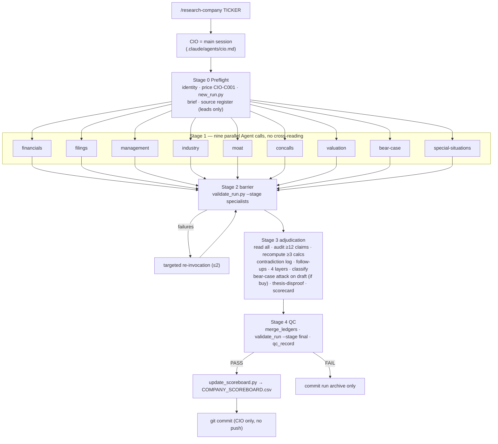

# Architecture

## 1. Roles and control flow

**Why the CIO is the main session:** in Claude Code, subagents do not launch further subagents. A CIO running as a subagent could not orchestrate, and nesting would only add a layer of summarization. `/research-company` therefore turns the current session into the CIO, which loads `.claude/agents/cio.md` as its protocol. The same file works as a main-thread agent via `claude --agent cio`.

**Why parallel and independent:** the pre-migration system ran specialists in three dependent waves, and each specialist "reconciled" against the earlier reports. Errors spread instead of being caught (audit §4). Now all nine work from primary sources at the same time, and cross-examination is the CIO's job.

## 2. Single sources of truth

| Fact | Lives in | Consumed by |
|---|---|---|
| Layer names and definitions, fit scale, epistemic tags, claim-ID syntax, specialist protocol | `.claude/skills/investment-constitution/SKILL.md` (marked blocks) | Preloaded into every agent via `skills:` frontmatter; parsed by `scripts/research_lib.py` |
| BQ/IA dimensions, weights, gates, verdicts, valuation statuses, methodology version | `methodology/SCORING.md` (marked blocks) | CIO; `validate_scorecard.py` |
| Ledger columns, flagged phrases | `methodology/EVIDENCE_STANDARDS.md` (marked blocks) | All agents; `validate_ledger.py`, `validate_report.py` |
| Common report sections | `methodology/REPORT_CONTRACTS.md` (marked block) | Specialists; `validate_report.py` |
| Domain sections per specialist, final-report sections | `REQUIRED_SECTIONS` block in each `.claude/agents/<name>.md` | That agent; `validate_report.py` |

The code holds **no copies** of these lists. Tests assert the expected canonical values, so an accidental edit to a marked block fails the test suite.

## 3. Claude Code configuration (verified against the installed 2.1.296)

| Item | Setting | Note |
|---|---|---|
| Agent location | `.claude/agents/<name>.md` | Frontmatter: `name`, `description`, `tools`, `model`, `skills` |
| Model | `model: opus` on all ten agents | The alias resolves, in this installation, to the user's Opus model (`claude-opus-5-5` at migration time). No hard-coded version string. |
| Specialist tools | `Read, Write, Edit, Bash, WebSearch, WebFetch` | No `Agent`, so specialists cannot spawn agents |
| CIO tools | Inherited (main session) | Needs `Agent` to launch specialists |
| Shared context | `skills: [investment-constitution]` | Preloads the constitution into every specialist. The constitution also tells agents to read it, as a fallback. |
| Workflow | `.claude/skills/research-company/SKILL.md` with `disable-model-invocation: true` | Runs only when the user types it, so the expensive workflow never triggers automatically |
| Permissions | `.claude/settings.json` allows WebSearch, WebFetch, `python3 scripts/*` | Reduces prompts for parallel background agents. Edits still follow the user's permission mode. |

**Effective model reporting:** the CIO records its own model ID only if its system context shows one. Per-subagent model IDs are not exposed to the parent, so the manifest records `opus alias (frontmatter); per-subagent ID not exposed` rather than inventing one.

## 4. Enforcement matrix

| Requirement | Enforced by code | Enforced by instruction and CIO audit |
|---|---|---|
| Canonical layer names; no redefinition | `check_layer_names` (errors on TVS-style redefinition) | Constitution |
| Four-layer crosswalk in every specialist report | `check_crosswalk` | Agent definitions |
| FACT/MS/CALC/ESTIMATE cite existing claim IDs | `check_tags` + ledgers | Constitution §2 |
| Ledger completeness (source, locator, formula) | `validate_ledger` | `EVIDENCE_STANDARDS.md` |
| Scorecard arithmetic, gates, verdict mapping, layer rules | `validate_scorecard` | `SCORING.md` |
| Final report consistent with scorecard | `validate_final_report` | CIO protocol |
| Completion barrier (all 9 exist and validate) | `validate_run --stage specialists` | CIO Stage 2 |
| Scoreboard only after QC PASS | `update_scoreboard.py` refusals | CIO Stage 4 |
| Flagged superlatives | Warnings (specialists), errors (final) | Constitution §4 |
| **Specialist independence (no cross-reading)** | — | Constitution §6, the attestation in each report header, CIO audit |
| **Specialists do not run git or write elsewhere** | — | Constitution §6 |
| Truth of a cited source or figure | — | CIO re-verification of ≥12 claims; ledger confidence |

The code verifies **structure and traceability**. It cannot verify that a cited page says what the report claims. That is why the CIO's independent re-verification and recomputation steps are mandatory, and why every claim records its exact locator.

## 5. Run artifacts

See `methodology/REPORT_CONTRACTS.md` §1. Each run is self-contained and immutable once committed. `manifest.json` records identity, cutoff, the hurdle rate, the framework commit, the methodology version, model information and per-specialist invocation status, so a run can be interpreted later even after the methodology changes.

## 6. Verification performed at migration (2026-10-12)

| Check | Method | Result |
|---|---|---|
| Unit and integration tests | `python3 -m unittest discover tests` | 31 tests pass. They cover a full synthetic run (create → barrier → merge → final QC → scoreboard), ledger, scorecard and report failure cases, and a regression on the legacy TVS report. |
| Legacy TVS layer redefinition detected | `check_layer_names` on `runs/legacy-antigravity-v1/final_report.md` | 6 errors (every redefined layer label). Bharti: 0 errors, 3 label-drift warnings. |
| Specialist registration, preload, model, tools | Fresh headless `claude -p` session in the repo, invoking `moat` via the Agent tool | Constitution preloaded; prefix `MOAT`; model `claude-opus-5-5` (self-reported from system context); tools exactly Read, Write, Edit, Bash, WebSearch, WebFetch; no Agent tool |
| Parallel launch of all nine | Fresh headless session, nine Agent calls in **one** message | All nine returned; each reported its correct prefix (FIN, FIL, MGT, IND, MOAT, CON, VAL, BEAR, SPS) with zero tool calls, which shows the constitution preload works; all `claude-opus-5-5`; none can spawn agents |
| `/research-company` registration | Fresh headless session, invoked without arguments | Skill loaded, asked for a company, created no run |

Not yet performed: a full live research run (it is long-running and compute-heavy). The first real run is the end-to-end test of research quality.

Note: headless sessions ignored `.claude/settings.json` permission rules until the workspace is trusted. Open Claude Code interactively in the repository once and accept the trust dialog.

## 7. Known limitations

- Independence is instruction-enforced. A hook-based read guard could enforce it technically; it was not added because a wrong hook would block legitimate CIO reads.
- Validators check structure, not semantic truth.
- Research quality depends on which primary documents the web tools can retrieve. Paywalled or blocked sources are recorded as missing, not reconstructed.
- Scoring calibration across companies starts empty. Calibration reviews begin once five or more companies are scored (`SCORING.md` §7).
