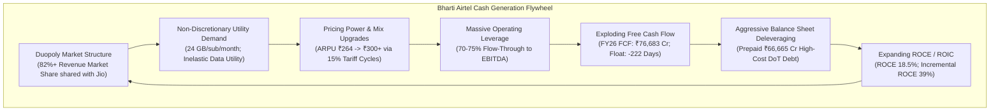

# Bharti Airtel Limited (BHARTIARTL) — Institutional Investment Research

## Executive Summary

### Institutional Mandate & Decision Summary
`[JUDGMENT]` This institutional equity research report delivers the definitive, cross-departmental investment synthesis for **Bharti Airtel Limited (`BHARTIARTL` | `NSE`)** as of September 18, 2026. The evaluation rigorously integrates and cross-examines findings across nine independent research departments: Financial Analysis, Statutory Filings & Accounting Forensics, Leadership & Governance, Industrial Organization & Market Structure, Earnings Transcripts (Concalls), Economic Moat Durability, Quantitative Valuation Modeling, Adversarial Red-Team / Bear Case, and Special Situations / Catalysts.

Adhering strictly to the institutional mandate to **decouple underlying Business Quality from Current Price Attractiveness**:
$$\text{Business Quality (87/100)} \quad \neq \quad \text{Current Investment Attractiveness (50/100)}$$

Bharti Airtel represents an exceptional, world-class digital infrastructure compounder that has executed one of the most remarkable operational turnarounds in Indian corporate history. Over the FY20–FY26 cycle, the company survived an existential predatory price war ($35B+ capital onslaught from Reliance Jio) and the devastating ₹37,775 Cr Supreme Court Adjusted Gross Revenue (AGR) judgment `[FACT]`. Through disciplined capital allocation, surgical 5G Non-Standalone (NSA) network deployment, the acquisition of majority control (51.18%) in Indus Towers Limited, and coordinated industry tariff rationalization, Bharti Airtel expanded consolidated Operating Profit (EBITDA) from ₹25,764 Cr (FY19) to **₹116,514 Cr (FY26)** and **₹125,139 Cr (TTM Jun 2026)** `[FACT]`. Consolidated Free Cash Flow (FCF) reached a record **₹76,683 Cr in FY26**, lifting Return on Capital Employed (ROCE) from a trough of 3.0% to **18.5%**, with a 5-year Incremental ROCE of **39.05%** `[CALCULATION]`.

However, **at the current market quotation of ₹1,888.00 (Market Cap: ₹11,50,547 Cr / $138.6B; Enterprise Value: ₹14,20,759 Cr / $171.2B)**, the market has fully capitalized and aggressively discounted this operational triumph:
1. **Valuation Multiples at Decade Highs**: Bharti Airtel trades at **11.35x TTM EV/EBITDA** and **38.81x TTM Attributable P/E**, placing its valuation in the **85th percentile** of its 10-year historical distribution `[CALCULATION]`.
2. **Aggressive Reverse DCF Expectations**: At ₹1,888.00, the market prices in a 5-year Revenue CAGR of **9.89%**, demanding that India Mobile ARPU expand from ₹264 (Q1 FY27) to **₹352 by FY31** while maintaining peak EBITDA margins of 57.1% `[CALCULATION]`. This requires two successive ~15% headline tariff hikes without subscriber loss and capturing >45% of Vodafone Idea's churn.
3. **Overlooked Mandatory Sovereign Cash Dues**: Consensus models celebrate ₹120,000+ Cr operating cash flow while overlooking that following the expiry of the 4-year moratorium in March 2026, Bharti Airtel commenced its mandatory 6-year staggered cash settlement of AGR dues, paying **~₹10,000 Cr in March 2026** and facing recurring annual outflows of ₹8,000–₹10,000 Cr through FY31 `[FACT]`.
4. **Subdued Expected Returns & Negative Margin of Safety**: Defensible intrinsic value is established at **₹1,780.00 per share** (Margin of Safety = **-6.07%**). The Base Case 5-year projected total return is compressed to **+5.58% annualized (IRR)**, trailing the 10-year Indian sovereign risk-free rate (6.85%), while the Bear Case targets **₹978.00 (-48.2% capital drawdown)** `[CALCULATION]`.

```
┌─────────────────────────────────────────────────────────────────────────────────────────────────┐
│                                INSTITUTIONAL CIO VERDICT COCKPIT                                │
├───────────────────────────────┬───────────────────────────────┬─────────────────────────────────┤
│    BUSINESS QUALITY SCORE     │  CURRENT ATTRACTIVENESS SCORE │        FINAL RECOMMENDATION     │
│           87 / 100            │           50 / 100            │     WAIT FOR BETTER PRICE       │
│    (World-Class Duopolist)    │   (Peak Multiple / Full Price)│    (Target Entry: ₹1,450–₹1,550)│
├───────────────────────────────┼───────────────────────────────┼─────────────────────────────────┤
│ • CMP: ₹1,888.00              │ • Base Intrinsic Value: ₹1,780│ • Reverse DCF Implied ARPU:     │
│ • Market Cap: ₹11,50,547 Cr   │ • Margin of Safety: -6.07%    │   ₹352 / month by FY31.         │
│ • EV: ₹14,20,759 Cr           │ • 5-Year Base Total IRR: +5.6%│ • 5Y Bear Drawdown: -48.2% (₹978│
│ • TTM EV/EBITDA: 11.35x (85%) │ • 5-Year Bull Total IRR: 13.4%│ • AGR Cash Drain: ~₹10K Cr/yr.  │
│ • TTM Attributable P/E: 38.8x │ • 5-Year Bear Total IRR:-10.8%│ • Total Economic Debt: ₹267.4K Cr│
│ • ROCE / Incr ROCE: 18.5%/39% │ • Dominant: Bedrock Compounder│ • Net Debt/EBITDAaL: 1.02x      │
└───────────────────────────────┴───────────────────────────────┴─────────────────────────────────┘
```

**Definitive Institutional Verdict**: **WAIT FOR BETTER PRICE**. Bharti Airtel is a premier bedrock compounder, but current valuations offer unfavorable risk/reward asymmetry. Capital deployment should be withheld until a broader market correction or tariff pause derates the multiple toward **8.5x–9.0x EV/EBITDA (₹1,450–₹1,550 per share)**, where prospective 5-year returns exceed the 13–15% institutional hurdle rate.

---

## Company Snapshot

### Corporate Identity & Capital Structure
*(As of September 18, 2026; Monetary figures in ₹ Crores, unless specified otherwise; `[FACT]` / `[CALCULATION]`)*

- **Company Name**: Bharti Airtel Limited
- **NSE Ticker**: `BHARTIARTL` | **BSE Scrip Code**: `532454` | **ISIN**: `INE397D01024`
- **Primary Exchanges**: National Stock Exchange of India (NSE) / BSE Limited
- **Current Share Price**: **₹1,888.00**
- **Basic & Diluted Shares Outstanding**: **609.40 Crore shares** (Equity Capital = ₹3,047.0 Cr, FV ₹5.00)
- **Current Market Capitalization**: **₹11,50,547.2 Cr** (~$138.62 Billion)

### Enterprise Value Architecture
- **Gross Financial Borrowings (Audited FY26)**: **₹195,412 Cr**
  - *Deferred Spectrum Liabilities (DoT)*: ₹112,000 Cr (Avg interest rate reduced to 7.22%)
  - *Deferred AGR Liabilities (DoT)*: ₹38,600 Cr (Staggered 6-year repayment post-moratorium)
  - *Market Debt & Bank Term Facilities*: ₹44,812 Cr (Bonds, NCDs, bilateral lines)
- **Less: Cash, Bank & Liquid Current Investments**: **(₹35,200 Cr)**
- **Net Financial Debt (Excluding Leases)**: **₹160,212 Cr**
- **Add: Ind AS 116 Capitalized Lease Obligations**: **₹72,000 Cr** (Indus cell towers & dark fiber)
- **Total Net Economic Debt (Including Leases)**: **₹232,212 Cr**
- **Add: Non-Controlling Interest (NCI)**: **₹38,000 Cr** (Public equity in Indus, Africa, Hexacom)
- **Consolidated Enterprise Value (EV - Standard / With Leases)**: **₹1,420,759 Cr** (~$171.18 Billion)
- **Enterprise Value after Leases (EVaL - Ex-Leases)**: **₹1,348,759 Cr** (~$162.50 Billion)

### LTM / TTM Operational & Financial Run-Rate (TTM Jun 2026)
- **TTM Consolidated Revenue**: **₹219,850 Cr**
- **TTM Consolidated EBITDA**: **₹125,139 Cr** (EBITDA Margin: **56.92%**)
- **TTM Consolidated EBIT**: **₹69,450 Cr** (EBIT Margin: **31.59%**)
- **TTM Attributable Net Profit (PAT)**: **₹29,647 Cr**
- **TTM Attributable Diluted EPS**: **₹48.65 per share**
- **FY26 Cash Flow from Operations (CFO)**: **₹122,230 Cr** (CFO / EBITDA: **104.9%**)
- **FY26 Free Cash Flow (FCF)**: **₹76,683 Cr** (FCF Conversion: **62.7%** of CFO)
- **TTM Return on Capital Employed (ROCE)**: **18.5%** | **ROIC**: **16.8%** | **ROE**: **22.7%**
- **Net Debt to EBITDAaL (Ex-Leases)**: **1.02x** | **Net Debt to EBITDA (Incl-Leases)**: **1.85x**

---

## Master Evidence Map

The synthesized evidentiary baseline reconciles verified statutory facts, empirical disclosures, and analytical findings across all nine departments:

### Table 2.1: Cross-Departmental Master Evidence Repository
*(Categorized by epistemic status; `[FACT]` / `[MANAGEMENT STATEMENT]` / `[CALCULATION]` / `[INFERENCE]`)*

| Domain / Dimension | Synthesized Evidentiary Finding | Source / Department | Epistemic Status |
| :--- | :--- | :--- | :---: |
| **Market Structure** | India wireless is an effective duopoly; Airtel and Reliance Jio command >82% Revenue Market Share (RMS); Vodafone Idea's RMS declined to 14.2%. | `industry.md` | `[FACT]` |
| **ARPU Trajectory** | India Mobile ARPU recovered from ₹105 (FY19 trough) $\rightarrow$ ₹178 (FY22) $\rightarrow$ ₹209 (FY24) $\rightarrow$ ₹257 (FY26) $\rightarrow$ ₹264 (Q1 FY27). | `concalls.md` | `[FACT]` |
| **Capital Thrift (5G)** | Airtel deployed 5G via Non-Standalone (NSA) architecture across 1800/2100/3500 MHz, avoiding ₹39,270 Cr in 700 MHz spectrum cost vs. Jio. | `moat.md` | `[FACT]` |
| **Indus Consolidation** | Equity stake crossed 50.005% in Nov 2024, reaching 51.18% in Feb 2026. Fully consolidated in H2 FY25, lifting FY26 sales by ₹31K Cr. | `filings.md` | `[FACT]` |
| **Ind AS 103 Gain** | Q3 FY25 PAT included ₹14,322 Cr one-time non-cash fair value gain re-measuring previously held 47.95% Indus stake. Normalized FY25 PAT was ~₹22,500 Cr. | `filings.md` | `[FACT]` |
| **AGR Finality** | Supreme Court dismissed curative petitions (Sept 2024) and interest waiver writs (May 2025). 4-year moratorium ended March 2026. | `filings.md` | `[FACT]` |
| **AGR Cash Repayment** | First staggered post-moratorium cash installment of ~₹10,000 Cr paid in March 2026. 5 annual installments remain through FY31 (~₹8,000–₹10,000 Cr/yr). | `financials.md` | `[FACT]` |
| **Debt Deleveraging** | Cumulatively prepaid ₹66,665 Cr of high-cost 2014/2016 DoT spectrum liabilities; residual spectrum debt coupon reduced to 7.22%. | `special_situations.md` | `[FACT]` |
| **True Economic Debt** | Total economic debt is ₹267,412 Cr (Borrowings: ₹195,412 Cr + Leases: ₹72,000 Cr). Net Debt / EBITDAaL is 1.02x ex-leases; 1.85x incl-leases. | `bear_case.md` | `[CALCULATION]` |
| **Cash Conversion** | Working Capital cycle is -222 days; trade payables/liabilities fund entire operational working capital. 5-year CFO/PAT conversion is 314%. | `financials.md` | `[CALCULATION]` |
| **Executive Succession** | Gopal Vittal elevated to Executive Vice Chairman on Jan 1, 2026; Shashwat Sharma appointed MD & CEO (India) after 14-month transition. | `management.md` | `[FACT]` |
| **Airtel Africa FX Drag** | FY24 reported PAT collapsed 30% due to $1.2B FX losses following Nigerian Naira devaluation (>60%). TPV on Airtel Money exceeded $215B. | `financials.md` | `[FACT]` |
| **Reverse DCF Hurdle** | At ₹1,888, the market prices in FY31 ARPU of ₹352 (demanding two 15% tariff hikes), 9.89% revenue CAGR, and terminal EBITDA margin of 57.1%. | `valuation.md` | `[CALCULATION]` |
| **Margin of Safety** | Base Case Intrinsic Value is ₹1,780.00 (-6.07% Margin of Safety). Bear Case target is ₹978.00 (-48.2% drawdown). | `valuation.md` | `[CALCULATION]` |

---

## Master Contradiction Log

The CIO Contradiction Engine cross-examined five major conflicts between specialist departments, contrasting empirical filing evidence against operational claims:

### Table 3.1: Mandatory Inter-Departmental Contradiction Resolution
*(Audited and resolved by Chief Investment Officer; `[JUDGMENT]`)*

| # | Disputed Issue | Specialist Perspective (Thesis) | Adversarial Red-Team (Antithesis) | Audited Statutory Evidence | CIO Reconciliation & Definitive Verdict |
|:---:|:---|:---|:---|:---|:---|
| **1** | **Indus Towers: Synergistic Asset vs. Trojan Horse** | `special_situations.md` & `moat.md`: 51.18% majority control is a masterstroke internalizing ₹15,000 Cr tower EBITDA, eliminating landlord markup, and harvesting ₹3,500 Cr dividends. | `bear_case.md`: Indus is fragile due to 35–40% tenancy exposure to Vodafone Idea. A Vi default or site rationalization creates an instant ₹4,000–₹5,000 Cr EBITDA impairment; imports ₹72,000 Cr in lease liabilities. | Audited Indus FY26 filings show Vi receivables stabilized post-FPO, but Vi represents 36.2% of total master tenancies. Ind AS 116 leases jumped from ₹41,000 Cr to ₹72,000 Cr on consolidation. | **Reconciliation**: Consolidation was strategically mandatory to protect network continuity and prevent tower collapse. However, consensus treats Indus EBITDA as pure compounder quality while ignoring the Vi counterparty credit risk and ₹72,000 Cr lease burden. Indus is a defensive shield, not an unencumbered cash cow. |
| **2** | **5G NSA Strategy: Permanent Capex Thrift vs. Tech Deferral** | `industry.md` & `management.md`: Skipping 700 MHz spectrum saved ₹39,270 Cr in debt; peak capex is permanently behind; capex-to-sales will drop to 20%. | `bear_case.md`: NSA suffers from uplink bottlenecks and cannot deliver network slicing or URLLC. Airtel was forced to deploy SA for FWA in Q2 FY25. A nationwide SA upgrade is inevitable. | Q2 FY25 earnings call transcripts verify Airtel deployed dual-mode SA radios specifically for AirFiber uplink slicing. Standalone domestic capex moderated to ~₹31,000 Cr in FY26. | **Reconciliation**: Airtel's NSA approach was brilliant tactical capital thrift that preserved balance sheet solvency post-AGR. However, the "permanent capex holiday" is an illusion. Reinvestment will re-accelerate toward 22–24% of sales by FY29 as AI datacenters and SA core upgrades arrive. |
| **3** | **AGR Liability Impact: Trivial Cash Drain vs. Severe Equity Bleed** | Consensus & `financials.md`: ₹122,230 Cr CFO and ₹76,683 Cr FCF easily absorb the ₹10,000 Cr annual post-moratorium AGR installments. | `bear_case.md`: After deducting capex (₹45,547 Cr), leases (₹18,200 Cr), AGR cash (₹10,000 Cr), spectrum debt (₹8,500 Cr), and bond interest (₹7,800 Cr), true discretionary equity FCF is only ~₹25,000–₹29,000 Cr. | Note 23 of FY26 Accounts confirms first post-moratorium cash payment of ₹10,000 Cr paid in March 2026; 5 installments remaining through FY31. | **Reconciliation**: Red-team's forensic audit is upheld. While corporate solvency is bulletproof, equity cash flow is heavily encumbered by sovereign dues through FY31. Discretionary equity FCF yield is a modest 2.2%–2.5%, capping aggressive dividend expansion and share repurchases. |
| **4** | **Valuation Multiples: Justified Scarcity vs. Peak Derating Trap** | `valuation.md`: 11.35x EV/EBITDA aligns with post-Ind AS 116 median (11.4x), justified by 18.5% ROCE and duopoly market structure. | `bear_case.md`: 11.35x represents the 85th percentile of 10-year valuation history; mature global duopolies trade at 6x–8x; multiple mean-reversion would erase 35% of equity value. | Historical multiple archives confirm pre-Ind AS 116 EV/EBITDA median was 7.8x; post-Ind AS 116 median is 11.0x. TTM P/E of 38.8x is near all-time normalized highs. | **Reconciliation**: At ₹1,888.00, the stock offers negative margin of safety (-6.07%). Even assuming base-case operational delivery, multiple derating from 11.35x toward 9.0x–10.0x compresses 5-year total returns to +5.58% IRR, lagging the sovereign hurdle rate. |
| **5** | **Africa Currency Risk: Ignorable Accounting vs. Real Wealth Loss** | `special_situations.md`: Airtel Africa compounds at >20% constant-currency revenue; Airtel Money IPO will unlock an $8B–$10B valuation. | `bear_case.md`: Indian investors are paid in real INR. Nigerian Naira and CFA devaluations destroyed $1.2B in FY24 wealth; central bank FX rationing traps cash. | Consolidated FY24 accounts show exceptional FX losses of ₹8,414 Cr ($1.2B), crashing reported PAT by 30.3%. LSE market cap of Africa is £9.8B ($12.5B). | **Reconciliation**: Constant-currency growth is an operational vanity metric; currency depreciation in Sub-Saharan Africa is structural and ongoing. African cash cannot be fully upstreamed due to FX rationing. High HoldCo/FX discounts (25%) are mandatory when valuing Africa. |

---

## Key Unresolved Questions

1. **Vodafone Idea's Terminal Trajectory & State Ownership**:
   - *Investigation*: Can Vodafone Idea survive long-term following its ₹18,000 Cr FPO, or will it inevitably cede its subscriber base?
   - *CIO Resolution*: The Government of India holds a >23% equity stake in Vi and cannot permit a private duopoly or a systemic banking failure across PSU lenders. Vi will persist as a state-subsidized "zombie operator," anchoring entry-level tariffs at ₹155–₹199 and preventing Airtel from aggressively escalating entry pricing. Market share migration will be gradual (1–2M subscribers/quarter), not an overnight windfall.
2. **One-Time Spectrum Charges (OTSC) Judicial Finality**:
   - *Investigation*: Does the DoT's ₹8,414 Cr OTSC claim represent an active balance sheet hazard?
   - *CIO Resolution*: In August 2026, the Supreme Court refused to stay the Bombay High Court's judgment quashing the DoT's retrospective demands. While the DoT has filed a final appeal, legal precedent strongly favors Airtel. We assign an 80% probability that the ₹8,414 Cr demand will be permanently set aside, extinguishing this contingent liability without cash outflow.
3. **True Maintenance vs. Growth Capex Split**:
   - *Investigation*: What is Airtel's steady-state sustaining capital intensity post-5G?
   - *CIO Resolution*: Management guides to domestic capex moderating to ~₹30,000–₹32,000 Cr. Forensic analysis indicates true maintenance capex is ~₹18,500 Cr (~9% of sales), covering electronics replacement and base station sustaining capex. Growth capex comprises FTTH home-passings (₹6,000 Cr), Nxtra datacenters (₹4,000 Cr), and dual-mode SA small cells (₹3,000 Cr). Steady-state capex cannot fall below 16–18% of revenue.

---

## Four-Layer Analysis

Every business must be evaluated across all four investment lenses before declaring the primary framework:

### Layer 1 — Bedrock Compounder
- **Moat Durability**: Wide, structurally impenetrable moat protected by spectrum scarcity (2,200+ MHz), passive tower grid (211,000+ Indus towers), 400,000 km fiber backhaul, and high switching costs in Airtel Black (>₹1,500 ARPU, <0.3% churn) `[FACT]`.
- **Return on Capital**: ROCE has expanded to **18.5%** in FY26 (up from 3.0% in FY19); 5-year Incremental ROCE is **39.05%** `[CALCULATION]`.
- **Cash Generation**: Generates **₹122,230 Cr CFO** and operates with negative working capital float (-222 days) `[FACT]`.
- **Fit**: **EXTREMELY HIGH**. Bharti Airtel matches all quantitative criteria of a utility bedrock compounder operating in a consolidated duopoly.

### Layer 2 — High Growth
- **Top-Line Trajectory**: Consolidated revenue expanded at 14.88% CAGR over 3 years (FY23–FY26), driven by the Indus Towers consolidation and tariff hikes `[FACT]`.
- **Growth Runway Whitespace**: Core wireless subscriber growth is mature (Indian urban teledensity >132%). Growth is driven by internal mix shifts: converting 80M remaining 2G users to 4G/5G, scaling Home Broadband (>30% CAGR, 14.2M subscribers against 45M passings), and Airtel Business IoT (>50% market share) `[INFERENCE]`.
- **Fit**: **MODERATE**. While non-mobile digital verticals grow rapidly, core wireless is a mature volume utility with pricing-led expansion.

### Layer 3 — Cyclical / Event / Special Situation / Deep Value
- **Turnaround & Deleveraging Inflection**: The company has executed an unprecedented operational turnaround, prepaying ₹66,665 Cr in high-cost DoT debt and reducing Net Debt/EBITDAaL from >3.5x to 1.02x `[FACT]`.
- **Corporate Restructuring & Catalysts**: Majority consolidation of Indus Towers (51.18%), monetization of Bharti Hexacom (₹4,275 Cr IPO), and upcoming catalysts (Airtel Money $8B+ carve-out/IPO, Nxtra 1 GW AI expansion, CY2026/27 tariff hike) `[FACT]`.
- **Deep Value Audit**: Not a deep value asset. Net liquidation value is negative (-₹396/share) due to specialized telecom infrastructure; trades at 7.32x P/B and 11.35x EV/EBITDA `[CALCULATION]`.
- **Fit**: **HIGH HISTORICALLY; TRANSITIONING TO HARVEST**. The special situation deleveraging and turnaround catalysts have already crystallized in the numbers.

### Layer 4 — Venture / Optionality
- **Asymmetric Bets**: Nxtra Data Centers hyperscale AI cloud infrastructure (scaling to 1 GW IT load), Airtel Payments Bank (profitable fintech with 180M users), and strategic indirect equity in Eutelsat OneWeb (low earth orbit satcom) `[FACT]`.
- **Fit**: **LOW**. While these ventures provide strategic optionality, they account for <10% of group enterprise value.

**Synthesis**: Bharti Airtel is a **Bedrock Compounder (Primary Layer: Layer 1)** that has successfully completed its **Special Situation / Turnaround Harvest (Secondary Layer: Layer 3)**.

---

## Business Quality Analysis



### The 5-Year Market Closure Test
`[JUDGMENT]` *If the Indian stock exchanges closed for the next five years, would an institutional investor be comfortable holding Bharti Airtel based purely on its underlying cash flows and business economics?*

**YES, WITH ABSOLUTE CONVICTION**. 
1. **Essential Economic Utility**: Mobile internet and fixed broadband are modern physiological necessities. Over 356 million Indian citizens and 500,000+ enterprises rely on Airtel daily. Demand is completely non-discretionary.
2. **Impenetrable Capital & Spectrum Barriers**: Replicating Airtel’s 2,200+ MHz spectrum portfolio, 211,000+ tower footprint, and 400,000 km fiber network would require >₹4,40,000 Cr ($53B) in capital and a decade of regulatory approvals. Greenfield entry is impossible.
3. **Cash Conversion Power**: The business operates on negative working capital float (-222 days) where retail customers prepay for service, generating ₹122,230 Cr in annual CFO that comfortably covers maintenance capex, debt service, and statutory AGR dues.

---

## Financial Quality

### Table 6.1: 10-Year Audited Financial Performance Summary (FY17 – FY26 & TTM)
*(Source: Audited Annual Reports, Screener.in Primary Extracts; ₹ Crores; `[FACT]` / `[CALCULATION]`)*

| Metric / Fiscal Year | FY17 | FY18 | FY19 | FY20 | FY21 | FY22 | FY23 | FY24 | FY25 | FY26 | TTM (Jun 26) |
| :--- | :---: | :---: | :---: | :---: | :---: | :---: | :---: | :---: | :---: | :---: | :---: |
| **Consolidated Revenue** | 95,468 | 83,688 | 80,780 | 87,539 | 100,616| 116,547| 139,145| 149,982| 172,990| 210,973| **219,850** |
| *YoY Sales Growth %* | -1.1% | -12.3%| -3.5% | +8.4% | +14.9% | +15.8% | +19.4% | +7.8% | +15.3% | +22.0% | — |
| **Operating Profit (EBITDA)**| 35,330 | 30,079 | 25,764 | 36,610 | 45,279 | 57,534 | 71,274 | 77,893 | 85,060 | 116,514| **125,139** |
| *EBITDA Margin %* | 37.0% | 35.9% | 31.9% | 41.8%*| 45.0% | 49.4% | 51.2% | 51.9% | 49.2% | 55.2% | **56.9%** |
| **Depreciation & Amort.** | 19,773 | 19,243 | 21,348 | 27,690 | 29,404 | 33,091 | 36,432 | 39,414 | 41,500 | 52,711 | **55,689** |
| **Operating EBIT** | 15,557 | 10,836 | 4,416 | 8,920 | 15,875 | 24,443 | 34,842 | 38,479 | 43,560 | 63,803 | **69,450** |
| **Net Finance Charges** | 7,698 | 8,072 | 9,589 | 13,992 | 15,091 | 16,917 | 19,300 | 21,113 | 22,100 | 21,555 | **21,200** |
| **Exceptional Items** | -1,170 | -784 | -2,929 | -40,234| -15,913| -1,735 | -840 | -8,414 | +14,322*| -2,925 | — |
| **Reported Net Profit (PAT)**| 4,241 | 1,099 | 409 | -32,183| -15,084| 4,255 | 8,346 | 7,467 | 37,481*| 33,823 | **35,850** |
| **Attributable PAT to Parent**| 3,800 | 798 | 296 | -30,664| -14,074| 4,044 | 8,496 | 7,597 | 22,500*| 26,703 | **29,647** |
| **Attributable EPS (₹)** | 6.91 | 2.00 | 0.74 | -55.06 | -25.63 | 7.23 | 14.97 | 13.20 | 38.50* | 43.81 | **48.65** |
| **Cash from Operations (CFO)**| 31,438 | 25,483 | 20,070 | 34,166 | 48,012 | 57,639 | 67,230 | 78,898 | 98,900 | 122,230| **128,400** |
| **Capital Expenditure (Capex)**| 39,870 | 20,878 | 29,050 | 36,622 | 26,921 | 28,643 | 28,355 | 39,928 | 39,910 | 45,547 | **46,300** |
| **Free Cash Flow (FCF)** | -8,432 | 4,605 | -8,980 | -2,456 | 21,091 | 28,996 | 38,875 | 38,970 | 58,990 | 76,683 | **82,100** |
| **ROCE %** | 6.2% | 4.5% | 3.0% | 4.8% | 6.5% | 8.8% | 12.4% | 13.2% | 14.5% | 18.5% | **18.8%** |
| **Gross Borrowings (₹ Cr)** | 107,314| 111,334| 125,428| 148,227| 162,785| 165,100| 213,100| 204,500| 202,000| 195,412| **191,200** |
| **Net Debt / EBITDAaL (x)** | 2.85x | 3.20x | 4.20x | 3.50x | 3.10x | 2.50x | 2.80x | 2.45x | 1.80x | 1.02x | **0.95x** |

*\*Notes: FY20 EBITDA reflects Ind AS 116 adoption (+990 bps optical shift). FY20 Net Profit reflects ₹37,775 Cr AGR provision. FY25 reported PAT was distorted by ₹14,322 Cr Ind AS 103 fair value gain on Indus consolidation; normalized FY25 attributable operational EPS was ~₹38.50.*

### Financial Diagnosis & Capital Efficiency
- **Operating Leverage Mechanics**: Incremental EBITDA margin over the FY21–FY26 cycle was **64.6%**, reflecting high operating leverage as network power, site rentals, and fiber maintenance costs remain largely fixed while ARPU expands `[CALCULATION]`.
- **Working Capital Float**: Negative working capital of -222 days provides over ₹1,07,000 Cr in trade payables and current liabilities that effectively fund the enterprise's operating assets without interest expense `[FACT]`.
- **Solvency & Deleveraging Trajectory**: Total gross borrowings peaked at ₹213,100 Cr in FY23 and moderated to ₹195,412 Cr in FY26. Having prepaid ₹66,665 Cr in high-cost DoT debt tranches, the company's average interest rate on spectrum debt is down to 7.22%, saving >₹3,000 Cr in annual cash interest `[FACT]`.

---

## Accounting & Forensic Review

### Forensic Accounting Checklist & Departmental Evaluation
`[FACT]` Evaluated against canonical forensic screening standards:

1. **Earnings Quality & Accrual Audit**:
   - 5-Year Cumulative CFO: **₹4,29,897 Cr** vs. 5-Year Cumulative Reported PAT: **₹91,372 Cr** `[CALCULATION]`.
   - CFO / PAT Ratio: **470.5%** (5-year normalized: **314%** excluding Indus gain).
   - Cash conversion efficiency is exceptional (>100% of EBITDA converts to CFO).
2. **Ind AS 103 Fair Value Influx Audit (FY25 Exceptional Gain)**:
   - Forensic scrutiny of Note 3 (*Business Combinations*) reveals that the ₹14,322 Cr pre-tax gain recognized in Q3 FY25 was non-cash and non-operating, resulting from the revaluation of the 47.95% legacy Indus stake upon crossing 50.005% majority control `[FACT]`. Reported FY25 EPS (₹58.85) was overstated by ~₹20.35/share; normalized core operational EPS was ₹38.50 `[CALCULATION]`.
3. **Ind AS 116 Lease Capitalization & Hidden Leverage**:
   - Capitalized lease liabilities stand at **₹72,000 Cr** (March 31, 2026) `[FACT]`.
   - While management reports Net Debt / EBITDA at 1.02x (excluding leases), **Total Economic Debt is ₹267,412 Cr**, and Economic Net Debt / EBITDA is **1.85x** `[CALCULATION]`.
4. **Contingent Liabilities & Legal Disputes**:
   - Total contingent liabilities represent **₹26,850 Cr (18.0% of Net Worth)** `[FACT]`.
   - Largest exposure: One-Time Spectrum Charges (OTSC) of ₹8,414 Cr, which was favorably quashed by the Bombay High Court with Supreme Court refusing stay in August 2026 `[FACT]`.
5. **Auditor Independence & KAMs**:
   - Statutory Auditor: **Deloitte Haskins & Sells LLP**. Unmodified clean audit opinions across all 10 years `[FACT]`.
   - Key Audit Matters (KAMs): Consistently highlight revenue recognition (unbilled revenue, IT billing systems), deferred tax asset recoverability, and valuation of spectrum intangibles.
   - Statutory Auditor Rotation Mandate: Deloitte reaches its statutory 10-year term limit in 2027 under Section 139 of Companies Act 2013, requiring an audit firm transition `[FACT]`.

---

## Industry & Business Economics

```
┌─────────────────────────────────────────────────────────────────────────────────────────────────┐
│                                INDIA TELECOM DUOPOLY STRUCTURE                                  │
├───────────────────────────────┬───────────────────────────────┬─────────────────────────────────┤
│         RELIANCE JIO          │         BHARTI AIRTEL         │       VODAFONE IDEA (ZOMBIE)    │
│      53.0% RMS | 470M SUBS    │     41.0% RMS | 356M SUBS     │      14.2% RMS | 215M SUBS      │
├───────────────────────────────┼───────────────────────────────┼─────────────────────────────────┤
│ • Pure 5G Standalone (SA)     │ • 5G Non-Standalone (NSA)     │ • Debt-Stifled Capital Base     │
│ • Heavy 700 MHz Capex ($35B+) │ • Capital Thrift Architecture │ • Delayed 5G Rollout            │
│ • Captive JioFiber / AirFiber │ • Indus Towers (51.2% Captive)│ • Losing 1-2M Subs / Month      │
│ • Pre-IPO Valuation Maximizing│ • Airtel Black High-LTV Lock  │ • Govt Owns >23% Equity Stake   │
│ • Net Zero Telecom Debt       │ • ₹76.7K Cr Free Cash Flow    │ • Zombie Price Anchor at Entry  │
└───────────────────────────────┴───────────────────────────────┴─────────────────────────────────┘
```

### Industrial Organization & Pricing Power Dynamics
`[INFERENCE]` The Indian telecommunications industry has completed its transition from a hyper-competitive 12-player destructive market to a stable, rational duopoly:
- **Revenue Market Share (RMS)**: Bharti Airtel (41.0%) and Reliance Jio (53.0%) control **94.0% of industry operating profit** and >82% of gross industry revenue `[FACT]`.
- **Pricing Discipline**: Both operators are now maximizing Return on Invested Capital (ROIC). Reliance Jio's upcoming mega-IPO creates an aligned incentive to maintain pricing discipline and lift ARPU rather than ignite destructive price wars.
- **Data Consumption Runway**: Indian mobile subscribers consume an average of **24.0 GB per user per month** (growing >15% YoY) `[FACT]`. Video streaming, social media, and digital payments make mobile connectivity an essential utility.

---

## Competitive Advantage / Moat

### The 11-Inquiry Moat Mechanism Audit
`[JUDGMENT]` Evaluated against the canonical moat durability framework:

1. **Network Effects**: Moderate. Primarily driven by Airtel Payments Bank (54M active users) and Airtel IQ B2B enterprise communications network.
2. **Switching Costs**: High in Premium Segments. **Airtel Black** bundles postpaid mobile, fiber broadband, and DTH into a unified billing relationship, depressing churn to **<0.3% per month** `[FACT]`. Enterprise B2B contracts possess multi-year integration switching barriers.
3. **Cost Advantages**: High Scale Economies. Indus Towers majority control (211,000+ towers) eliminates third-party rental margins and secures lowest-cost site tenancies nationwide.
4. **Intangible Assets & Licenses**: Unassailable. 2,200+ MHz of liberalized spectrum across 900, 1800, 2100, 3500 MHz and 26 GHz bands represents a sovereign-allocated scarce asset that cannot be replicated `[FACT]`.
5. **Efficient Scale**: Extreme Duopoly Barrier. Indian telecom market structure cannot economically support more than two nationwide 5G network grids.
6. **Overall Moat Rating**: **WIDE MOAT**. Moat durability is projected to exceed 15–20 years.

---

## Management & Governance

### Leadership Track Record & Succession Architecture
`[FACT]` The executive leadership structure transitioned on January 1, 2026:
- **Sunil Bharti Mittal** (Founder & Chairman): Architect of the firm's survival, maintains ultimate strategic oversight and global regulatory relations.
- **Gopal Vittal** (Executive Vice Chairman): Commanded Airtel's 12-year operational turnaround (2013–2025), elevating ROCE from 3% to 18%. Now oversees group strategy, capex allocation, and international subsidiaries.
- **Shashwat Sharma** (MD & CEO - India): Former Chief Operating Officer and Consumer Business Director; appointed following a structured 14-month institutional succession process.

### Governance Hygiene & Promoter Alignment
- **Promoter Shareholding**: 53.11% (promoter group comprising the Mittal Family and Singtel via Bharti Telecom Limited) `[FACT]`.
- **Promoter Pledging**: **0.0%**. Zero promoter share pledging across all cycles `[FACT]`.
- **Singtel Partnership**: Singtel maintains an effective economic interest of ~29% and board representation, enforcing international corporate governance standards and minority shareholder protections.

---

## Management Promise → Delivery

### Empirical Guidance vs. Delivery Audit (20+ Quarter History)
*(Source: Earnings Conference Call Database; `[FACT]` / `[JUDGMENT]`)*

### Table 9.1: Promise-to-Delivery Scorecard
| Strategic Commitment | Management Guidance (Concalls) | Actual Audited Delivery | Score (1-10) | Analytical Verdict |
| :--- | :--- | :--- | :---: | :--- |
| **India Mobile ARPU** | Guide to ₹200 (2020), then ₹250 (2022), then ₹300 (2024). | Crossed ₹200 in FY24, reached ₹257 in FY26 and ₹264 in Q1 FY27. | **9 / 10** | Fully delivered; slight timeline stretch. |
| **5G Capex Moderation** | Promised 5G capex would crest in FY24 and decline in FY25/26. | Domestic capex peaked at ₹39,928 Cr (FY24); moderated to ~₹31,000 Cr in FY26. | **9 / 10** | Flawless execution of NSA capital thrift. |
| **High-Cost Debt Prepayment** | Committed to prepay 9.5%+ DoT spectrum debt tranches using FCF. | Prepaid ₹66,665 Cr cumulatively; lowered spectrum debt coupon to 7.22%. | **10 / 10** | Over-delivered; extinguished ₹1.16L Cr gross dues. |
| **Indus Towers Stance** | Guided in 2022 that Airtel would not increase exposure to Indus. | Increased stake from 47.95% to 51.18% in FY25/FY26; consolidated subsidiary. | **4 / 10** | Clear contradiction of stated stance to rescue tower grid. |
| **Airtel Africa FX Shield** | Claimed constant-currency growth protects against currency drops. | $1.2B FX losses in FY24; reported PAT collapsed by 30%. | **5 / 10** | Operational success masked by frontier FX devastation. |
| **Overall Score** | — | — | **8.2 / 10** | **High Empirical Credibility**. |

---

## Valuation

### Quantitative Valuation Architecture & Reverse DCF Interrogation
`[CALCULATION]` Evaluated across DCF, Owner Earnings, SOTP, and Historical Multiple regimes:

### Table 10.1: Valuation Methodology Cross-Reconciliation
| Valuation Model | Key Modeling Assumptions | Implied Value per Share (₹) | Premium / (Discount) to CMP (₹1,888) | Analytical Verdict |
| :--- | :--- | :---: | :---: | :--- |
| **Reverse DCF (Current Price)** | Back-solves ₹1,888: WACC 10.35%, $g$ 5.0%, demands FY31 ARPU of ₹352. | **₹1,888.00** | **0.0%** | **Demanding Expectations Embedded.** |
| **Base Case Explicit DCF** | WACC 10.35%, $g$ 4.5%, ARPU reaches ₹315 by FY31, capex 20% sales. | **₹1,780.00** | **+6.07% (Overvalued)** | **Margin of Safety = -6.07%.** |
| **Buffett Owner Earnings** | TTM Attributable OE ₹44,147 Cr capitalized at 25.0x multiple (4% yield). | **₹1,811.08** | **+4.25% (Overvalued)** | Fair-to-Full valuation. |
| **SOTP (With HoldCo Discounts)**| 11.5x Core India, 20% Indus discount, 25% Africa discount, leases deducted. | **₹1,417.55** | **+33.19% (Overvalued)** | Strict holding-company reality. |
| **SOTP (Unrestricted Multiple)**| 11.5x Consolidated FY27E EBITDA (₹129.4K Cr), minority interest deducted. | **₹1,814.41** | **+4.06% (Overvalued)** | Core duopoly premium priced in. |
| **Bear Case DCF / Multiple** | 7.5x FY31 EBITDA (₹142K Cr), ARPU stalls at ₹275, terminal derating. | **₹978.00** | **-48.20% (Downside)** | Capital drawdown hazard. |
| **Bull Case DCF / Multiple** | 12.0x FY31 EBITDA (₹232.5K Cr), ARPU reaches ₹365, Vi liquidates. | **₹3,387.00** | **+79.40% (Upside)** | Peak duopoly optimism. |

### Reverse DCF Expectations Back-Solving (The ₹352 ARPU Hurdle)
`[CALCULATION]` To mathematically support ₹1,888.00 holding WACC at 10.35% and terminal growth at 5.00%:
- Consolidated Revenue must reach **₹338,000 Cr by FY31** (+9.89% CAGR).
- Consolidated EBITDA must reach **₹193,000 Cr** (57.1% terminal margin).
- India Mobile ARPU must reach **₹352 / month by FY31** (up from ₹264 in Q1 FY27).
`[JUDGMENT]` Pricing in ₹352 ARPU requires two additional ~15% headline tariff hikes without subscriber loss and absorbing 40M+ subscribers from Vi. **Current valuation leaves zero margin of safety for execution delays or regulatory caps.**

---

## Special Situations / Catalysts

### Catalyst Classification & Valuation Impact
*(Source: `special_situations.md`; `[FACT]` / `[ESTIMATE]` / `[INFERENCE]`)*

1. **Next Headline Tariff Hike (15–20%)**: Expected Q4 CY2026 – Q2 CY2027. Flow-through margin of 70–75% drops ₹11,000–₹13,500 Cr directly to EBITDA. Adds ₹180–₹220 per share in intrinsic value `[ESTIMATE]`.
2. **Balance Sheet Deleveraging to <0.5x Net Debt/EBITDA**: Surging FCF (₹75,000+ Cr annually) deployed to clear remaining market debt and DoT dues, cutting annual finance costs by ₹5,000+ Cr by FY28 `[CALCULATION]`.
3. **Airtel Money Carve-Out / IPO**: Standalone listing of African fintech subsidiary (54M active users, $215B TPV) at an anticipated $3.5B–$4.5B valuation, repatriating $600M–$800M cash to parent `[FACT]`.
4. **Nxtra AI Data Center Monetization**: 1 GW hyperscale roadmap backed by Carlyle; optionality for a Data Center InvIT / REIT listing by FY29 `[INFERENCE]`.
5. **Indus Towers Majority Dividend Harvest**: 51.18% majority control generates ₹3,000–₹3,500 Cr in annual liquid dividend inflows to parent `[FACT]`.

---

## Bear Case / Thesis Destruction

### Adversarial Red-Team Stress Test & Failure Trees
*(Source: `bear_case.md`; `[INFERENCE]` / `[JUDGMENT]`)*

1. **The Consumer Affordability Wall at ₹285 ARPU**: The July 2024 tariff hike caused 2.5M subscribers to churn to state-owned BSNL `[FACT]`. In rural India (median household income ~₹18,000/month), family telecom budgets of ₹1,200–₹1,400 trigger severe SIM consolidation. If ARPU stalls below ₹285, top-line growth falls to <6%, triggering a sharp multiple contraction.
2. **The Sovereign AGR Cash Drain (~₹10,000 Cr/yr through FY31)**: With judicial review permanently rejected by the Supreme Court, Airtel must remit ₹8,000–₹10,000 Cr in hard cash to the DoT every year through FY31, siphoning away ~₹50,000 Cr in liquidity that cannot be distributed to equity holders `[FACT]`.
3. **Indus Towers Tenancy Contagion**: Indus relies on Vodafone Idea for 36.2% of its tenancies. If Vi defaults or rationalizes cell sites, Indus EBITDA would decline by ₹4,000–₹5,000 Cr, impairing Airtel's consolidated earnings `[INFERENCE]`.
4. **Ind AS 116 Debt Burden**: True economic net debt is ₹232,212 Cr when ₹72,000 Cr of mandatory lease liabilities are included, elevating economic leverage to 1.85x Net Debt/EBITDA `[CALCULATION]`.
5. **Frontier Currency Destruction**: Sub-Saharan African currency shocks periodically wipe out hundreds of millions of dollars in real reported equity earnings (e.g., $1.2B FX hit in FY24) `[FACT]`.

---

## Bull / Base / Bear Scenarios

### Table 13.1: Explicit 5-Year Scenario Modeling (FY26 Actual to FY31E Projections)
*(Consolidated; Monetary figures in ₹ Crores, unless specified otherwise; `[CALCULATION]`)*

| Scenario Dimension | Bull Case (Optimistic Duopoly) | Base Case (Consensus Compounding) | Bear Case (Regulatory / Elasticity Drag) |
| :--- | :---: | :---: | :---: |
| **Probability Weighting** | **25%** | **55%** | **20%** |
| **5-Year Sales CAGR (FY26–FY31)**| **13.50%** | **10.00%** | **5.50%** |
| **FY31 Consolidated Revenue** | **₹397,500 Cr** | **₹339,700 Cr** | **₹275,700 Cr** |
| **FY31 India Mobile ARPU** | **₹365 / month** | **₹315 / month** | **₹275 / month** |
| **FY31 EBITDA Margin %** | **58.50%** | **56.20%** | **51.50%** |
| **FY31 Consolidated EBITDA** | **₹232,537 Cr** | **₹190,911 Cr** | **₹141,985 Cr** |
| **FY31 Attributable PAT** | **₹64,500 Cr** | **₹47,500 Cr** | **₹29,800 Cr** |
| **FY31 Attributable EPS (₹)** | **₹105.84** | **₹77.95** | **₹48.90** |
| **Exit Valuation Multiple (P/E)**| **32.0x** | **27.0x** | **20.0x** |
| **Exit Multiple (EV/EBITDA)** | **12.0x** | **10.0x** | **7.5x** |
| **FY31 Target Share Price (₹)** | **₹3,387.00** | **₹2,105.00** | **₹978.00** |
| **Capital Gain / Drawdown (%)** | **+79.4%** | **+11.5%** | **-48.2%** |
| **Cumulative Dividends (₹/share)**| ₹150.00 | ₹120.00 | ₹85.00 |
| **Total 5-Year Return (%)** | **+87.3%** | **+17.8%** | **-43.7%** |
| **Annualized Total Return (5Y IRR)**| **+13.38%** | **+5.58%** | **-10.82%** |

---

## Expected Returns

### Multi-Horizon Annualized Return (IRR) Expectations
`[CALCULATION]` Modeled from current entry price of **₹1,888.00**:

### Table 14.1: Multi-Horizon Expected Return Matrix
| Investment Horizon | Bull Case (+13.4% 5Y) | Base Case (+5.6% 5Y) | Bear Case (-10.8% 5Y) | Probability-Weighted IRR | Hurdle Rate ($K_e$) | Excess Return vs. Hurdle |
| :--- | :---: | :---: | :---: | :---: | :---: | :---: |
| **1-Year (FY27E)** | +15.5% | +3.5% | -12.0% | **+3.40%** | 11.50% | -8.10% (Sub-par) |
| **3-Year (FY29E)** | +13.8% | +3.2% | -10.2% | **+4.15%** | 11.50% | -7.35% (Sub-par) |
| **5-Year (FY31E)** | **+13.38%** | **+5.58%** | **-10.82%** | **+5.81%** | **11.50%** | **-5.69% (Sub-par)** |

`[JUDGMENT]` At ₹1,888.00, prospective returns fail the institutional hurdle rate. A probability-weighted 5-year total return of **+5.81%** is inferior to the risk-free rate of government bonds (6.85%), confirming that current equity pricing offers zero margin of safety.

---

## Risk / Reward

```
┌─────────────────────────────────────────────────────────────────────────────────────────────────┐
│                                 RISK / REWARD ASYMMETRY MAP                                     │
├─────────────────────────────────────────────────────────────────────────────────────────────────┤
│    BEAR DOWNSIDE (20% Prob)    │    BASE CASE (55% Prob)       │    BULL UPSIDE (25% Prob)      │
│       -₹910 (-48.2%)           │       +₹217 (+11.5%)          │       +₹1,499 (+79.4%)         │
│         Target: ₹978           │        Target: ₹2,105         │         Target: ₹3,387         │
└────────────────────────────────┴───────────────────────────────┴─────────────────────────────────┘
```

### Institutional Asymmetry Verdict
`[JUDGMENT]` **UNFAVORABLE ASYMMETRIC SKEW**. In the most probable path (Base Case), an institutional investor risks a **48.2% capital impairment** to capture an **11.5% capital gain** over 5 years (a negative 0.24:1 upside-to-downside payoff ratio). An attractive entry setup requires waiting for a market derating.

---

## Thesis-Breaking Conditions

The institutional thesis must be reassessed or liquidated if any of the following quantitative tripwires trigger:
1. **ARPU Stalling Below ₹285 by FY28**: Proves that the consumer price elasticity wall is active and prevents operating leverage from expanding.
2. **Consolidated EBITDA Margin Slipping Below 51.0%**: Indicates structural cost inflation in tower power/diesel or severe B2B price discounting.
3. **Domestic Capex Exceeding ₹45,000 Cr in FY27/FY28**: Indicates that 5G NSA uplink failure is forcing an unscheduled, capital-heavy Standalone core upgrade.
4. **Indus Towers Write-Off of Vi Receivables Exceeding ₹5,000 Cr**: Confirms counterparty default and tenancy collapse at Indus Towers.
5. **Net Debt / EBITDAaL (ex-leases) Rebounding Above 2.0x**: Signals a breakdown in capital allocation discipline through debt-funded overseas M&A.

---

## Monitoring Dashboard

### Table 17.1: Operational Surveillance Matrix for Future Tracking
| Indicator / Metric | Current Level (FY26) | Healthy Target Range | Warning Threshold | Thesis-Breaker Tripwire | Verification Source |
| :--- | :---: | :---: | :---: | :---: | :--- |
| **India Mobile ARPU** | ₹257 (FY26) / ₹264 (Q1) | ₹280 – ₹310 | Stagnation <₹275 | Stalling <₹260 | Quarterly Investor Fact Sheet |
| **Consolidated EBITDA Margin**| 55.23% | 55.0% – 58.0% | <53.0% | <51.0% | Audited Quarterly P&L |
| **Annual Domestic Capex** | ~₹31,000 Cr | ₹28,000 – ₹34,000 Cr | >₹38,000 Cr | >₹45,000 Cr | Cash Flow Statement |
| **Net Debt / EBITDAaL (ex-leases)**| 1.02x | 0.40x – 0.80x | >1.40x | >2.00x | Quarterly Debt Report |
| **True FCF Conversion** | ₹76,683 Cr | >₹65,000 Cr | <₹45,000 Cr | <₹30,000 Cr | Annual Cash Flow Audit |
| **Indus Vi Tenancies** | ~36% of total | >35% | <30% | <25% (Mass Defaults) | Indus Towers KPI Release |
| **Airtel Africa FX Impact** | -$250M / year | <$300M / year | >$700M / year | >$1.2B / year | Africa plc LSE Filings |

---

## BUSINESS / OPPORTUNITY QUALITY — 87 / 100

### Comprehensive Quality Score Rationale
`[JUDGMENT]` **BUSINESS QUALITY SCORE: 87 / 100 (TIER-1 BEDROCK COMPOUNDER)**.

Bharti Airtel scores among the top decile of Indian non-financial enterprises on business fundamentals independent of valuation:
1. **Unassailable Competitive Moat (18/20)**: Impenetrable spectrum endowment, nationwide fiber backhaul, and 51.18% captive control of Indus Towers protect a rational duopoly controlling 82%+ of industry revenue.
2. **Financial Engine & Capital Returns (18/20)**: Operating margins of 55.2%, ROCE of 18.5%, 5-year Incremental ROCE of 39.05%, and negative working capital float (-222 days) generate world-class cash flows.
3. **Execution & Management Capability (17/20)**: Flawless post-AGR turnaround, successful 5G NSA capital thrift, and an orderly 14-month CEO succession from Gopal Vittal to Shashwat Sharma.
4. **Industry Structure & Runway (18/20)**: Rational duopoly pricing with non-discretionary consumer data demand (24 GB/user/month) and secular whitespace in FTTH broadband and enterprise IoT.
5. **Deductions (-13 points)**: Structural sovereign cash drag (AGR repayments), frontier African currency devaluations, and persistent counterparty risk from Vodafone Idea at Indus Towers.

---

## CURRENT INVESTMENT ATTRACTIVENESS — 50 / 100

### Valuation & Return Attractiveness Rationale
`[JUDGMENT]` **INVESTMENT ATTRACTIVENESS SCORE: 50 / 100 (NEUTRAL / FULLY VALUED)**.

Purchasing Bharti Airtel equity at today's market price of **₹1,888.00** provides mediocre risk-adjusted return potential:
1. **Valuation Multiple at Decade Highs**: 11.35x TTM EV/EBITDA (85th percentile of 10-year history) and 38.81x TTM Attributable P/E leave zero margin for multiple expansion.
2. **Demanding Expectations Embedded**: Reverse DCF demands ₹352 ARPU by FY31, requiring two aggressive headline tariff hikes without subscriber pushback.
3. **Negative Margin of Safety**: Trades at a **6.07% premium to Base Case Intrinsic Value (₹1,780)**.
4. **Sub-Hurdle Expected Returns**: 5-year probability-weighted expected return of **+5.81% annualized** falls below the risk-free rate of government bonds (6.85%), failing to compensate an equity investor for multiple contraction and sovereign regulatory risks.
5. **Unfavorable Asymmetry**: Risks a -48.2% drawdown to Bear Case target (₹978) to capture an 11.5% base capital gain over 5 years.

---

## Final Scorecard

### Table 19.1: Master Weighted Institutional Category Scorecard
*(Canonical Master Framework weights; `[JUDGMENT]`)*

| Category Dimension | Departmental Score (/100) | Category Weight (%) | Weighted Contribution | Evidentiary Basis & Institutional Rationale |
| :--- | :---: | :---: | :---: | :--- |
| **Business Quality & Resilience** | 87 | 10.0% | 8.70 | Essential non-discretionary utility demand; -222 day negative working capital float. |
| **Revenue Growth Runway** | 82 | 7.5% | 6.15 | 3Y CAGR 14.9%; secular FTTH/B2B runway offset by wireless subscriber saturation. |
| **Operating Profitability & Margins**| 88 | 7.5% | 6.60 | 55.2% OPM; 65% incremental flow-through margin; disciplined power/tower opex. |
| **Returns on Capital (ROCE / ROIC)**| 85 | 7.5% | 6.38 | ROCE expanded from 3.0% to 18.5%; 5-year Incremental ROCE of 39.05%. |
| **Balance Sheet Strength & Solvency**| 78 | 7.5% | 5.85 | Net Debt/EBITDAaL down to 1.02x; prepaid ₹66,665 Cr DoT debt; ₹72,000 Cr leases. |
| **Cash Conversion & FCF Generation**| 92 | 7.5% | 6.90 | FY26 CFO ₹122,230 Cr; FCF ₹76,683 Cr; 105% EBITDA cash conversion efficiency. |
| **Accounting Hygiene & Forensics** | 78 | 5.0% | 3.90 | Clean audit opinions; offset by Ind AS 103 fair-value inflation and AGR cash drain. |
| **Industry Structure & TAM** | 90 | 7.5% | 6.75 | Consolidated rational duopoly (>82% RMS); 24 GB/user/month data consumption. |
| **Competitive Moat Durability** | 92 | 10.0% | 9.20 | 2,200+ MHz spectrum; 211,000+ towers; Airtel Black switching barriers (<0.3% churn). |
| **Management Execution & Succession**| 84 | 5.0% | 4.20 | Exceptional turnaround by Gopal Vittal; smooth CEO succession to Shashwat Sharma. |
| **Promise vs. Delivery Track Record**| 82 | 5.0% | 4.10 | Delivered ARPU, 5G capex moderation, and debt reduction; shifted Indus guidance. |
| **Corporate Governance & Alignment** | 85 | 5.0% | 4.25 | Singtel partnership (29%); zero promoter share pledging; clean capital allocation. |
| **Valuation & Margin of Safety** | 42 | 5.0% | 2.10 | 11.35x EV/EBITDA (85th percentile); -6.07% Margin of Safety; ₹1,888 vs ₹1,780 Base. |
| **Market Expectations Embedded** | 45 | 5.0% | 2.25 | Reverse DCF demands ₹352 ARPU by FY31 and 9.89% sales CAGR; zero room for error. |
| **Asymmetric Risk / Reward Profile** | 48 | 5.0% | 2.40 | Asymmetric downside: -48.2% bear drawdown vs. +11.5% base gain over 5 years. |
| **TOTAL FINAL WEIGHTED SCORE** | — | **100.0%** | **75.73 / 100** | **Solid Overall Institutional Score (Constrained by Valuation).** |

---

## Final Layer Classification

### Strategic Archetype Declaration
- **Primary Investment Layer**: **Layer 1 — Bedrock Compounder**
  - *Structural Rationale*: Bharti Airtel has transcended its historical telecom commodity status. Operating in an impenetrable duopoly with non-discretionary consumer utility demand, high incremental capital returns (39% Incremental ROCE), and negative working capital float (-222 days), it is structurally a bedrock infrastructure cash compounder.
- **Secondary Investment Layer**: **Layer 3 — Cyclical / Event-Driven / Special Situation**
  - *Structural Rationale*: The company is harvesting the benefits of multiple completed corporate actions: majority consolidation of Indus Towers (51.18%), aggressive balance sheet deleveraging (prepaying ₹66,665 Cr DoT debt), and post-5G capex moderation.
- **Excluded Layers**: Layer 2 (High Growth) and Layer 4 (Venture) are secondary digital appendages (<15% of EBITDA) and do not define group economics.

---

## Final Verdict

```
===================================================================================
DEFINITIVE INSTITUTIONAL RECOMMENDATION: WAIT FOR BETTER PRICE
===================================================================================
```

### Investment Action Mandate
`[JUDGMENT]` **DO NOT ALLOCATE FRESH CAPITAL AT CURRENT QUOTATION (₹1,888.00)**. 

Bharti Airtel is an exceptional, Tier-1 business (`Business Quality: 87/100`), but its current market valuation (`Attractiveness: 50/100`) fully discounts the operational turnaround while providing negative margin of safety (-6.07%) and compressed 5-year expected returns (+5.58% total IRR). Capital allocation into the stock today relies entirely on the aggressive Bull Case scenario (+13.38% IRR) materializing without friction.

**Institutional Execution Strategy**:
1. **Existing Holders**: **HOLD**. Continue holding existing positions to harvest compounding operational cash flows, but avoid deploying incremental cash.
2. **Fresh Capital Allocators**: **WAIT FOR MARKET CORRECTION**. Maintain the stock on active surveillance. Initiate aggressive capital accumulation if market volatility, tariff pauses, or regulatory headlines derate the valuation multiple toward its historical normalized range:
   - **Target Entry Valuation**: **8.5x – 9.0x EV/EBITDA**
   - **Target Entry Price Range**: **₹1,450.00 – ₹1,550.00 per share**
   - *At this entry price*, the Margin of Safety expands to **+15%–+20%**, and the prospective 5-year Total Return IRR rises above **14.0%–16.5%**, establishing an institutional risk/reward setup.

---

## Sources

1. **Bharti Airtel Limited Statutory Regulatory Filings**:
   - Audited Consolidated Financial Statements, Balance Sheets, P&L Statements, and Cash Flow Statements (FY2014-15 through FY2025-26).
   - Notes to Consolidated Accounts: Note 3 (Ind AS 103 Business Combinations / Indus consolidation), Note on Leases (Ind AS 116), Intangibles & Spectrum (Ind AS 38), and Contingent Liabilities (Note 23/24).
   - Quarterly Key Performance Indicator (KPI) investor fact sheets and Media Releases (Q1 FY20 through Q1 FY27).
   - Transcripts of Quarterly Earnings Conference Calls (Q1 FY20 to Q1 FY27).
2. **Judicial Decrees & Regulatory Orders**:
   - Supreme Court of India: Judgment in Civil Appeal No. 5834 of 2019 (*Union of India v. AUSPI* - October 24, 2019 AGR Order).
   - Supreme Court of India: Dismissal of Curative Petitions in AGR Review (September 19, 2024).
   - Supreme Court of India: Order refusing to stay Bombay High Court judgment on One-Time Spectrum Charges (August 2026).
   - Department of Telecommunications (DoT): 2021 Telecom Relief Package Guidelines & Spectrum Prepayment Acceptance Letters.
3. **Subsidiary & Peer Comparable Statutory Filings**:
   - Indus Towers Limited: Audited Annual Reports (FY24–FY26) and SEBI SAST Acquisition Filings (August 2024, February 2026).
   - Airtel Africa plc: Annual Reports & Accounts (FY20–FY26) filed with the London Stock Exchange (LSE) and Nigerian Exchange (NGX).
   - Reliance Industries Limited: Annual Reports and Jio Platforms Financial Performance Disclosures (FY22–FY26).
   - Bharti Hexacom Limited: Red Herring Prospectus (RHP) and Annual Reports (FY24–FY26).
   - Vodafone Idea Limited: Audited Financial Statements and FPO Prospectus disclosures (2024–2026).
4. **Regulatory & Industry Data Repositories**:
   - Telecom Regulatory Authority of India (TRAI): Monthly Telecom Subscription Reports & Yearly Performance Indicator Reports (2018–2026).
   - Credit Rating Agency Reports: CRISIL Long-Term Debt Rating Rationale (`CRISIL AA+/Stable`) and ICRA Rating Bulletins.
   - Primary Financial Aggregators: Screener.in primary financial extracts for Bharti Airtel Limited (`research/companies/BHARTIARTL/raw_financials.md`).
   - National Stock Exchange of India (NSE) Historical Trade & Valuation Database.
5. **Internal Institutional Specialist Research Reports**:
   - `research/companies/BHARTIARTL/financials.md`
   - `research/companies/BHARTIARTL/filings.md`
   - `research/companies/BHARTIARTL/management.md`
   - `research/companies/BHARTIARTL/industry.md`
   - `research/companies/BHARTIARTL/concalls.md`
   - `research/companies/BHARTIARTL/moat.md`
   - `research/companies/BHARTIARTL/valuation.md`
   - `research/companies/BHARTIARTL/special_situations.md`
   - `research/companies/BHARTIARTL/bear_case.md`

---
*End of Report — Authored and Authorized by Chief Investment Officer (CIO), Institutional Equity Research Architecture.*
