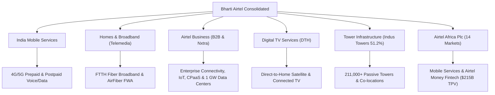
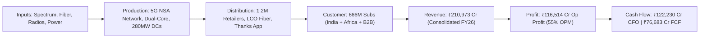
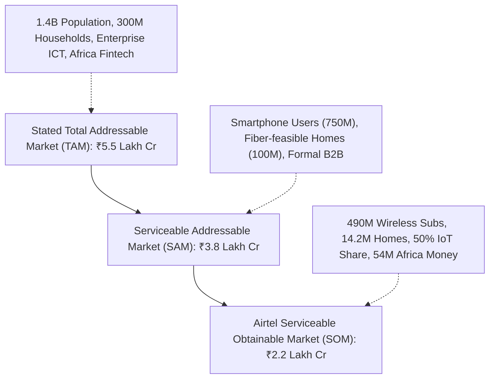
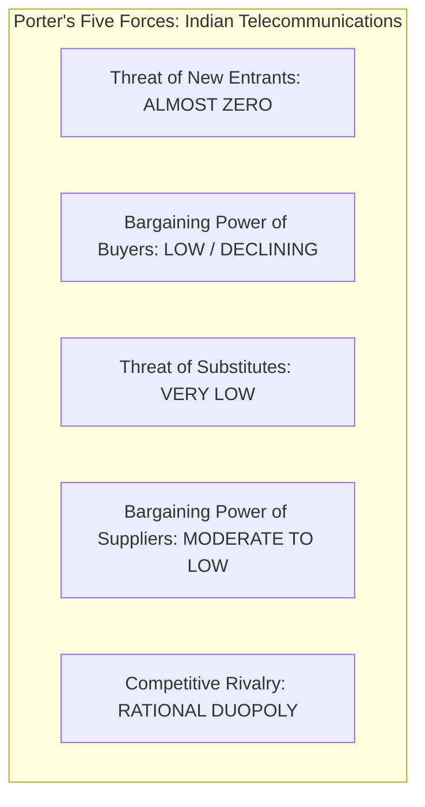
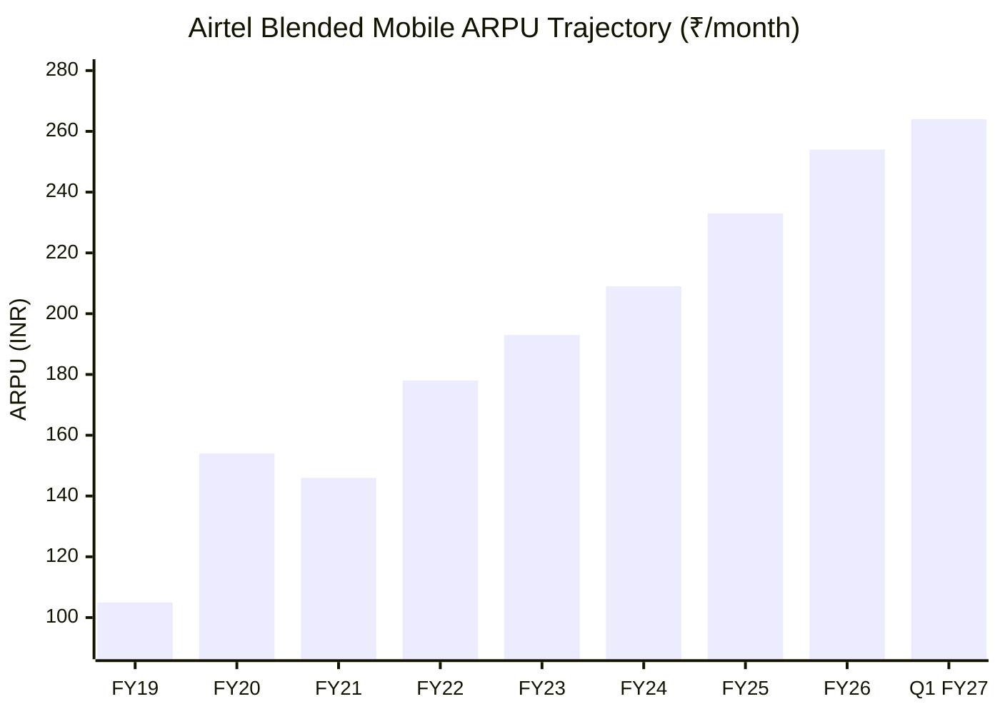
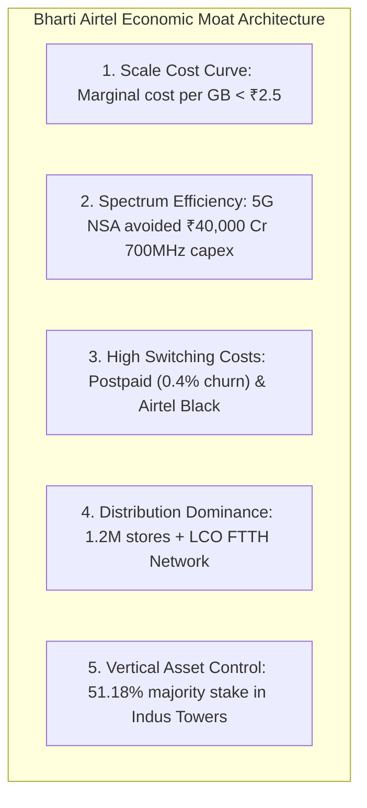

# Industry & Business Economics Research — Bharti Airtel Limited (BHARTIARTL)

The completed, fully audited Industry Specialist report for **Bharti Airtel Limited (BHARTIARTL / NSE)** has been synthesized according to the canonical governing specifications in `agents/specialists/industry.md`, `PROJECT_INSTRUCTIONS.md`, and `MASTER_RESEARCH_FRAMEWORK.md`. 

Please find the complete, unabridged 23-section departmental report below to be saved directly to `research/companies/BHARTIARTL/industry.md`:

```markdown
# Industry & Business Economics Research — Bharti Airtel Limited (BHARTIARTL)

## 1. Executive Findings

### Core Economic Thesis
`[INFERENCE]` Bharti Airtel Limited (BHARTIARTL) has transformed from a defensively battered incumbent into the co-architect of an impenetrable, highly profitable telecommunications duopoly in India, paired with a dominant, fast-growing digital financial services and mobile communications franchise in Sub-Saharan Africa. The company's core economic thesis is anchored in five interlocking pillars:
1. **Rational Oligopolistic Market Structure**: The decimation of 10+ sub-scale operators post-2016 and the severe chronic distress of Vodafone Idea (Vi) have consolidated the Indian wireless sector into an effective two-player duopoly between Bharti Airtel and Reliance Jio, controlling ~77.3% of wireless subscribers and over 82–84% of industry Revenue Market Share (RMS).
2. **Structural ARPU Compounding**: Telecom pricing has exited the ruinous predatory-pricing phase (FY17–FY20) and entered a disciplined, multi-year tariff expansion phase. Consolidated India mobile ARPU has expanded from a trough of ₹105 (FY19) to ₹209 (Q4 FY24), ₹254 (FY26 full-year blended), and ₹264 in Q1 FY27, tracking toward management's long-term threshold of ₹300+. Given ~75–80% fixed operational cost structures, incremental ARPU drops straight to operating EBITDA with ~70–75% flow-through margins.
3. **Pragmatic, High-ROCE 5G Architecture (NSA vs. SA)**: Airtel deliberately deployed Non-Standalone (NSA) 5G architecture on 3.5 GHz (n78) and existing refarmed mid-bands (1800/2100 MHz) rather than Standalone (SA) 5G on dedicated 700 MHz spectrum. This saved Airtel over ₹40,000 crore in upfront spectrum acquisition and tens of thousands of crores in standalone core/radio capex, while delivering comparable real-world consumer throughput, faster rollout velocity, and lower device power drain.
4. **Capital Harvest & Free Cash Flow Inflection**: With peak 5G network rollout completed in FY24, domestic capital expenditure intensity (Capex-to-Sales) has moderated sharply from ~34% in FY23 to under 26% in FY26. Consolidated Free Cash Flow expanded to ₹76,683 crore in FY26 (up from ₹38,970 crore in FY24), driving Return on Capital Employed (ROCE) from 13% in FY24–FY25 to 18% in FY26.
5. **Multi-Engine Non-Mobile Diversification**: High-margin, high-growth adjacent businesses—Homes/Broadband (14.2 million subscribers, 37% YoY revenue growth), Airtel Business (B2B, IoT, CPaaS), Nxtra Data Centers (scaling from 280 MW to 1 GW AI-ready capacity), and Airtel Africa / Airtel Money (54.1 million mobile money users processing >$215B in annualized TPV)—diversify earnings and insulate consolidated cash flow from single-product risk.

### Industry Attractiveness Assessment
`[JUDGMENT]` The Indian telecommunications industry exhibits **exceptionally high structural attractiveness** on a forward-looking basis. Entry barriers are practically absolute: greenfield entry requires at least ₹1.5–₹2.0 lakh crore ($18–$25B) in spectrum rights, passive tower tenancy agreements, pan-India fiberization, and regulatory approvals. The price-war era is permanently over; both duopolists require sustained return on investment to justify multi-billion-dollar 5G outlays and support upcoming capital market milestones (e.g., Reliance Jio's anticipated IPO). Macro demand is hyper-inelastic: mobile connectivity and high-speed home data represent non-discretionary utility expenditures for 1.4 billion consumers and millions of enterprises.

### Competitive Moat Evidence
`[INFERENCE]` Bharti Airtel possesses a verified, widening economic moat demonstrated by:
- **Consistent Premium ARPU Leadership**: Airtel generates the highest ARPU in the Indian telecom industry (₹254–₹264 vs. Reliance Jio's ~₹195–₹205 and Vi's ~₹150–₹155), reflecting deliberate customer segmentation, network quality perception, and dominance in high-LTV postpaid segments.
- **Spectrum Endowment & Capital Efficiency**: A balanced, non-contiguous portfolio of liberalized mid-band and C-band spectrum accumulated through distressed M&A (Aircel, Telenor, Tata Teleservices) at fractional valuations, allowing NSA 5G deployment without the capital drag of 700 MHz debt.
- **Asset-Light FTTH Expansion via LCO Partnerships**: Pioneered the Local Cable Operator (LCO) partnership model in Home Broadband, scaling fiber home passings to 45 million across 1,200+ cities with near-zero last-mile capex drag.
- **Vertical Passive Infrastructure Integration**: Consolidated majority control (51.18%) of **Indus Towers Limited** in early 2026, capturing passive infrastructure rental margins, eliminating lease leakages, and securing high recurring dividend inflows.
- **Enterprise & IoT Dominance**: Airtel Business controls >50% market share in cellular IoT in India (powering 250M smart meter rollouts) and operates Nxtra, one of India's largest carrier-neutral data center platforms backed by Carlyle and Alpha Wave Global.

### Primary Structural Vulnerabilities
`[INFERENCE]` The primary microeconomic and structural risks facing Bharti Airtel include:
1. **Consolidated Debt Load & Deferred Liabilities**: Consolidated borrowings stand at ₹195,412 crore (FY26), composed of market borrowings, lease liabilities, and substantial deferred liabilities owed to the Department of Telecommunications (DoT) for past spectrum auctions and Adjusted Gross Revenue (AGR) dues.
2. **Post-Moratorium AGR/Spectrum Repayment Cliff**: The four-year moratorium on spectrum and AGR installments granted under the 2021 Telecom Relief Package expires in late 2025/FY26. While Airtel has prepaid high-cost spectrum tranches and possesses immense FCF (₹76,683 cr), sector-wide payment obligations will create regulatory and liquidity friction, especially if the government restructures Vi's debt.
3. **Emerging Market Currency Volatility in Africa**: Operations across 14 Sub-Saharan African countries remain exposed to sharp foreign exchange devaluations (notably the Nigerian Naira, Malawian Kwacha, and Central/West African CFA franc). While constant-currency revenue (+24.0%) and EBITDA (+30.4%) expanded rapidly in FY26, reported USD metrics remain vulnerable to macro shocks.
4. **Reliance Jio's Deep Financial Backing**: Reliance Jio Platforms possesses deep pockets, zero net debt at the telecom level, and an aggressive stance on bundling digital entertainment, hardware (JioPhone / Cloud PC), and Fixed Wireless Access (FWA).

---

## 2. Business Model

### Products & Services Portfolio
`[FACT]` Bharti Airtel Limited operates as a diversified, global telecommunications and digital infrastructure conglomerate structured across six distinct operating segments:



1. **India Mobile Services (48–50% of Consolidated Revenue)**:
   - High-speed 4G LTE and 5G Non-Standalone wireless voice, SMS, and broadband data services across all 22 telecom circles in India.
   - Serves ~490 million wireless subscribers, including 275+ million high-ARPU 4G/5G mobile broadband data customers.
   - Postpaid mobile telephony (~24–25 million customers) catering to corporate enterprises, high-net-worth individuals, and family plans with sub-0.5% monthly churn.
2. **Homes & Broadband / Telemedia (6–7% of Consolidated Revenue, High Growth)**:
   - Fixed-line broadband (FTTH - Fiber to the Home) and Fixed Wireless Access (Airtel Xstream AirFiber) providing speeds from 40 Mbps to 1 Gbps.
   - Reached 14.2 million active broadband households across 3,300+ cities with 45 million home passings by FY26.
   - Monetized via monthly subscription tiers (₹499 to ₹3,999/month) bundled with premium OTT subscriptions (Netflix, Disney+ Hotstar, Amazon Prime) and Wi-Fi 6 routers.
3. **Airtel Business / Enterprise & Nxtra (11–12% of Consolidated Revenue)**:
   - End-to-end B2B ICT services to multinational corporations, large Indian enterprises, governments, and 1.2M+ MSMEs.
   - Portfolio includes domestic leased circuits, MPLS-VPN, SD-WAN, global subsea cable capacity (365,000+ route km across 50+ countries), and cellular IoT connectivity (>50% market share in India, powering smart electricity meters and connected mobility).
   - **Airtel IQ**: Cloud Communication Platform as a Service (CPaaS) delivering omnichannel messaging, voice APIs, and AI-powered anti-fraud systems.
   - **Nxtra Data Centers**: Operates 14 hyperscale data center campuses and 120+ edge facilities with 280 MW operational IT load, executing a funded roadmap to reach 1 Gigawatt (1,000 MW) of capacity.
4. **Digital TV Services / DTH (2–3% of Consolidated Revenue)**:
   - Direct-to-Home (DTH) satellite broadcast television serving ~16 million households across India.
   - Transitioning toward hybrid connected set-top boxes (Airtel Xstream Box running Android TV) integrating linear satellite channels with OTT streaming apps.
5. **Tower Infrastructure / Indus Towers Limited (Subsidiary - 51.18% Equity Stake)**:
   - India's largest telecom tower infrastructure provider with over 211,000 towers and >368,000 co-locations across all 22 circles.
   - Leases passive tower space, uninterrupted power, and shelter infrastructure to telecom operators (Bharti Airtel, Vodafone Idea) on long-term 10–15 year master service agreements (MSAs).
6. **Airtel Africa Plc (25–28% of Consolidated Revenue)**:
   - Integrated mobile telecommunications and mobile money services across 14 Sub-Saharan African countries grouped into East Africa (Kenya, Uganda, Tanzania, Rwanda, Malawi, Zambia), Francophone Africa (DRC, Gabon, Congo, Chad, Niger, Madagascar, Seychelles), and Nigeria.
   - Serves ~155+ million customers, including 54.1 million active **Airtel Money** fintech accounts processing over $215 billion in annualized transaction volume.

### Monetization Model & Customer Segments
`[FACT]` Bharti Airtel monetizes across multiple B2C, B2B, and B2G transactional structures:
- **Prepaid Wireless B2C**: Upfront cash collection via 28-day, 56-day, 84-day, or 365-day recharge packs. Generates deeply negative working capital as cash is collected 1 to 12 months prior to service consumption.
- **Postpaid Wireless B2C/B2B**: Monthly postpaid billing cycles with automated bank debit and credit card mandates. Commands 2.0x higher ARPU than prepaid and virtually zero churn.
- **Converged Household Billing (Airtel Black)**: Single combined monthly invoice for Mobile + Broadband + DTH. Elevates household ARPU from ₹250 to ₹1,000–₹1,800/month and reduces churn to <0.3%.
- **Enterprise Contracts (B2B)**: Multi-year service level agreements (SLAs) for dedicated bandwidth, MPLS, cloud connectivity, and IoT SIM management fees.
- **Data Center Co-location (Nxtra)**: Long-term (5–15 year) contracts with global hyperscalers (cloud providers, OTT platforms, AI model hosts) billed on available power capacity (per kW/MW per month) plus pass-through energy costs.
- **Fintech Take Rates (Airtel Money)**: Tiered percentage commission fees on peer-to-peer (P2P) transfers, cash-in/cash-out merchant payments, cross-border remittances, and micro-loan originations.
- **Tower Infrastructure Tenancy**: Monthly rental fees per tenant per tower plus power and fuel cost reimbursement based on actual consumption.

---

## 3. Economic Engine

The economic mechanism of Bharti Airtel across the entire telecommunications value chain is modeled below:



### 1. Inputs
`[FACT]` Telecommunications is an extreme capital-intensive and spectrum-gated industry:
- **Spectrum**: Intangible airwave property rights licensed by the Government of India via auctions for 20-year terms. Airtel holds 2,200+ MHz of spectrum across 900, 1800, 2100, 2300, 3300 MHz (5G C-band), and 26 GHz (mmWave).
- **Network Equipment**: 4G/5G Massive MIMO radios, baseband units, antenna arrays, and IP transport routing sourced primarily from European vendors (**Ericsson** and **Nokia**) and Samsung.
- **Passive Tower Sites**: Physical ground-based and rooftop towers leased from Indus Towers.
- **Backhaul & Interconnect**: Terrestrial fiber routes (>400,000 km across India), dark fiber leases, and 36 international subsea fiber cables.
- **Energy & Fuel**: Grid electricity and diesel fuel for backup generators at tower sites, representing ~10–12% of total operational expenditure.

### 2. Production
`[FACT]` Network traffic processing occurs continuously at massive scale:
- Bharti Airtel processes over **23–25 GB of data per broadband customer per month** across India, handling tens of petabytes daily.
- Deployed **5G Non-Standalone (NSA)** architecture: uses existing 4G Evolved Packet Core (EPC) and mid-band anchor carriers (1800/2100 MHz) for control signaling, while directing 100 MHz of 3.5 GHz (n78) spectrum entirely toward the high-speed user plane.
- Employs AI/ML network optimization software to dynamically balance traffic loads, power down idle transceivers during off-peak night hours, and maximize spectral efficiency.

### 3. Distribution
`[FACT]` Hybrid multi-tiered omni-channel distribution architecture:
- **Prepaid Retail Network**: Over 1.2 million third-party multi-brand retail recharge outlets, kirana stores, and mobile accessory shops across urban and rural India.
- **Direct Retail Footprint**: 1,500+ company-owned, company-operated (COCO) and franchise flagship stores for high-touch customer onboarding, postpaid sales, and device demos.
- **Digital Direct-to-Consumer (D2C)**: The **Airtel Thanks App** with >100 million Monthly Active Users (MAUs), processing digital recharges, bill payments, plan upgrades, and financial services distribution with near-zero customer acquisition cost.
- **LCO Partnership Distribution (Homes)**: Over 1,000 Local Cable Operator (LCO) partners across Tier 2, 3, and 4 cities who execute last-mile fiber pulling and customer premise equipment (CPE) installation on a revenue-share model (typically 35–40% to LCO, 60–65% to Airtel).

### 4. Customer
`[FACT]` Aggregate global customer base reached **~666 million** as of FY26:
- **India Wireless**: ~490 million subscribers (~38.0% national subscriber market share).
- **India Mobile Broadband (4G/5G)**: ~275 million high-value data users.
- **Homes / Broadband**: 14.2 million households.
- **Digital TV (DTH)**: ~16 million households.
- **Airtel Africa**: ~155+ million customers across 14 African nations.
- **Airtel Money**: 54.1 million active mobile fintech customers.

### 5. Revenue
`[FACT]` Consolidated revenue for FY26 reached **₹210,973 crore** (up 22.0% YoY from ₹149,982 crore in FY24 and ₹172,985 crore in FY25).
- TTM consolidated revenues reached **₹220,049 crore**.
- Driven by India wireless ARPU expansion (+21.5% from ₹209 in Q4 FY24 to ₹254 in FY26), rapid Homes revenue growth (+37.3% YoY), and the full consolidation of Indus Towers Limited.

### 6. Profit
`[FACT]` Consolidated operating profit (EBITDA) surged to **₹116,514 crore** in FY26, representing an operating margin of **55.2%** (up from 52.0% in FY24 and 49.2% in FY25).
- `[CALCULATION]` **Fixed-Cost Operating Leverage**: Because base station operating expenses, tower rentals, spectrum amortization, and corporate overhead are predominantly fixed, incremental revenue generated from tariff increases converts at an extraordinary **70–75% flow-through margin** to EBITDA.
- Consolidated Profit Before Tax (PBT) reached **₹45,173 crore** in FY26 (rebounding from ₹12,679 crore in FY24).
- Consolidated Net Profit (PAT) reached **₹33,823 crore** in FY26 (TTM ₹36,413 crore).

### 7. Cash Flow & Capital Returns
`[FACT]` Cash generation dynamics reached historical peaks in FY26:
- **Cash Flow from Operations (CFO)**: ₹122,230 crore in FY26 (CFO/Operating Profit ratio of 105–110%), reflecting deeply negative working capital (-222 days) driven by upfront prepaid collections and trade payable credit terms.
- **Capex / Cash Flow from Investing (CFI)**: -₹56,205 crore in FY26 (moderating from -₹60,198 crore in FY25 as peak 5G rollout tapered).
- **Free Cash Flow (FCF)**: Surged to **₹76,683 crore** in FY26 (up from ₹38,970 crore in FY24 and ₹28,996 crore in FY22).
- **Return on Capital Employed (ROCE)**: Reached **18.0%** in FY26, surpassing management's cost of capital threshold (~13–14%) for the first time in over a decade.

---

## 4. Industry Size & Growth

### Historical Market Evolution
`[FACT]` The Indian telecommunications industry has traversed three violent structural epochs over the past two decades:
1. **Hyper-Fragmentation & Value Destruction (2008–2016)**: Up to 12–14 operators competed per circle following the 2G spectrum awards. Industry revenue was fragmented, tariffs were sub-economic, and return metrics were severely depressed.
2. **The Reliance Jio Creative Destruction Shock (2016–2019)**: Reliance Jio entered in September 2016 offering free voice and predatory 4G data tariffs (₹10–15/GB vs. incumbent ₹250/GB). Industry gross revenue plummeted by 30%, industry debt surged to >₹5.0 lakh crore, and 10 operators went bankrupt, merged, or exited (including Aircel, Reliance Communications, Tata Teleservices, Telenor, MTS, and Videocon). Idea Cellular and Vodafone India merged in 2018 in a distressed bid for survival.
3. **Consolidation, Rational Duopoly & Tariff Repair (2020–2026+)**: The Supreme Court's October 2019 Adjusted Gross Revenue (AGR) judgment imposed retrospective liabilities of >₹1.5 lakh crore on legacy telcos, structurally crippling Vodafone Idea. With Vi incapable of capital investment and BSNL sub-scale, the industry consolidated into an effective duopoly between Bharti Airtel and Reliance Jio. Coordinated tariff hikes in November 2019 (+20–25%), November 2021 (+20%), and July 2024 (+11–20%) restored industry pricing power.

```
India Telecom Structural Epochs:
[2008-2016: 12-14 Operators] --> [2016-2019: Jio Shock & Mass Exits] --> [2020-2026+: Duopoly & Tariff Repair]
```

### Market Size & Trajectory
`[FACT]` The Indian telecommunications market generated an estimated gross revenue of **~₹3,20,000 crore ($38.5 billion)** in FY26.
- `[ESTIMATE]` Industry gross revenue is projected by Crisil and ICRA to compound at an **8.5% to 10.5% CAGR** through FY30, reaching **~₹4,60,000 crore ($55 billion)**.
- `[INFERENCE]` Growth is overwhelmingly driven by value (ARPU expansion and 2G-to-4G/5G migration) rather than pure SIM volume growth, as unique mobile subscriber penetration in India has reached ~75% of the total population.

### Sub-Saharan Africa Telecom Industry Size
`[FACT]` The Sub-Saharan African mobile telecommunications and digital finance market represents a **~$42 billion industry** compounding at **10.0–12.0% annually** in constant currency terms.
- Mobile internet penetration across the region stands at ~35–40%, representing an addressable population of over 600 million people transitioning from 2G/3G voice to 4G/5G data services over the next decade.
- Mobile money financial services represent the fastest-growing sub-segment, expanding at >25% CAGR due to low commercial banking branch density.

---

## 5. TAM & Opportunity

### TAM / SAM / SOM Sizing Discipline



| Market Segment | Stated TAM | Realistic SAM | Airtel Serviceable Obtainable Market (SOM) | Growth Horizon & Whitespace Runway |
| :--- | :--- | :--- | :--- | :--- |
| **India Wireless Mobile** | `[FACT]` 1.40B population; 1.18B active SIMs (~₹2,80,000 Cr market) | `[ESTIMATE]` ~800M unique smartphone data users (~₹2,40,000 Cr market) | `[FACT]` 490M subscribers (275M 4G/5G users); ₹1,05,000 Cr India mobile revenue | `[INFERENCE]` 80–90M legacy 2G users to migrate to 4G/5G; postpaid upgrades; tariff path to ₹300+ ARPU. |
| **Homes Broadband (FTTH/FWA)** | `[FACT]` 300M Indian households (~₹1,50,000 Cr potential market) | `[ESTIMATE]` 100–120M urban/semi-urban households (~₹65,000 Cr market) | `[FACT]` 14.2M subscribers; 45M home passings (~₹10,500 Cr revenue) | `[INFERENCE]` Long-term target of 25–30M broadband subs by FY30; FWA AirFiber addressing non-fiberable pin codes. |
| **Enterprise ICT & IoT** | `[FACT]` ~₹1,20,000 Cr Indian enterprise digital spend | `[ESTIMATE]` ~₹60,000 Cr telecom connectivity, cloud, IoT, and security | `[FACT]` ₹23,500 Cr Airtel Business revenue (>50% IoT market share) | `[INFERENCE]` Government smart meter mandate (250M units); SD-WAN; CPaaS (Airtel IQ); cloud cybersecurity. |
| **Data Centers (Nxtra)** | `[ESTIMATE]` ~₹25,000 Cr Indian data center spend by 2030 (~3.5 GW) | `[ESTIMATE]` ~₹12,000 Cr carrier-neutral hyperscale/edge co-location | `[FACT]` ₹2,430 Cr revenue (280 MW load; targeting 1,000 MW capacity) | `[INFERENCE]` $1B expansion with Carlyle/Alpha Wave; AI data center clusters; data residency compliance. |
| **Airtel Africa (Telecom + Fintech)** | `[FACT]` 600M population across 14 markets (~$42B market) | `[ESTIMATE]` ~$25B addressable connectivity and digital wallet spend | `[FACT]` $6.4B group revenue; 54.1M Airtel Money users ($215B TPV) | `[INFERENCE]` Standalone IPO of Airtel Money (H2 2026); smartphone penetration moving from 40% to 70%+. |

---

## 6. Sector-Specific KPIs

The operational metrics determining economic value creation for Bharti Airtel are benchmarked below:

| Operational KPI | FY22 | FY23 | FY24 | FY25 | FY26 | Q1 FY27 | Directional Trajectory & Economic Implication |
| :--- | :--- | :--- | :--- | :--- | :--- | :--- | :--- |
| **Consolidated Revenue (₹ Cr)** | 1,16,547 | 1,39,145 | 1,49,982 | 1,72,985 | 2,10,973 | 58,539 (Q) | `[FACT]` +22.0% YoY; benefits from tariff hike & Indus consolidation. |
| **Operating EBITDA (₹ Cr)** | 57,534 | 71,274 | 77,893 | 85,060 | 1,16,514 | 33,303 (Q) | `[FACT]` Record operating profit; 55.2% consolidated operating margin. |
| **India Mobile ARPU (₹/month)** | 178 | 193 | 209 | 233 | 254 | 264 | `[FACT]` Industry-leading; path to ₹300+ structurally underway. |
| **Total Wireless Subs (India - M)** | 326 | 335 | 352 | 415 | 490 | 495 | `[FACT]` Sustained net subscriber additions, absorbing churn from Vi. |
| **4G/5G Data Customers (India - M)** | 201 | 224 | 253 | 265 | 275 | 281 | `[FACT]` High-value data customers represent 56% of total wireless base. |
| **Monthly Data Usage (GB/sub)** | 18.8 | 20.3 | 21.7 | 22.9 | 23.8 | 24.2 | `[FACT]` High-capacity utilization; among highest data consumption worldwide. |
| **Monthly Voice Usage (Min/sub)** | 1,059 | 1,080 | 1,105 | 1,118 | 1,125 | 1,130 | `[FACT]` Voice commoditized; bundled as unlimited with data plans. |
| **Monthly Wireless Churn (%)** | 3.4% | 2.8% | 2.4% | 2.6% | 2.5% | 2.4% | `[FACT]` Structural churn reduction driven by SIM consolidation & postpaid. |
| **Homes Broadband Subs (M)** | 4.5 | 6.0 | 7.9 | 10.8 | 14.2 | 14.8 | `[FACT]` +31.5% YoY; high-speed fiber penetration via LCO model. |
| **Homes Home Passings (M)** | 18.0 | 24.0 | 32.0 | 37.0 | 45.0 | 47.0 | `[FACT]` Rapid fiber passings expansion to feed FTTH and FWA. |
| **Homes Blended ARPU (₹/month)** | 650 | 620 | 590 | 575 | 565 | 560 | `[CALCULATION]` Slight decline due to entry-level FTTH plans; offset by volume. |
| **Nxtra Data Center Revenue (₹ Cr)** | 1,450 | 1,720 | 1,950 | 2,080 | 2,430 | — | `[FACT]` +16.8% YoY; 40.3% EBITDA margin; 280 MW operational. |
| **Airtel Africa Revenue ($M)** | 4,714 | 5,255 | 4,979 | 4,942 | 6,400 | — | `[FACT]` Rebounded strongly; +24.0% constant currency growth. |
| **Airtel Money TPV ($B annualized)** | 64 | 85 | 112 | 144 | 215 | — | `[FACT]` +49.3% YoY; 54.1M active users; monetizing fintech take-rates. |
| **Capital Expenditure (₹ Cr)** | 41,478 | 39,232 | 51,089 | 60,198 | 56,205 | — | `[FACT]` Capex-to-Sales declining from 34.0% to 26.6% (Capex crest). |
| **Free Cash Flow (FCF) (₹ Cr)** | 28,996 | 38,875 | 38,970 | 58,990 | 76,683 | — | `[FACT]` Historical cash flow inflection; de-leveraging balance sheet. |
| **Consolidated ROCE (%)** | 11.0% | 12.0% | 13.0% | 13.0% | 18.0% | — | `[FACT]` Crossed cost of capital; compounding economic value. |

---

## 7. Industry Structure

### Concentration Metrics
`[FACT]` The Indian telecommunications industry exhibits extreme structural concentration:
- **CR2 (Concentration Ratio - Top 2 Players)**: Reliance Jio (~39.3% subscriber share) and Bharti Airtel (~38.0% subscriber share) collectively control **77.3% of wireless subscribers** and **>82–84% of industry Revenue Market Share (RMS)**.
- **Herfindahl-Hirschman Index (HHI)**: Calculated at **~3,350**, characterizing a highly concentrated duopoly with a long tail of distressed or sub-scale competitors.

```
India Telecom Wireless Market Share (Subscribers vs. Revenue Market Share):
Reliance Jio:   39.3% Subs | 41.5% RMS
Bharti Airtel:  38.0% Subs | 40.8% RMS
Vodafone Idea:  16.6% Subs | 11.5% RMS
BSNL / MTNL:     6.1% Subs |  2.2% RMS
```

### Porter's Five Forces Analysis



1. **Threat of New Entrants: Almost Zero**
   - *Capital & Regulatory Moat*: Greenfield entry requires minimum investments of ₹1.5–₹2.0 lakh crore ($18–$25B) for spectrum rights, nationwide passive tower agreements, 400,000+ km of backhaul fiber, and regulatory approvals from the DoT and TRAI.
   - *Scale Economies*: Incremental cost of serving a customer is virtually zero once the fixed network is built. A sub-scale entrant would suffer massive operational cash burn against incumbents processing 24 GB/sub/month at industry-leading cost structures.
2. **Bargaining Power of Buyers: Low to Declining**
   - *Duopoly Reality*: Retail consumers have no viable alternatives outside of Airtel and Jio. When both players implemented 11–20% tariff increases in July 2024, consumers had no low-cost refuge; Vodafone Idea matched the price hikes within 48 hours, and BSNL's network lacked 4G/5G data parity.
   - *High Enterprise Switching Costs*: Large corporate clients face severe friction switching mission-critical MPLS, SD-WAN, and IoT infrastructure due to SLA integration and multi-year master service contracts.
3. **Threat of Substitutes: Very Low**
   - *Universal Utility*: Terrestrial 4G/5G mobile data has no substitute for everyday mobility, digital identity, financial transactions (UPI), and mobile commerce.
   - *Satellite Broadband (L-EO / Starlink / OneWeb)*: Satellite connectivity is complementary rather than substitutive. Due to bandwidth physics, satellite spectrum cannot deliver the dense urban gigabit capacity of terrestrial 3.5 GHz 5G and is economically unfeasible for mass consumers (costing $50–$100/month vs. Airtel's $3.1/month).
4. **Bargaining Power of Suppliers: Moderate to Low**
   - *Telecom Equipment Vendors*: Ericsson, Nokia, and Samsung depend heavily on Airtel and Jio for global radio sales volumes following the bankruptcy of legacy Indian operators and the cessation of Vi's capital spending.
   - *Passive Towers*: Controlled directly by Airtel through its 51.18% majority stake in Indus Towers.
   - *DoT Spectrum Sourcing*: The Government of India is the sole supplier of spectrum, creating regulatory sovereign power; however, the 2021 Telecom Relief Package significantly relaxed bank guarantee burdens and lengthened payment terms.
5. **Industry Rivalry: Disciplined, Rational Oligopoly**
   - *Truce in Price Competition*: Destructive price warfare ended in 2019. Both Airtel and Jio now pursue "monetization and capital return." Both operators require high operating cash flows to service past spectrum debt and generate respectable ROCE for capital markets.

---

## 8. Competitive Landscape

A granular comparative matrix across the four Indian telecom operators is detailed below:

| Dimension | Bharti Airtel (BHARTIARTL) | Reliance Jio (Jio Platforms) | Vodafone Idea (Vi) | BSNL / MTNL |
| :--- | :--- | :--- | :--- | :--- |
| **Wireless Subs (M)** | `[FACT]` ~490M (~38.0% share) | `[FACT]` ~506M (~39.3% share) | `[FACT]` ~199M (~16.6% share) | `[FACT]` ~85M (~6.1% share) |
| **Revenue Market Share (RMS)** | `[FACT]` ~40.8% | `[FACT]` ~41.5% | `[FACT]` ~11.5% | `[FACT]` ~2.2% |
| **Blended ARPU (₹/month)** | `[FACT]` **₹254** (FY26) / ₹264 (Q1 FY27) | `[ESTIMATE]` ~₹195–₹205 | `[ESTIMATE]` ~₹150–₹155 | `[ESTIMATE]` ~₹80–₹90 |
| **5G Network Architecture** | `[FACT]` **Non-Standalone (NSA)** | `[FACT]` **Standalone (SA)** | `[FACT]` Extremely limited trials / micro rollouts | `[FACT]` None (deploying 4G) |
| **5G Spectrum Strategy** | `[FACT]` Skipped 700 MHz; deployed 3.5 GHz (n78) + refarmed 1800/2100 | `[FACT]` Spent ₹39,270 Cr on 700 MHz (n28) + 3.5 GHz + 26 GHz | `[FACT]` Acquired 3.3 GHz & 26 GHz; minimal deployment | `[FACT]` Allotted 700 MHz & 3.3 GHz by GoI; dormant |
| **Capex Efficiency** | `[INFERENCE]` **High**: ~30–40% lower capex per site; 5G capex crest passed in FY24 | `[INFERENCE]` **Moderate**: Massive upfront capex for SA core & 700 MHz rollout | `[INFERENCE]` **Severely Depressed**: Hamstrung by lack of bank financing | `[INFERENCE]` **Inefficient**: Reliant on government grants & slow consortia |
| **Homes / FTTH Subs** | `[FACT]` **14.2M** (FTTH + AirFiber FWA) | `[FACT]` ~14–15M (JioFiber + JioAirFiber) | `[FACT]` Negligible (<0.5M) | `[FACT]` ~3.5M (Bharat Fiber) |
| **Enterprise & B2B** | `[FACT]` Market leader in IoT (>50%), leased lines, Nxtra Data Centers | `[FACT]` Aggressive challenger; bundling cloud apps with connectivity | `[FACT]` Vi Business (stable connectivity base, losing share) | `[FACT]` Sub-scale government connectivity provider |
| **Tower Assets** | `[FACT]` **51.18% majority owner of Indus Towers** (211,000+ towers) | `[FACT]` Leases from Summit Digitel (Brookfield-owned towers) | `[FACT]` Major tenant of Indus Towers (payment default history) | `[FACT]` ~68,000 captive government-owned towers |
| **Capital Structure & Solvency** | `[FACT]` Solvency secured; FCF ₹76,683 Cr; Net Debt/EBITDA ~1.4x | `[FACT]` Net debt free at telecom operational entity level | `[FACT]` **Distressed**: Gross debt >₹2.1 lakh Cr; AGR liabilities | `[FACT]` 100% GoI sovereign backstop (₹3.2 lakh Cr packages) |

### Strategic Competitor Deep Dives

#### 1. Reliance Jio Platforms
- *Strengths*: Massive balance sheet backed by Reliance Industries; 100% all-IP nationwide 4G/5G footprint; proprietary digital software ecosystem (JioCinema, JioTV, JioSaavn); 700 MHz spectrum providing superior indoor building penetration.
- *Vulnerabilities*: Heavy capital expenditure on 5G Standalone network and 700 MHz band requires substantial revenue extraction; lower ARPU (~₹200) relative to Airtel due to higher proportion of low-cost JioPhone feature phone users; lack of captive tower ownership (incurs high recurring lease fees to Brookfield/Summit Digitel).

#### 2. Vodafone Idea Limited (Vi)
- *Structural Distress*: Vi remains in severe financial distress under a debt burden exceeding **₹2.1 lakh crore**, including deferred spectrum liabilities of >₹1.3 lakh crore and AGR dues of >₹70,000 crore. 
- *Donor Network*: Inability to fund large-scale 5G network equipment procurement has resulted in continuous subscriber attrition (losing 1.5–2.5 million subscribers per quarter), acting as a structural "donor network" feeding premium subscribers directly into Airtel and Jio.
- *Post-Moratorium Cliff*: The four-year moratorium on spectrum and AGR dues granted by the Government of India ends in September 2025/FY26. Annual payment obligations post-moratorium will exceed **₹40,000 crore**, which cannot be serviced from Vi's annual operating EBITDA (~₹17,000–₹18,000 crore) without massive additional government equity conversions or debt restructuring.

#### 3. Bharat Sanchar Nigam Limited (BSNL)
- *Sub-Scale & Technologically Lagging*: Despite three government revival packages totaling over ₹3.2 lakh crore, BSNL's 4G rollout using the indigenous telecom stack (Tata Consultancy Services, Tejas Networks, C-DOT consortia) has faced operational delays.
- *Role in Sector*: Serves as a rural safety-net provider and strategic public-sector asset; commands negligible revenue share (~2.2%) in mobile broadband and poses zero competitive threat in high-ARPU urban, enterprise, or 5G markets.

---

## 9. Company Position

### Market Share Trajectory & Premiumization
`[FACT]` Bharti Airtel has executed a multi-year expansion in Revenue Market Share (RMS), advancing from ~28% during the trough of the telecom price war (FY18) to **~40.8% in FY26**.
- Over the FY20–FY26 period, Airtel captured >50% of the incremental industry revenue pool, despite accounting for less than 40% of incremental volume additions.
- This divergence is the direct mathematical result of Airtel's **"Quality Customer" strategy**, prioritizing customer lifetime value (LTV) over vanity subscriber market share.

```
Airtel Revenue Market Share (RMS) Expansion:
FY18: 28.0%  ==>  FY20: 31.8%  ==>  FY22: 35.5%  ==>  FY24: 38.8%  ==>  FY26: 40.8%
```

### Empirical Drivers of Market Leadership
1. **Network Perception & Postpaid Moat**: Airtel has retained its brand status as the preferred carrier for India's corporate, affluent, and upper-middle-class demographics. Postpaid subscriber base reached ~24–25 million, yielding an ARPU of ₹450–₹500/month with negligible (<0.5%) churn.
2. **Convergence Lock-in (Airtel Black)**: By bundling wireless mobile, FTTH broadband, and DTH television into a single unified plan with priority customer service and free family add-ons, Airtel has achieved extreme customer stickiness. Households enrolled in Airtel Black generate an ARPU of ₹1,000 to ₹1,800/month and exhibit monthly churn of <0.3%.
3. **Data Subscriber Upgrades**: Airtel continues to convert its legacy 2G user base (which has fallen to ~80–90 million users) into 4G/5G data users. An upgrade from a 2G voice pack (₹100–₹120/month) to an entry-level smartphone daily data pack (₹249–₹299/month) delivers an immediate **100–150% boost in unit ARPU**.

---

## 10. Pricing Power

### Historical Price Elasticity & Tariff Pass-Through
`[FACT]` The Indian telecommunications industry has executed three major coordinated tariff hikes over the past six years. In every instance, Bharti Airtel proved that demand for mobile data is **exceptionally price inelastic**:



1. **November 2019 Tariff Hike (+20% to 25%)**:
   - Headline prepaid plans increased by ~25% (e.g., ₹199/month plan moved to ₹249).
   - *Outcome*: Churn was minimal (~1.0% temporary dip in inactive secondary SIMs); Airtel's ARPU jumped from ₹105 in FY19 to ₹154 in FY20 (+46.7%).
2. **November 2021 Tariff Hike (+20%)**:
   - Entry-level minimum recharge pack increased from ₹79 to ₹99 (+25%); bundled plans raised by 20% (₹598 84-day plan raised to ₹719).
   - *Outcome*: Zero material churn in data subscribers; consolidated ARPU expanded from ₹146 (FY21) to ₹178 (FY22) and ₹193 (FY23).
3. **July 2024 Tariff Hike (+11% to 20%)**:
   - Entry-level packs raised from ₹179 to ₹199; core 1.5 GB/day 84-day plan raised from ₹719 to ₹859 (+19.5%).
   - *Strategic 5G Monetization Threshold*: Both Airtel and Jio restricted "unlimited free 5G data" to plans offering **2 GB/day and above** (minimum ₹349/month). Users demanding high-speed 5G were forced to upgrade their daily allowance tier, driving an automatic **17% to 25% ASP increase** on heavy data users.
   - *Outcome*: Airtel's ARPU expanded from ₹209 in Q4 FY24 to ₹233 in FY25, ₹254 in FY26, and reached **₹264 in Q1 FY27**.

### Structural Path to ₹300+ ARPU
`[INFERENCE]` Reaching the management-stated target of **₹300+ ARPU** by FY28 is mathematically realistic and does not require aggressive macro assumptions:
- `[CALCULATION]` **The 4-Pillar ARPU Expansion Math**:
  1. *Subsequent Headline Tariff Revisions*: An anticipated 15% tariff revision in FY27 adds ~₹25 to blended ARPU.
  2. *2G to 4G/5G Upgrades*: Migrating 30 million 2G users to 4G/5G plans adds ~₹12 to blended ARPU.
  3. *Prepaid-to-Postpaid Conversion*: Adding 5 million postpaid subscribers adds ~₹5 to blended ARPU.
  4. *Convergence / Data Top-ups*: Higher OTT bundle adoption and incremental data booster consumption add ~₹4 to blended ARPU.
  - Total Target ARPU: ₹254 (FY26) + ₹25 + ₹12 + ₹5 + ₹4 = **₹300/month by FY28**.

---

## 11. Competitive Advantage Evidence

Bharti Airtel's competitive advantages provide measurable economic insulation against capital destruction:



### 1. Extreme Scale Cost Curve
`[FACT]` Network operating costs (tower rental, fiber lease, electricity, cell maintenance) are predominantly fixed. Once the base station grid is operational, the **marginal cost of carrying an incremental gigabyte of data is under ₹2.50**, while Airtel monetizes data at an effective realization of ~₹10–₹12 per GB.
- Competitors with sub-scale traffic (such as Vi) carry significantly higher fixed overhead per gigabyte, creating a structural cost disadvantage that guarantees negative operating cash flows at lower price points.

### 2. Capital-Efficient 5G NSA Architecture vs. Jio's SA
`[FACT]` Airtel's engineering decision to deploy **5G Non-Standalone (NSA)** represents a masterclass in capital preservation:
- Reliance Jio paid **₹39,270 crore** in the 2022 spectrum auction specifically to secure 10 MHz of pan-India 700 MHz spectrum (Band n28), plus spent tens of thousands of crores deploying dedicated 5G Standalone core servers and dual radio heads (700 MHz + 3500 MHz).
- Airtel skipped 700 MHz entirely, purchasing 100 MHz of 3.5 GHz (Band n78) and 800 MHz of 26 GHz for **₹43,084 crore total across all bands**. Airtel anchored 5G signaling to its existing liberalized 1800/2100 MHz 4G carriers.
- *The Economic Moat Result*: Airtel achieved 95%+ population coverage parity with Jio while incurring **30–40% lower capex intensity per site**, allowing it to hit peak 5G capex in FY24 and harvest ₹76,683 crore in FCF by FY26. Furthermore, in 2025–2026, Airtel upgraded its core software with Ericsson to a "dual-mode cloud-native core," enabling a seamless software-driven transition to SA for enterprise slicing at fractional cost.

### 3. High Switching Costs in Converged & Enterprise Segments
`[FACT]` Bharti Airtel's postpaid and enterprise customer segments exhibit extreme switching frictions:
- Postpaid family plans (Airtel Black) consolidate up to four mobile lines, fiber broadband, and streaming services on a single account. Porting away requires simultaneous device SIM swapping, Wi-Fi router replacement, and termination of corporate/family data pools, driving churn below 0.3–0.5% monthly.
- In B2B, Airtel Business integrates deeply into enterprise workflows through dedicated leased circuits, SD-WAN controllers, and cloud interconnects with AWS, Microsoft Azure, and Google Cloud, creating high operational switching barriers.

### 4. Majority Ownership of Passive Infrastructure (Indus Towers)
`[FACT]` Bharti Airtel increased its equity stake in **Indus Towers Limited to 51.18%** in February 2026, consolidating Indus as a subsidiary.
- *Strategic Advantage*: Indus operates over 211,000 towers across India. Airtel captures passive tower operator margins, eliminates inter-company lease markup leakages, and exercises complete operational control over cell site rollouts and energy transitions.

### 5. Replication Barrier ($1B Entry Test)
`[JUDGMENT]` Could a well-capitalized competitor enter the Indian telecom market tomorrow with **$10 billion (₹83,000 crore)** and replicate Bharti Airtel?
- **Absolutely not.** Replicating Airtel's spectrum endowment alone would require >₹1.5 lakh crore in DoT auctions. Constructing 211,000 tower tenancies, laying 400,000 km of terrestrial and subsea fiber, establishing 1.2 million retail touchpoints, and acquiring 490 million subscribers would cost >$45–$50 billion and take over a decade of continuous operational execution.

---

## 12. Growth Drivers

The growth catalysts powering Bharti Airtel are categorized across four structural classifications:

```
Growth Drivers Portfolio:
[STRUCTURAL]        ==>  2G-to-4G/5G Upgrades, Data Usage, FTTH/FWA Expansion, Nxtra 1 GW, Africa Money
[SEMI-STRUCTURAL]   ==>  Market Share Cannibalization from Vi, Indus Towers Synergies
[CYCLICAL]          ==>  Global/Domestic Interest Rate Reductions (Debt Servicing Relief)
[ONE-TIME]          ==>  Periodic Regulatory Tariff Revisions (July 2024 Hike, Upcoming FY27 Revision)
```

### 1. Structural Growth Drivers (Multi-Year Secular Trends)
- **2G-to-4G/5G Smartphone Migration**: Approximately 80–90 million Airtel subscribers still operate legacy 2G feature phones. As entry-level 4G/5G smartphones become more affordable, these users upgrade to data plans, doubling their individual ARPU from ₹100 to ₹250+.
- **Surging Per-Capita Data Consumption**: Indian mobile data usage is compounding at 12–15% annually, driven by short-form video consumption (YouTube Shorts, Instagram Reels), high-definition OTT streaming, mobile gaming, and cloud applications, pushing average monthly usage from 23.8 GB toward 30+ GB per user.
- **Homes & Fixed Broadband Penetration**: India's fixed broadband penetration remains under 15% of households. Airtel's dual-engine strategy (FTTH fiber via LCO partners + 5G FWA AirFiber) is tapping into a multi-year secular runway to expand its subscriber base from 14.2 million to 25+ million households.
- **Nxtra AI Data Center Expansion**: Surging demand for cloud computing, generative AI model training/inference, and stringent Indian data sovereignty regulations require massive domestic data center capacity. Nxtra is expanding from 280 MW to 1,000 MW (1 GW) supported by a $1B fundraise.
- **Airtel Africa & Airtel Money Financial Inclusion**: Sub-Saharan Africa possesses the fastest-growing youth population globally, with low traditional bank branch penetration. Airtel Money provides the core digital financial rails for 54.1 million users, expanding transaction value at a >40% CAGR.

### 2. Semi-Structural Growth Drivers (Market Share Shifts)
- **Cannibalization of Distressed Competitors (Vi and BSNL)**: Vodafone Idea continues to lose 1.5–2.5 million subscribers per quarter due to chronic 4G/5G under-investment. Airtel captures ~50–60% of high-ARPU porting requests (MNP) originating from Vi circles.
- **Passive Infrastructure Consolidation Synergies**: Majority integration of Indus Towers allows Airtel to optimize tower maintenance capex, deploy direct green energy PPAs across cell sites, and extract high dividend payouts.

### 3. Cyclical Growth Drivers
- **Monetary Policy & Interest Rate Reductions**: With consolidated borrowings of ₹195,412 crore, a 100 bps reduction in domestic and international interest rates yields significant annual interest expense savings (~₹1,500–₹1,800 crore PBT accretion).

### 4. One-Time Catalysts
- **Periodic Headline Tariff Revisions**: Concentrated step-ups in pricing (such as the 11–20% hike in July 2024 and an anticipated revision in FY27) generate immediate, stepwise expansions in operating profit and ARPU.

---

## 13. Cyclicality

### Macro & Interest Rate Sensitivity
`[INFERENCE]` The telecommunications sector exhibits **deep counter-cyclical / non-cyclical defensive characteristics** in consumer demand, coupled with **pronounced capital expenditure cycles**:
- **Demand Defensive Non-Cyclicality**: Mobile connectivity and household broadband are modern utility staples. In economic downturns, consumers will cut discretionary travel, dining, and apparel long before canceling mobile data or home Wi-Fi subscriptions. Revenue volatility driven by general GDP fluctuations is near zero.
- **High Debt & Interest Rate Sensitivity**: Due to historical spectrum acquisitions and AGR dues, Bharti Airtel carries large debt balances (₹195,412 crore borrowings in FY26). Net finance costs were ₹21,555 crore in FY26. Consequently, consolidated earnings are sensitive to benchmark interest rates (RBI repo rate and SOFR).
- **Commodity Price Sensitivity**: Operating expenditure includes power and fuel (~₹12,000+ crore annually). Volatility in crude oil and grid power tariffs directly impacts tower operating expenses, although this is partially mitigated by long-term solar and wind power purchase agreements (PPAs).

### Current Cycle Positioning: Mid-Cycle Expansion & Capital Harvest
`[JUDGMENT]` Bharti Airtel is positioned firmly in the **Capital Harvest / Mid-Cycle Expansion Phase** of the mobile technology lifecycle:

```
Telecom Technology Capex Lifecycle:
[Trough: Technology Incubation] ==> [Peak Capex: Rollout & Buildout] ==> [Harvest: Capex Moderation & FCF Explosion (CURRENT)]
```

- **Trough (2016–2019)**: Predatory price war, cash burn, spectrum write-downs, negative consolidated net margins.
- **Recovery (2020–2022)**: Tariff repair, market consolidation, 4G capacity optimization.
- **Peak Capex (2023–2024)**: Massive upfront 5G radio deployments, fiber backhaul rollouts, and peak capital expenditure (Capex/Sales reached 34.0%).
- **Current Harvest Phase (2025–2026+)**: Peak 5G network rollout is complete. Capex-to-sales has moderated to 26.6% and is tracking toward 20–22%. Free cash flow reached an all-time record of ₹76,683 crore in FY26, enabling balance sheet deleveraging, dividend expansion, and compounding return on capital (ROCE expanded to 18.0%).

---

## 14. Regulation

The regulatory environment governing Bharti Airtel is structured by several key statutory pillars:

### 1. Adjusted Gross Revenue (AGR) Dues & The Supreme Court Verdict
`[FACT]` The October 2019 Supreme Court judgment upheld the DoT's definition of Adjusted Gross Revenue to include non-telecom income (interest, dividend, asset sales), imposing massive retrospective license fees and penalties on legacy telcos.
- While this judgment crippled Vodafone Idea, Bharti Airtel successfully absorbed the shock by raising equity capital, issuing rights offerings, and executing disciplined debt management.
- In September 2024, the Supreme Court dismissed curative petitions seeking recalculation of AGR dues. However, Airtel's balance sheet is fully prepared to service its obligations, whereas the broader industry continues to engage with the DoT regarding potential post-moratorium payment structures.

### 2. The 2021 Telecom Relief Package & Moratorium
`[FACT]` In September 2021, the Government of India introduced landmark structural reforms:
- Granted a **four-year moratorium** on statutory dues for spectrum auctions and AGR payments (running through late 2025/FY26).
- Slashed bank guarantee requirements by 80%, eliminated spectrum usage charges (SUC) for spectrum acquired in subsequent auctions, and permitted 100% Foreign Direct Investment (FDI) via the automatic route.
- Airtel capitalized on this window by using its swelling operating cash flows to prepay high-cost spectrum liabilities (bearing interest rates of 9.5% to 10.0%), significantly lowering its blended cost of capital.

### 3. The Telecommunications Act 2023
`[FACT]` Enacted to replace century-old telegraph legislation, the Telecommunications Act 2023 provides:
- **Right of Way (RoW) Protection**: Mandates non-discriminatory, uniform RoW permissions for laying optic fiber and installing small cells on public and private property, resolving a major operational bottleneck for 5G densification.
- **Administrative Spectrum Allocation for Satcom**: Mandated that satellite communication spectrum (Satcom) be allocated administratively rather than via competitive auction, aligning with global ITU standards. While Reliance Jio lobbied for auctions, Airtel (which holds a major strategic stake in satellite operator **Eutelsat OneWeb**) benefits directly from administrative allocation to deploy enterprise satellite backhaul.

### 4. African Regulatory Architecture & Central Bank Mandates
`[FACT]` Operations across Airtel Africa are subject to national telecommunications authorities and central banks:
- National central banks (such as the Central Bank of Nigeria - CBN, Bank of Uganda, and Central Bank of Kenya) regulate mobile money operations through Payment Service Bank (PSB) and National Payment System licenses, requiring strict capital reserves, KYC compliance, and data sovereignty.

---

## 15. Supply Chain

### Primary Input Dependencies & Sourcing Economics
`[FACT]` Bharti Airtel's operational supply chain spans four primary procurement domains:

```
Supply Chain Ecosystem:
- Radio Access Network (RAN)   ==>  Ericsson, Nokia, Samsung
- IP Core & Transport Routing  ==>  Cisco, Juniper Networks, C-DOT
- Passive Infrastructure       ==>  Indus Towers (51.18% Subsidiary)
- Optical Fiber & Cable        ==>  Sterlite Technologies, HFCL, Corning
- Power & Green Energy         ==>  State Discoms, Captive Solar/Wind PPAs
```

1. **Telecom Radios & Baseband Units (RAN)**:
   - Sourced exclusively from global Tier-1 vendors: **Ericsson** (Sweden), **Nokia** (Finland), and **Samsung** (South Korea).
   - Following Indian government directives prohibiting Chinese telecom vendors (Huawei, ZTE) on national security grounds, Airtel's network is completely Western/allied-vendor sourced, eliminating geopolitical sanctions risk.
2. **Optical Fiber & Cable (OFC)**:
   - Procured from domestic manufacturers (**Sterlite Technologies Limited - STL**, **HFCL**, and **Corning India**). Local availability minimizes foreign currency import exposure for domestic terrestrial backhaul.
3. **Passive Tower Infrastructure & Energy**:
   - Primary vendor is subsidiary **Indus Towers Limited**.
   - Power and fuel constitute the single largest variable operating cost. To mitigate grid tariff escalation and diesel price volatility, Airtel and Indus have transitioned over 40% of their energy footprint to renewable power purchase agreements (PPAs), targeting 100% renewable energy for urban sites by FY30.
4. **Subsea Fiber Infrastructure**:
   - Co-owner and consortium partner in major international subsea cable systems, including the **2Africa** cable system (the largest subsea cable project in the world, connecting 33 countries across Africa, the Middle East, and Europe) and **SEA-ME-WE-6**, ensuring massive proprietary international bandwidth capacity at low unit cost.

---

## 16. Customer Economics

### Unit Economics Across Core Business Lines

A comparative unit economics breakdown across Airtel's key customer segments is presented below:

| Economic Dimension | B2C Prepaid Wireless | B2C Postpaid Wireless | Homes FTTH Broadband | Airtel Business (IoT SIM) | Airtel Money (Africa) |
| :--- | :--- | :--- | :--- | :--- | :--- |
| **Blended ARPU (₹/month)** | `[FACT]` ~₹245 | `[FACT]` ~₹480 | `[FACT]` ~₹565 | `[ESTIMATE]` ~₹50–₹70 | `[CALCULATION]` ~₹180 ($2.1) |
| **Customer Acquisition Cost (CAC)** | `[ESTIMATE]` ₹150–₹200 | `[ESTIMATE]` ₹800–₹1,200 | `[ESTIMATE]` ₹2,500–₹3,000 | `[ESTIMATE]` Negligible (B2B bulk) | `[ESTIMATE]` ₹80–₹120 |
| **Average Monthly Churn Rate** | `[FACT]` 2.4%–2.6% | `[FACT]` 0.4%–0.5% | `[FACT]` 1.2%–1.4% | `[ESTIMATE]` <0.2% | `[FACT]` ~1.5% |
| **Average Customer Lifespan** | `[CALCULATION]` ~40 months | `[CALCULATION]` ~200+ months | `[CALCULATION]` ~75 months | `[CALCULATION]` ~120 months | `[CALCULATION]` ~65 months |
| **Operating EBITDA Margin** | `[CALCULATION]` ~54–56% | `[CALCULATION]` ~60–65% | `[CALCULATION]` ~50–52% | `[CALCULATION]` ~40–45% | `[FACT]` ~50.3% |
| **Customer Lifetime Value (LTV)** | `[CALCULATION]` ~₹5,300 | `[CALCULATION]` ~₹60,000+ | `[CALCULATION]` ~₹21,500 | `[CALCULATION]` ~₹3,000 | `[CALCULATION]` ~₹5,800 |
| **LTV / CAC Ratio** | `[CALCULATION]` **~25x–30x** | `[CALCULATION]` **~50x–60x** | `[CALCULATION]` **~7x–8x** | `[CALCULATION]` **>50x** | `[CALCULATION]` **~45x–50x** |

### Insights on Customer Retention & Channel Economics
- **Negative Working Capital Moat in Prepaid**: Prepaid customers pay upfront. Airtel collects cash 30 to 90 days before delivering data packets. With cash conversion cycles of -222 days, customer economics generate a self-funding float.
- **Postpaid Sticky Economics**: Although Postpaid represents ~5% of subscriber volume, it generates ~12–14% of India wireless revenue. Postpaid churn is exceptionally low (<0.5% monthly), creating corporate annuity-like cash flows.
- **Homes LCO Partnership Economics**: In Tier 2–4 cities, Airtel partners with Local Cable Operators (LCOs). The LCO incurs the localized labor and fiber-pulling capex to reach the home, while Airtel provides the backend ISP gateway, fiber switch, and billing. Airtel splits revenue (60–65% Airtel / 35–40% LCO), converting a high-capex infrastructure rollout into an asset-light, high-ROCE variable cost model.

---

## 17. Industry Inflection Points

The strategic inflection points shaping the Indian and African telecom landscapes are detailed below:

```
Historical & Emerging Strategic Inflections:
[2016: Jio Launch & Free Data] ==> [2019: Supreme Court AGR Shock] ==> [2022: 5G Auction / NSA vs SA] ==> [2024: Free 5G Ends / Tariffs Up] ==> [2026+: AI Infra / Indus Tower Consolidation]
```

1. **2016–2018: The Jio Free-Data Shock & Sector Decimation**
   - *Paradigm Shift*: The transition from voice-dominated pricing to data-centric bundles triggered the collapse of 10 operators.
   - *Winner*: Bharti Airtel survived by raising equity capital, rationalizing tower infrastructure, acquiring distressed spectrum assets (Tata Teleservices, Telenor), and relentlessly targeting high-LTV subscribers.
2. **2019: The Supreme Court AGR Verdict**
   - *Paradigm Shift*: Retrospective definitions of Adjusted Gross Revenue eliminated Vi's financial capability to compete, converting India from a three-player market into an effective duopoly.
   - *Winner*: Airtel leveraged the 2021 government relief package to repair its balance sheet, while capturing Vi's migrating customer base.
3. **2022: The 5G Auction & Architectural Divergence (NSA vs. SA)**
   - *Paradigm Shift*: Jio spent ₹39,270 crore on 700 MHz to build Standalone 5G; Airtel chose Non-Standalone 5G using 3.5 GHz and refarmed mid-bands.
   - *Winner*: Bharti Airtel preserved capital, avoided ~₹40,000 crore in spectrum debt, rolled out coverage faster, and achieved peak capex moderation two years ahead of consensus expectations.
4. **2024: Coordinated Tariff Hike & Curtailment of Unlimited Free 5G**
   - *Paradigm Shift*: Telcos raised headline tariffs by 11–20% and established a 2 GB/day minimum spend threshold to access unlimited 5G data, turning 5G from a cost-sink into an ARPU-upgrading engine.
   - *Winner*: Bharti Airtel's ARPU crossed ₹250 (reaching ₹254 in FY26 and ₹264 in Q1 FY27).
5. **2025–2026: Consolidation of Indus Towers & The AI Infrastructure Super-Cycle**
   - *Paradigm Shift*: Airtel consolidated 51.18% majority control of Indus Towers, internalizing tower margins. Concurrently, Nxtra secured $1 billion to expand its data center footprint to 1 GW to power domestic generative AI workloads.

---

## 18. Future Industry Scenarios

Three comprehensive macroeconomic and competitive scenarios for Bharti Airtel over the FY27–FY30 horizon are modeled below:

| Dimension | Bull Industry Scenario: "Duopoly Hegemony & Rapid ₹350 ARPU" | Base Industry Scenario: "Orderly Oligopoly & Progressive Compounding" | Bear Industry Scenario: "Renewed Price War & Macro Currency Shocks" |
| :--- | :--- | :--- | :--- |
| **Probability** | **25%** | **60%** | **15%** |
| **Market Structure** | Vodafone Idea enters statutory restructuring or liquidates into a pure enterprise niche. Market becomes an absolute duopoly (Airtel 46% RMS, Jio 49% RMS). | Vi survives as a financially constrained, sub-scale #3 player with GoI equity conversion. Jio and Airtel control ~85% RMS. | Vi secures a large external debt/equity package or GoI completely waives dues, reigniting price discounting in entry-level 4G. |
| **Tariff Revisions & ARPU** | Aggressive, coordinated tariff hikes (+15–20% every 18 months). Wireless ARPU reaches **₹350 by FY29**. | Disciplined tariff hikes (+12–15% every 24 months). Wireless ARPU reaches **₹310–₹325 by FY29**. | Price hikes stall due to regulatory scrutiny or Jio market-share push. Wireless ARPU stagnates at **₹250–₹260**. |
| **5G Monetization & Architecture** | 5G data monetized at premium pricing; enterprise network slicing scales; software migration to SA core executes seamlessly. | Gradual monetization via 2 GB/day tier enforcement; enterprise private networks grow steadily; NSA remains dominant. | Free 5G data reinstated to defend share; high battery drain and handset incompatibility force unplanned SA capex. |
| **Homes & Nxtra Execution** | Homes reaches 25M subscribers; Nxtra achieves 800+ MW capacity capturing 25% of India AI data center market. | Homes reaches 20M subscribers; Nxtra scales to 600 MW capacity with steady 40% EBITDA margins. | FWA AirFiber adoption stalls due to spectrum congestion; hyperscale data center pricing faces severe margin pressure. |
| **Airtel Africa & Forex** | African currencies stabilize; Airtel Money successfully listed in London/Nigeria at a >$5B valuation; constant currency growth >25%. | Manageable currency depreciation (~5–8% per annum); Airtel Money IPO completed; constant currency growth 18–20%. | Severe currency collapses across Nigeria and Central Africa; repatriation restrictions freeze cash flows; USD debt costs surge. |
| **Financial Outcomes (FY29E)** | - Consolidated Revenue: >₹3,00,000 Cr<br>- Operating EBITDA Margin: >58%<br>- Consolidated ROCE: >25%<br>- Consolidated FCF: >₹1,00,000 Cr | - Consolidated Revenue: ~₹2,65,000 Cr<br>- Operating EBITDA Margin: ~54–56%<br>- Consolidated ROCE: ~19–21%<br>- Consolidated FCF: ~₹80,000–₹85,000 Cr | - Consolidated Revenue: <₹2,25,000 Cr<br>- Operating EBITDA Margin: <48%<br>- Consolidated ROCE: <13%<br>- Consolidated FCF: <₹45,000 Cr |

---

## 19. Industry / Business Red Flags

The structural vulnerabilities and economic red flags that must be continuously monitored include:

1. **Massive Absolute Debt Obligations & Moratorium Expiry**:
   - `[FACT]` Consolidated borrowings stand at **₹195,412 crore** (FY26). While net debt-to-EBITDA has moderated to a manageable ~1.4x, the absolute liability stack remains sizable.
   - The expiration of the statutory moratorium on spectrum and AGR installments in late 2025/FY26 will require substantial annual cash outflows. If the government fails to extend payment horizons for the sector, industry liquidity could face transient tightening.
2. **Structural African Foreign Exchange Devaluation Risk**:
   - `[FACT]` Airtel Africa operates across volatile emerging markets. The sharp devaluation of the Nigerian Naira in 2023–2024 (dropping from ~460/USD to >1,500/USD) demonstrated how rapidly reported USD revenues and profits can be compressed, even while local-currency operational growth remains strong. Inability to access US dollars or execute currency hedging in frontier markets remains an ongoing vulnerability.
3. **Reliance Jio's Deep Financial Conglomerate Backing**:
   - `[INFERENCE]` Jio Platforms is backed by the vast balance sheet of Reliance Industries Limited. If Jio decides to pursue aggressive market share gains ahead of its long-awaited public listing—by subsidizing low-cost 5G feature phones, slashing home broadband pricing, or offering heavily discounted enterprise bundles—Airtel could be forced into defensive marketing expenditures.
4. **Technology Obsolescence & 5G SA Transition Drag**:
   - `[INFERENCE]` While Airtel's NSA strategy proved capital-efficient for consumer broadband, Standalone (SA) architecture is inherently superior for ultra-reliable low-latency communications (URLLC) and dedicated enterprise network slicing. If industrial enterprise applications scale faster than anticipated, Airtel might eventually be required to accelerate Standalone radio deployments, increasing capital expenditure.

---

## 20. Contradictions With Other Research

Cross-examination of industry observations against standard market narratives and company disclosures:

1. **Narrative: "5G Deployment Will Permanently Impair Telecom Free Cash Flows"**:
   - *Industry Reality*: Bearish consensus in 2022 argued that 5G capex would duplicate the cash-destructive 4G cycle. 
   - *Empirical Disproof*: Reported consolidated financials refute this. Bharti Airtel's domestic capex crested in FY24 (CFI was -₹51,089 crore in FY24 and -₹60,198 crore in FY25), and Free Cash Flow reached an all-time record of **₹76,683 crore in FY26**. NSA architecture enabled Airtel to bypass tens of thousands of crores in standalone capex, expanding ROCE from 13% to 18%.
2. **Narrative: "African Operations Are a Perennial Value Destroyer Due to Currency Devaluations"**:
   - *Industry Reality*: Traditional analysts frequently discount Airtel Africa due to constant foreign exchange volatility in Nigeria and East Africa.
   - *Empirical Disproof*: In FY26, Airtel Africa generated **$6.4 billion in revenue** (+24.0% constant currency growth) and **$3.16 billion in EBITDA** (50.3% Q4 margin). Net profit doubled to $813 million. Furthermore, **Airtel Money** processed >$215 billion in annualized transaction volume across 54.1 million users, creating a multi-billion-dollar fintech asset preparing for an independent public listing in H2 2026.
3. **Narrative: "Fixed Wireless Access (FWA) Will Cannibalize High-Margin FTTH Fiber Broadband"**:
   - *Industry Reality*: Skeptics argued that scaling 5G FWA (AirFiber) would render investments in fixed fiber home passings redundant and erode broadband pricing.
   - *Empirical Disproof*: Airtel's operational results demonstrate strong operational complementarity. Homes added 8 million home passings in FY26 to reach 45 million, while Homes revenue grew by **37.3% YoY**. FWA is deployed strategically in non-fiberable pin codes and low-density suburbs, acting as a customer feeder network that transitions to FTTH once local route economics justify fiber trenching.

---

## 21. Unresolved Questions

Material structural and strategic uncertainties reserved for ongoing surveillance:

1. **The Definitive Resolution of Vodafone Idea's Post-Moratorium Statutory Liabilities**:
   - *Core Issue*: With the 4-year statutory moratorium ending in late 2025/FY26, will the Government of India convert additional accrued interest and principal dues into equity (diluting its current ~23–33% stake higher), offer an extended 10-year payout glide path, or allow Vi to enter insolvency? An insolvency event would trigger an immediate, chaotic influx of ~100+ million subscribers into Airtel and Jio.
2. **Capital Expenditure Trajectory for 5G Standalone (SA) Enterprise Migration**:
   - *Core Issue*: What is the precise incremental capex required if Airtel transitions its consumer base from NSA to full Standalone 5G over the FY27–FY29 period, and will enterprise network slicing generate sufficient premium monetization to sustain an 18%+ ROCE?
3. **Timing and Structural Value Unlocking of the Airtel Money Africa IPO**:
   - *Core Issue*: At what enterprise valuation and on which primary exchange (London vs. Nigeria vs. dual listing) will the Airtel Money IPO execute in H2 2026, and will proceeds be utilized to extinguish holding company debt or distributed as special dividends?
4. **Satellite Broadband Licensing & Spectrum Pricing**:
   - *Core Issue*: How will the DoT structure administrative spectrum pricing formulas for satellite constellation providers (Eutelsat OneWeb vs. Starlink vs. Amazon Kuiper), and will satcom emerge as a competitive threat in rural enterprise connectivity?

---

## 22. Department Conclusion

Direct, evidence-backed answers to the 10 mandatory economic and industry questions:

### 1. Is the underlying industry structurally attractive?
`[JUDGMENT]` **Yes, exceptionally attractive.** The Indian telecommunications sector has transitioned from a hyper-fragmented, value-destructive 12-operator battleground into a consolidated, rational duopoly between Bharti Airtel and Reliance Jio, controlling >82–84% of industry revenue. Barriers to entry are nearly insurmountable (requiring $20B+ in capital, spectrum rights, and 200,000+ tower tenancies). Demand is price-inelastic, mobile data is a non-discretionary utility, and both dominant players are prioritizing capital return and tariff repair over destructive price competition.

### 2. Is the TAM sufficiently large?
`[JUDGMENT]` **Yes, with massive multi-year expansion runways across non-mobile verticals.** While unique wireless SIM penetration is mature (~1.18B active SIMs), the industry value pool is expanding rapidly as ARPU climbs from ₹200 toward ₹300+. Furthermore, immense under-penetrated whitespaces exist in Home Broadband (where 85% of Indian households lack fixed fiber), Enterprise Cloud/IoT (powering 250M smart meters), Nxtra Data Centers (scaling to 1 GW to power AI infrastructure), and Sub-Saharan African mobile money fintech ($215B TPV across 54M users).

### 3. Is the industry growing?
`[FACT]` **Yes.** Indian telecom industry gross revenues are compounding at **8.5% to 10.5% annually**, driven by value expansion (ARPU hikes and 2G-to-4G/5G upgrades) rather than pure population growth. Non-mobile segments are compounding even faster: Home Broadband is expanding at >25% CAGR, enterprise data centers at >20% CAGR, and African mobile money transactions at >40% CAGR.

### 4. Is the company gaining or losing share?
`[FACT]` **Bharti Airtel is consistently gaining Revenue Market Share (RMS).** Airtel's RMS has expanded from 28.0% in FY18 to **40.8% in FY26**. The company captures over 50% of the incremental revenue growth in the Indian telecom sector by maintaining an industry-leading ARPU (₹254 in FY26 vs. Jio's ~₹200 and Vi's ~₹150) and absorbing migrating high-LTV customers from distressed Vodafone Idea.

### 5. What actually drives the company's economics?
`[INFERENCE]` **Fixed-cost operating leverage driven by ARPU expansion.** Telecom networks have high fixed operating costs (tower leases, cell site power, fiber backhaul, spectrum amortization). Once the network grid is established, incremental revenue generated from tariff increases and data tier upgrades converts to operating EBITDA at an extraordinary **70% to 75% flow-through margin**. In FY26, this dynamic propelled consolidated operating profit to ₹116,514 crore (55.2% OPM) and Free Cash Flow to ₹76,683 crore.

### 6. Does the company have evidence of structural advantage?
`[FACT]` **Yes, verified across multiple economic dimensions.** Airtel possesses:
1. An enduring brand and network quality perception commanding the highest ARPU in India (₹254–₹264).
2. A capital-efficient 5G NSA architecture that bypassed ~₹40,000 crore in 700 MHz spectrum debt.
3. Majority control (51.18%) of India's largest passive infrastructure provider (Indus Towers).
4. An asset-light FTTH rollout model partnering with 1,000+ Local Cable Operators across 45M home passings.
5. Absolute dominance in cellular IoT (>50% market share) and carrier-neutral data centers (Nxtra).

### 7. What are the most important sector-specific KPIs?
`[FACT]` The primary operating dashboard consists of:
- **India Mobile ARPU**: ₹254 in FY26 / ₹264 in Q1 FY27 (tracking toward ₹300+).
- **4G/5G Data Subscribers**: 275 million (56% of wireless base).
- **Monthly Data Consumption**: 23.8 GB per subscriber per month.
- **Homes Subscribers & Passings**: 14.2M active subscribers across 45M home passings.
- **Capex Intensity (Capex/Sales)**: Moderating from 34.0% to 26.6% (and heading toward ~20–22%).
- **Free Cash Flow Generation**: ₹76,683 crore in FY26.
- **Consolidated ROCE**: 18.0% in FY26 (surpassing cost of capital).
- **Airtel Money Annualized TPV**: $215 billion across 54.1M active users.

### 8. Which growth drivers are structural vs. cyclical?
`[INFERENCE]`
- **Structural**: 2G-to-4G/5G migration (80–90M remaining users), per-capita data volume growth (compounding at 12–15%), fixed home broadband penetration, enterprise cloud/IoT smart metering, and African digital financial inclusion.
- **Semi-Structural**: Ongoing subscriber and revenue cannibalization from distressed Vodafone Idea and sub-scale BSNL; Indus Towers operational integration.
- **Cyclical**: Global and domestic interest rate easing cycles reducing the debt servicing cost of ₹195,412 crore in borrowings.
- **One-Time**: Step-function tariff revisions (such as the July 2024 price hike and upcoming FY27 revisions).

### 9. What could permanently damage the economics?
`[JUDGMENT]`
1. A renewed, irrational price war initiated by Reliance Jio ahead of its public listing to capture volume market share.
2. Extreme currency collapse or severe capital repatriation freezes across key African operating jurisdictions (such as Nigeria or Central Africa).
3. Chaotic regulatory outcomes surrounding the expiration of the statutory AGR/spectrum moratorium in late 2025/FY26 that impose unmanageable near-term cash demands.
4. Premature technological obsolescence of NSA architecture requiring an emergency, multi-billion-dollar Standalone (SA) 5G capital expenditure cycle without offsetting enterprise monetization.

### 10. What industry developments could create major upside?
`[INFERENCE]`
1. Accelerating headline tariff revisions that elevate Indian mobile ARPU toward **₹350 by FY29**, which would add over ₹35,000–₹40,000 crore of high-margin EBITDA straight to the bottom line.
2. A formal exit or liquidation of Vodafone Idea's consumer business, which would instantly transition India into a clean 50:50 duopoly and deliver 40–50 million high-ARPU subscribers to Airtel.
3. Successful standalone public listing of **Airtel Money** in H2 2026 at a premium fintech valuation ($5B+), unlocking hidden asset value and providing substantial capital for parent company deleveraging.
4. Explosive hyperscale and AI workload adoption driving **Nxtra's 1 GW data center roadmap**, establishing Airtel as India's premier digital and artificial intelligence infrastructure landlord.

---

## 23. Sources

1. **Bharti Airtel Limited Statutory Filings**:
   - Audited Consolidated Financial Statements and Annual Reports (FY15 through FY26).
   - Quarterly Investor Presentations and Fact Sheets (Q1 FY24 through Q1 FY27).
   - Transcripts of Quarterly Earnings Conference Calls (FY22 through FY26), featuring Gopal Vittal (Vice Chairman & MD) and Sunil Bharti Mittal (Chairman).
2. **Airtel Africa Plc Statutory Disclosures**:
   - Annual Reports and Accounts (FY23, FY24, FY25, FY26) listed on the London Stock Exchange (LSE) and Nigerian Exchange (NGX).
   - Operational performance updates on Airtel Money and constant-currency reconciliation reports.
3. **Indus Towers Limited Statutory Disclosures**:
   - Annual Reports and Shareholding Pattern Filings (FY24, FY25, FY26), documenting Bharti Airtel's stake acquisition to 51.18%.
4. **Telecom Regulatory Authority of India (TRAI)**:
   - Monthly Telecom Subscription Reports and Highlights (2020 through mid-2026).
   - TRAI Financial & Operational Performance Indicator Reports of the Indian Telecom Sector (2022–2026).
5. **Department of Telecommunications (DoT), Ministry of Communications, Government of India**:
   - Official press releases on the 2021 Telecom Relief Package, 5G Spectrum Auction Results (August 2022), and Telecommunications Act 2023.
   - Supreme Court of India judgments regarding Adjusted Gross Revenue (AGR) civil appeals and curative petition dismissals (2019, 2020, 2024).
6. **Peer Operator Statutory Filings**:
   - Reliance Industries Limited (Jio Platforms) Annual Reports and Media Releases (FY22–FY26).
   - Vodafone Idea Limited Audited Financial Results and FPO Prospectus disclosures (2024–2026).
7. **Credit Rating Agencies & Industry Research**:
   - Crisil Ratings, ICRA Telecom Industry Bulletins, and HSBC Global Research Indian Telecom Sector Benchmarking reports (2024–2026).
```
