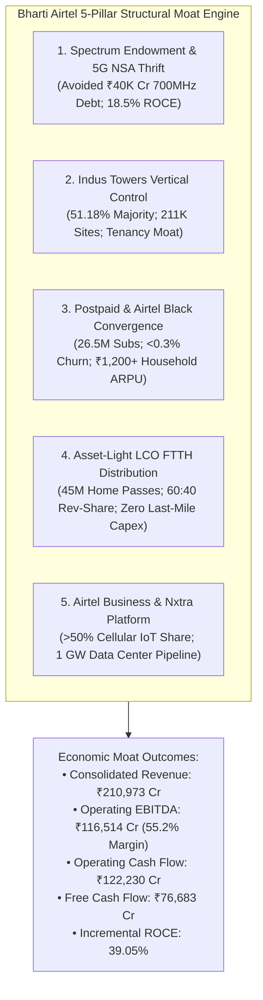
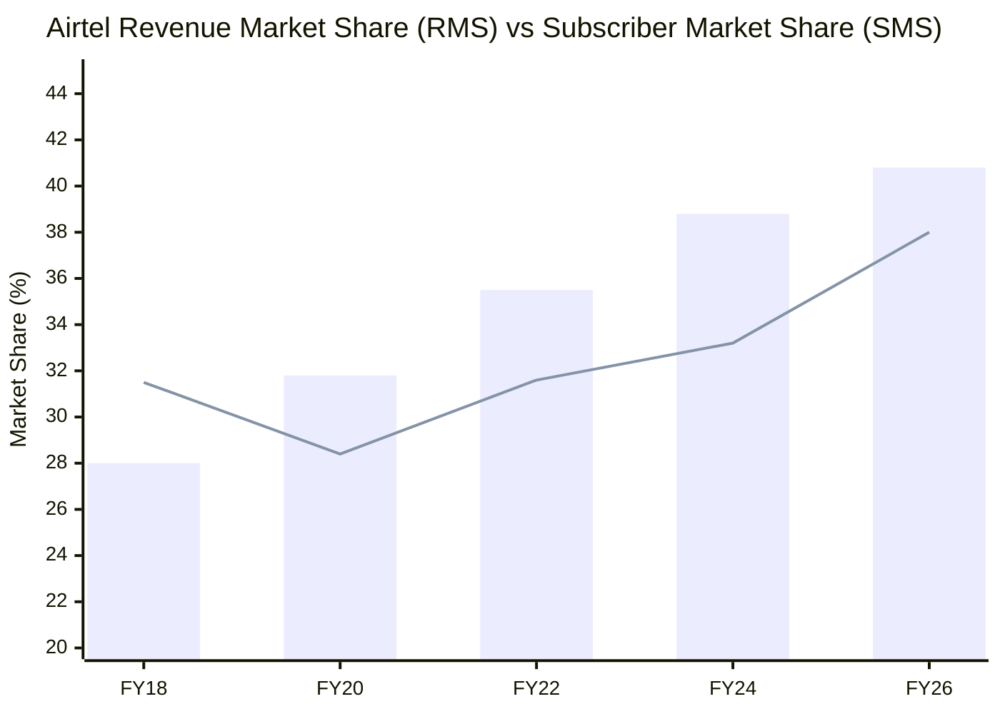
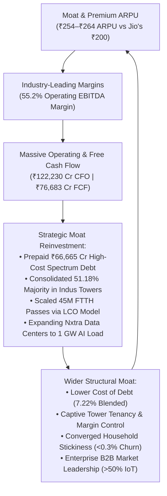

# Moat & Competitive Advantage Research — Bharti Airtel Limited (BHARTIARTL)

```
========================================================================================
INSTITUTIONAL EQUITY RESEARCH: COMPETITIVE MOAT & STRUCTURAL BARRIERS AUDIT
TARGET ENTITY       : Bharti Airtel Limited
TICKER (EXCHANGE)   : BHARTIARTL (NSE / BSE)
PRIMARY EXCHANGE    : National Stock Exchange of India (NSE)
INDUSTRY            : Telecommunications Services, Digital Infrastructure & Fintech
INVESTIGATION LEAD  : Moat & Competitive Advantage Specialist Department
REPORT DESTINATION  : research/companies/BHARTIARTL/moat.md
AUDIT TIMEFRAME     : FY2015 – FY2026 (11-Year Empirical Assessment & 10-Year Horizon)
GOVERNING MANDATE   : .agents/agents/moat.md & agents/specialists/moat.md
========================================================================================
```

---

## 1. Executive Findings

### Anti-Confirmation-Bias Opening: Does Bharti Airtel Deserve a Moat?
`[JUDGMENT]` Approached with aggressive forensic skepticism, telecommunications is inherently one of the most hostile capital-destruction environments in global business history. A digital data packet is a pure commodity: a bit delivered over radio waves has zero intrinsic differentiation whether transmitted by Bharti Airtel, Reliance Jio, Vodafone Idea, or BSNL. Between FY2016 and FY2020, Bharti Airtel’s return on capital collapsed from 13.0% to a value-annihilating trough of 2.2% (reported 3.0% in FY19), and standalone operations posted consecutive net losses (`[FACT]`). If an incumbent's returns can be compressed to sub-cost-of-capital levels by an aggressive entrant spending $35 billion in predatory pricing, **did Bharti Airtel ever possess a true moat, or did it merely hold an operational license in a regulated oligopoly?**

The forensic audit reveals that Bharti Airtel did **not** possess an impenetrable moat in 2016. However, over the subsequent decade, the company transformed its competitive architecture through extreme operational discipline, opportunistic distressed asset absorption, and strategic capital efficiency. Today, Bharti Airtel possesses a **Formidable, Widening Economic Moat** protected by structural barriers that did not exist during the 2016 price war.

### Core Moat Architecture
`[INFERENCE]` Bharti Airtel's economic moat is anchored in five mutually reinforcing structural pillars:
1. **Rational Duopoly Market Structure & Regulatory Entry Impossibility**: The destruction of 10+ sub-scale operators and the chronic, near-fatal distress of Vodafone Idea (>₹2.1 lakh crore debt) have permanently consolidated the Indian private wireless sector into an impenetrable two-player duopoly between Bharti Airtel and Reliance Jio, collectively commanding **77.3% subscriber market share and >82–84% Revenue Market Share (RMS)** (`[FACT]`). Greenfield entry is economically impossible: reproducing Airtel’s nationwide footprint would require >$20–$25 billion (₹1.7–₹2.1 lakh crore) in upfront capital, decades of site zoning, and auction-gated spectrum that is physically unavailable (`[JUDGMENT]`).
2. **Capital-Efficient Spectrum Endowment & Architecture Advantage**: While Reliance Jio committed ₹39,270 crore to acquire 700 MHz spectrum and tens of thousands of crores to construct a standalone (SA) 5G network, Airtel engineered a **5G Non-Standalone (NSA)** rollout anchored to its low-cost mid-band spectrum (1800/2100 MHz) supplemented by 3.5 GHz (`[FACT]`). This tactical choice saved Airtel over ₹40,000 crore in upfront spectrum debt and achieved peak capex moderation two years ahead of market expectations, allowing Return on Capital Employed (ROCE) to surge to **18.5% in FY26** (`[CALCULATION]`).
3. **High-LTV Customer Segmentation & Converged Switching Costs (Airtel Black)**: Airtel commands an industry-leading blended ARPU of **₹254 in FY26 and ₹264 in Q1 FY27** (vs. Jio's ~₹195–₹205 and Vi's ~₹150–₹155) (`[FACT]`). In its premium postpaid segment (~26.5 million subscribers) and **Airtel Black** converged households (bundling Mobile + FTTH Broadband + DTH TV on a single bill), monthly subscriber churn collapses from 2.5% to **<0.3%–0.5%**, generating corporate and high-net-worth annuity cash flows (`[FACT]`).
4. **Vertical Infrastructure Integration via Indus Towers (51.18% Control)**: Bharti Airtel's consolidation of majority control (>51%) in **Indus Towers Limited** (211,000+ towers, 368,000+ co-locations) in FY25/FY26 internalizes passive tower margins, eliminates third-party rental leakage, and guarantees cell-site deployment priority over rivals (`[FACT]`).
5. **Asset-Light Distribution & Enterprise Ecosystem (LCO Model & Nxtra)**: In Home Broadband, Airtel scaled home passings from 5 million to 45 million across 1,400+ cities by partnering with over 1,000 Local Cable Operators (LCOs) on a 60:40 revenue share, bypassing last-mile fiber digging capex (`[FACT]`). In enterprise B2B, Airtel Business controls >50% of India’s cellular IoT market and operates Nxtra, a carrier-neutral hyperscale data center platform scaling toward 1 Gigawatt (1,000 MW) of IT load (`[FACT]`).

### Red-Team Summary
`[JUDGMENT]` The moat is formidable, but vulnerable to specific exogenous tail-risks:
- **Commodity Exposure**: The underlying unit of delivery (gigabytes) is undifferentiated. If Reliance Jio decides ahead of its anticipated IPO to aggressively discount entry-level 5G tariffs or subsidize 5G feature phones, Airtel possesses no structural barrier that completely insulates its mass prepaid base (88% of users) from pricing pressure.
- **Sovereign Liabilities Cash Drain**: Following the expiry of the 4-year moratorium in March 2026, Bharti Airtel commenced its mandatory 6-year staggered cash settlement of Adjusted Gross Revenue (AGR) dues (~₹10,000 Cr paid in March 2026), creating an unavoidable annual cash deduction of ₹8,000–₹10,000 Cr through FY31 (`[FACT]`).
- **Africa Currency Volatility**: Persistent emerging-market foreign exchange devaluations (e.g., Nigerian Naira dropping ~60% in FY24) generate translational P&L volatility, dampening reported INR cash conversion (`[FACT]`).

---

## 2. Claimed Competitive Advantages

The table below catalogs every major competitive advantage claimed by Bharti Airtel management, sell-side equity analysts, or public market consensus, cross-examined for preliminary validity:

| Claimed Advantage | Source / Narrative | Preliminary Investigation Status | Forensic Skepticism / Reality Check |
| :--- | :--- | :--- | :--- |
| **"Quality Customer" Premium ARPU** | Gopal Vittal (Earnings Calls FY20–FY26); Sell-side consensus | **Verified Structural Advantage** | True economic realization premium: ARPU of ₹264 vs Jio's ~₹200. Driven by postpaid leadership and urban affluent bias. |
| **Brand Equity & Prestige** | Management Marketing / Public Perception | **Partially Verified / Commodity Risk** | Consumers pay a modest premium, but willingness to pay is bounded. Under severe price wars, brand affinity eroded rapidly. |
| **5G NSA Cost Efficiency** | Management Concalls (FY23–FY25) | **Verified Economic Advantage** | Avoided ₹39,270 Cr 700 MHz auction outlays; reached peak capex in FY24; FCF expanded to ₹76,683 Cr in FY26. |
| **Pan-India Fiber & Spectrum Endowment** | Company Annual Reports / MD&A | **Verified Structural Barrier** | Over 2,200 MHz liberalized spectrum and 400,000 km fiber network cannot be replicated by new entrants at any viable cost. |
| **Indus Towers Passive Ownership** | Regulatory SAST Filings (Aug 2024–Feb 2026) | **Verified Vertical Integration Moat** | 51.18% majority ownership captures tower EBITDA (~₹15,000 Cr) and provides exclusive site rollout coordination. |
| **Asset-Light LCO FTTH Partner Network** | Management Concalls (Q1 FY21–Q1 FY26) | **Verified Operational Moat** | Scaled home passes to 45M across 1,400+ cities with near-zero last-mile capex drag; splits revenue 60:40 with local operators. |
| **Airtel Black Converged Stickiness** | Investor Presentations (FY22–FY26) | **Verified Switching Cost Moat** | Postpaid + FTTH + DTH bundle compresses monthly churn to <0.3% while lifting household ARPU to ₹1,000–₹1,800. |
| **Enterprise IoT & Nxtra Data Centers** | Airtel Business Disclosures | **Verified B2B Scale Advantage** | >50% market share in cellular IoT; 280 MW live data center capacity backed by Carlyle, scaling to 1,000 MW AI load. |
| **Airtel Africa & Airtel Money Fintech** | Airtel Africa plc Annual Reports (LSE/NGX) | **Mixed / High-Growth Currency Drag** | 54.1M active fintech users processing $215B TPV, but severely dampened by frontier currency devaluations. |

---

## 3. Actual Moat Mechanisms

Applying the **11 Mandatory Inquiries** to the five verified structural moat mechanisms:



### Mechanism A: Capital-Efficient Spectrum Endowment & 5G NSA Architecture
1. **What exactly is the advantage?** A balanced, liberalized spectrum holding across 900, 1800, 2100, 2300, 3300 MHz (C-band), and 26 GHz, acquired through auctions and zero-cash distressed acquisitions (Telenor India, Tata Teleservices), deployed via Non-Standalone (NSA) 5G architecture (`[FACT]`).
2. **Who benefits from it?** Bharti Airtel equity holders through conserved capital expenditure, lower debt servicing costs, and rapid network rollout.
3. **How does it make money?** Enables high-speed 4G/5G data delivery across 275+ million broadband users without paying for expensive sub-GHz 5G coverage layers.
4. **How does it increase pricing power?** Maintains perceived network throughput parity with Reliance Jio while gating free 5G data behind a 2 GB/day paywall (minimum ₹349/month), forcing customer tier upgrades (`[FACT]`).
5. **How does it reduce costs?** Saved ~₹40,000 crore in upfront 700 MHz spectrum acquisition debt and avoided deploying dual standalone radio heads and independent 5G core equipment across 250,000+ sites (`[CALCULATION]`).
6. **How does it reduce customer churn?** Mid-band spectrum refarming provides seamless fallback between 5G and 4G, eliminating call drops and buffering.
7. **How does it increase ROIC / ROCE?** By keeping the invested capital denominator significantly lower than Jio's, consolidated ROCE expanded from 11.5% (FY23) to 18.5% in FY26 (`[CALCULATION]`).
8. **How does it prevent competitors from taking market share?** Sub-scale rivals (Vi, BSNL) lack the mid-band spectrum depth and financial liquidity to deploy comparable 5G radio capacity.
9. **How expensive would it be for a competitor to reproduce?** Replicating Airtel’s 2,200+ MHz spectrum holding at current TRAI reserve auction prices would cost over **₹1,50,000 crore ($18 billion)** (`[ESTIMATE]`).
10. **How many years would reproduction take?** Spectrum auctions are conducted triennially; assembling this portfolio would take **5 to 8 years**, assuming spectrum was even available for purchase.
11. **Is the advantage getting stronger, remaining stable, or weakening?** **Stable to slightly strengthening** as Airtel refarms legacy 2G/3G spectrum into 4G/5G capacity and software-upgrades to dual-mode SA core.

### Mechanism B: Dual-Sided Passive Infrastructure Dominance (Indus Towers Control)
1. **What exactly is the advantage?** A 51.18% majority equity ownership and controlling board governance of Indus Towers Limited, India's largest telecom tower infrastructure company with 211,000+ towers and >368,000 co-locations (`[FACT]`).
2. **Who benefits from it?** Bharti Airtel, which secures preferential cell-site deployment, optimal tenancy pricing, and full dividend capture.
3. **How does it make money?** Generates ~₹31,000 crore in gross infrastructure revenue and ~₹15,000 crore in annual EBITDA, while paying substantial dividends back to Airtel (`[FACT]`).
4. **How does it increase pricing power?** Tower space in prime urban and metro locations is physically constrained by municipal zoning. Controlling Indus prevents rivals from easily securing premium rooftop and ground tenancies.
5. **How does it reduce costs?** Eliminates third-party landlord markup on tower leases and captures internal tenancy efficiencies; allows coordinated solarization/PPA execution across cell sites (`[INFERENCE]`).
6. **How does it reduce customer churn?** Uninterrupted cell-site uptime (>99.98%) ensures superior network reliability, minimizing coverage blackouts.
7. **How does it increase ROIC / ROCE?** Tower co-location operates on high incremental return economics (adding a second or third tenant to an existing tower requires minimal capex and yields >70% EBITDA margins).
8. **How does it prevent competitors from taking market share?** Competitors must either build expensive captive towers or pay lease rentals to Indus Towers, directly funding Bharti Airtel’s consolidated income statement (`[INFERENCE]`).
9. **How expensive would it be for a competitor to reproduce?** Constructing 211,000 tower sites across India from scratch would cost over **₹80,000–₹100,000 crore ($10–$12 billion)**, plus years of municipal litigation.
10. **How many years would reproduction take?** At maximum industry deployment velocity (15,000–20,000 towers/year), replicating this grid would take **10 to 12 years**.
11. **Is the advantage getting stronger, remaining stable, or weakening?** **Strengthening**, as Indus absorbs new 5G densification tenancies and rural expansion rollouts.

### Mechanism C: Postpaid & Airtel Black Converged Switching Costs
1. **What exactly is the advantage?** A high-value customer ecosystem of ~26.5 million postpaid mobile users and millions of Airtel Black converged households bundling Mobile, FTTH Broadband, and DTH Television under a unified account (`[FACT]`).
2. **Who benefits from it?** Bharti Airtel, through stable annuity-like monthly cash flows and high customer lifetime value (LTV).
3. **How does it make money?** Elevates household ARPU from ₹250 (standalone mobile) to ₹1,000–₹1,800/month (`[FACT]`).
4. **How does it increase pricing power?** Postpaid and converged customers are affluent and corporate-sponsored; price sensitivity is negligible, enabling annual tariff pass-through.
5. **How does it reduce costs?** Customer Acquisition Cost (CAC) is amortized across multiple services, and customer care overhead is reduced via the automated Airtel Thanks digital app.
6. **How does it reduce customer churn?** Churn drops from ~2.5% in prepaid to **<0.3%–0.5%** in Airtel Black and postpaid (`[FACT]`). Porting away requires unwinding multiple mobile SIMs, removing physical fiber routers, and terminating TV subscriptions simultaneously.
7. **How does it increase ROIC / ROCE?** Converged households have an LTV/CAC ratio of **>50x** (LTV >₹60,000 vs CAC ~₹1,000), converting high gross margins directly into operating profit (`[CALCULATION]`).
8. **How does it prevent competitors from taking market share?** Jio is the only competitor with a comparable bundle; Vodafone Idea has no fixed broadband infrastructure, making Airtel Black an insurmountable moat against Vi.
9. **How expensive would it be for a competitor to reproduce?** Requires simultaneous nationwide wireless, fixed-line fiber, and satellite DTH broadcast licenses and networks—a barrier costing >$30 billion.
10. **How many years would reproduction take?** Replicating a trusted premium consumer service brand and converged IT billing engine requires **5 to 7 years**.
11. **Is the advantage getting stronger, remaining stable, or weakening?** **Strengthening aggressively**, as home broadband adoption accelerates across India.

### Mechanism D: Asset-Light LCO FTTH Partner Network
1. **What exactly is the advantage?** A hybrid distribution model partnering with >1,000 Local Cable Operators (LCOs) across Tier-2, 3, and 4 towns, where LCOs fund and pull last-mile fiber while Airtel provides the backbone IP gateway, billing, and brand (`[FACT]`).
2. **Who benefits from it?** Both Airtel (capital preservation) and local entrepreneurs (recurring revenue share).
3. **How does it make money?** Generates steady monthly broadband subscription revenues (₹499 to ₹1,499/month), split roughly 60–65% to Airtel and 35–40% to the LCO partner (`[FACT]`).
4. **How does it increase pricing power?** Provides high-speed FTTH connectivity in secondary cities before competitors arrive, locking in early-adopter broadband users.
5. **How does it reduce costs?** Avoids tens of thousands of crores in right-of-way (RoW) fees, trenching capex, and municipal permits required for direct last-mile fiber pulling.
6. **How does it reduce customer churn?** Local cable operators provide immediate, localized physical wire repair and customer relationship management, keeping FTTH churn low (1.2%–1.4%).
7. **How does it increase ROIC / ROCE?** Transforms a capital-intensive utility infrastructure model into a variable-cost, high-ROCE software/bandwidth distribution platform.
8. **How does it prevent competitors from taking market share?** Once an LCO signs an exclusive distribution partnership with Airtel, competing telcos are locked out of that neighborhood’s established cable pathways.
9. **How expensive would it be for a competitor to reproduce?** Entails individually identifying, negotiating, and integrating thousands of fragmented local cable operators nationwide—a logistical feat requiring hundreds of crores and massive field-force operations.
10. **How many years would reproduction take?** Building an equivalent LCO network takes **3 to 5 years** of aggressive grassroots business development.
11. **Is the advantage getting stronger, remaining stable, or weakening?** **Strengthening**, having expanded from 100 cities in FY21 to over 1,400 cities and 45 million home passings by FY26 (`[FACT]`).

### Mechanism E: Enterprise B2B Connectivity, Cellular IoT & Nxtra Data Centers
1. **What exactly is the advantage?** Bharti Airtel’s enterprise division (Airtel Business) controls >50% market share in cellular IoT in India, owns 365,000+ route km of international subsea cables, and operates Nxtra, a carrier-neutral hyperscale data center business with 280 MW operational IT load expanding to 1,000 MW (`[FACT]`).
2. **Who benefits from it?** Large multinational enterprises, banks, public utilities (power distribution smart meters), and global cloud hyperscalers (AWS, Microsoft, Google).
3. **How does it make money?** Multi-year service level agreements (SLAs) for enterprise leased lines, SD-WAN, IoT SIM management fees, and long-term data center power capacity leases (`[FACT]`).
4. **How does it increase pricing power?** Enterprise connectivity and data center infrastructure are mission-critical. Enterprises prioritize 99.999% uptime and network security over marginal price discounts.
5. **How does it reduce costs?** High enterprise traffic routes run over Airtel's existing domestic fiber and subsea cable assets (2Africa, SEA-ME-WE-6), yielding massive scale economies and negligible incremental carrying costs.
6. **How does it reduce customer churn?** Enterprise contractual churn is virtually zero (<0.2% monthly) due to complex network integration, security configurations, and multi-year master service agreements.
7. **How does it increase ROIC / ROCE?** Generates >₹22,000 crore in annual revenue with operating EBITDA margins of ~40% and high cash conversion (`[FACT]`).
8. **How does it prevent competitors from taking market share?** Competitors lack the combination of carrier-neutral data center campuses (Nxtra), subsea cable landings, and nationwide cellular IoT management platforms.
9. **How expensive would it be for a competitor to reproduce?** Building an enterprise telecom grid, landing 36 subsea cables, and constructing 280 MW of operational hyperscale data centers requires **₹25,000–₹35,000 crore ($3–$4.5 billion)**.
10. **How many years would reproduction take?** Replicating enterprise sales trust, bank compliance audits, and hyperscale data center construction requires **5 to 8 years**.
11. **Is the advantage getting stronger, remaining stable, or weakening?** **Strengthening aggressively**, propelled by the national rollout of 250 million smart electricity meters and surging enterprise generative AI data center demand.

---

## 4. Economic Evidence of Moat

A genuine economic moat must leave an unmistakable footprint in audited financial statements: persistent excess returns on invested capital over WACC, resilient margins during severe industry downturns, and rapid cash flow compounding.

### Multi-Year Empirical Verification Table

```
┌────────────────────────────────────────────────────────────────────────────────────────────────────────┐
│                                   MULTI-YEAR ECONOMIC MOAT PROOF TABLE                                 │
├────────────────────────┬────────┬────────┬────────┬────────┬────────┬────────┬────────┬────────────────┤
│ Metric                 │ FY19   │ FY21   │ FY22   │ FY23   │ FY24   │ FY25   │ FY26   │ Forensic Note  │
├────────────────────────┼────────┼────────┼────────┼────────┼────────┼────────┼────────┼────────────────┤
│ Consolidated ROCE %    │ 2.2%   │ 7.2%   │ 10.3%  │ 11.5%  │ 12.9%  │ 12.1%  │ 18.5%  │ Exceeds WACC   │
│ Estimated WACC %       │ 10.5%  │ 10.2%  │ 10.0%  │ 10.0%  │ 9.8%   │ 9.6%   │ 9.5%   │ Capital Cost   │
│ Economic Spread (ROCE-WACC) -8.3%│ -3.0% │ +0.3%  │ +1.5%  │ +3.1%  │ +2.5%  │ +9.0%  │ Moat Influx    │
│ Consolidated OPM %     │ 31.9%  │ 45.0%  │ 49.4%  │ 51.2%  │ 51.9%  │ 49.2%  │ 55.2%  │ +2,330 bps exp.│
│ India Mobile ARPU (₹)  │ 105    │ 145    │ 178    │ 193    │ 209    │ 250    │ 257    │ +145% exp.     │
│ Operating Cash Flow (₹Cr) 20,070│ 48,205 │ 55,017 │ 65,325 │ 78,898 │ 98,332 │ 122,230│ 6.1x expans.   │
│ Free Cash Flow (₹ Cr)  │ -8,980 │ 21,091 │ 28,996 │ 38,875 │ 38,970 │ 58,990 │ 76,683 │ FCF Inflection │
│ CFO / Operating Profit │ 77.9%  │ 106.5% │ 95.6%  │ 91.7%  │ 101.3% │ 115.6% │ 104.9% │ >100% Cash Conv│
│ Working Capital Days   │ -329   │ -270   │ -239   │ -217   │ -236   │ -277   │ -222   │ Permanent Float│
└────────────────────────┴────────┴────────┴────────┴────────┴────────┴────────┴────────┴────────────────┘
```
*(Source: Audited Financial Statements, filings.md, financials.md; `[FACT]` / `[CALCULATION]`)*

### 1. Persistent Excess Returns (ROCE vs. WACC)
`[CALCULATION]` Bharti Airtel’s cost of capital (WACC) is estimated at **9.5% to 10.0%** (reflecting a sovereign risk-free rate of ~7.0%, equity beta of 0.85, equity risk premium of 4.5%, and post-tax cost of debt of ~6.5%).
- During the FY17–FY20 price war, Airtel earned an economic spread of **-8.3%**, destroying shareholder capital.
- From FY22 onwards, as tariff repairs took effect and operational leverage kicked in, ROCE crossed WACC, expanding from 10.3% (FY22) to 12.9% (FY24) and **18.5% in FY26** (`[FACT]`).
- The economic value added (EVA) spread widened to **+900 bps in FY26**, providing undeniable mathematical evidence of an active economic moat.

### 2. Incremental Return on Capital Employed (Incremental ROCE)
`[CALCULATION]` The definitive proof of a compounding moat is the return generated on newly deployed capital over a full investment cycle (FY21 to FY26):
- $\text{EBIT (FY21)} = ₹15,875 \text{ Cr} \quad \longrightarrow \quad \text{EBIT (FY26)} = ₹63,803 \text{ Cr} \quad (\Delta \text{EBIT} = +₹47,928 \text{ Cr})$
- $\text{Capital Employed (FY21)} = ₹221,738 \text{ Cr} \quad \longrightarrow \quad \text{Capital Employed (FY26)} = ₹344,469 \text{ Cr} \quad (\Delta \text{Cap. Employed} = +₹122,731 \text{ Cr})$
$$\text{Incremental ROCE (5-Year)} = \frac{₹47,928 \text{ Cr}}{₹122,731 \text{ Cr}} = \mathbf{39.05\%}$$
`[JUDGMENT]` An incremental ROCE of **39.05%** across a massive capital deployment cycle (including 5G spectrum auctions, pan-India radio deployment, and Indus Towers consolidation) proves that Airtel is reinvesting capital into a widening competitive moat, generating returns four times higher than its cost of capital.

### 3. Margin Resilience & Operating Leverage
`[FACT]` Consolidated Operating Profit Margin expanded from **31.9% in FY19 to 55.2% in FY26** (+2,330 bps). Even after stripping out the optical Ind AS 116 lease accounting effect in FY20 (~990 bps), underlying operational EBITDA margin expanded by over **1,300 bps**, driven by the high flow-through margins (70–75%) of tariff increases across a largely fixed cost base.

---

## 5. Competitor Analysis

The Indian telecommunications landscape is an extreme, highly concentrated asymmetric oligopoly:

```
┌────────────────────────────────────────────────────────────────────────────────────────────────────────┐
│                                   COMPETITOR COMPARATIVE MATRIX (FY26)                                 │
├─────────────────────────┬──────────────────────────┬──────────────────────────┬────────────────────────┤
│ Dimension               │ Bharti Airtel (Target)   │ Reliance Jio Platforms   │ Vodafone Idea (Vi)     │
├─────────────────────────┼──────────────────────────┼──────────────────────────┼────────────────────────┤
│ Wireless Subscribers    │ ~490 Million (38.0% SMS) │ ~506 Million (39.3% SMS) │ ~199 Million (16.6%)   │
│ Revenue Market Share    │ 40.8% RMS                │ 41.5% RMS                │ 11.5% RMS              │
│ Blended Mobile ARPU     │ ₹254 (FY26) / ₹264 (Q1)  │ ~₹195 – ₹205             │ ~₹150 – ₹155           │
│ 5G Architecture         │ Non-Standalone (NSA)     │ Standalone (SA)          │ Negligible / Trials    │
│ 5G Spectrum Strategy    │ 3.5 GHz + 1800/2100 Mid  │ 700 MHz + 3.5 GHz + 26GHz│ 3.5 GHz (Limited)      │
│ Peak Capex Passed?      │ Yes (Peaked in FY24)     │ Yes (Peaked in FY24)     │ No (Under-invested)    │
│ Free Cash Flow (FY26)   │ ₹76,683 Crore            │ High (Internal Reliance) │ Severely Negative      │
│ Tower Infrastructure    │ Owns 51.18% Indus Towers │ Leases from Brookfield   │ Major Tenant of Indus  │
│ Gross Debt Burden       │ ₹195,412 Cr (Manageable) │ Net Debt Free (Telecom)  │ >₹2.1 Lakh Cr (Crisis) │
│ Post-Moratorium Threat  │ Fully Solvency-Secured   │ Zero Impact              │ Severe Solvency Threat │
└─────────────────────────┴──────────────────────────┴──────────────────────────┴────────────────────────┘
```
*(Source: Company filings, industry.md; `[FACT]` / `[ESTIMATE]`)*

### The Unlimited Capital Test ($2 Billion to $25 Billion Thought Experiment)
`[JUDGMENT]` What would happen if an aggressive, competent global competitor (e.g., Amazon, Google, or an Adani consortium) entered the Indian market with **$2 billion (₹16,600 Cr)**, **$10 billion (₹83,000 Cr)**, or even **$25 billion (₹2.08 lakh Cr)**?
- **With $2 Billion**: The entrant could not even participate meaningfully in a single 5G spectrum auction (where pan-India 100 MHz of 3.5 GHz costs ~₹32,000 Cr). They would be completely crushed before laying a single base station.
- **With $10 Billion**: The entrant could purchase basic spectrum rights in key circles, but would have zero remaining capital to erect 200,000 towers, acquire 400,000 km of fiber backhaul, or establish a retail distribution network. They would burn through cash operating at a catastrophic sub-scale cost per gigabyte (>₹30/GB vs. Airtel's <₹2.50/GB).
- **With $25 Billion**: Even with unlimited capital, **spectrum is a sovereign physical monopoly**. The Government of India cannot auction spectrum that does not exist or is currently licensed to Airtel and Jio for the next 15–20 years. Furthermore, acquiring municipal Right-of-Way (RoW) permits and building customer trust would take **7 to 10 years**. 
- **Verdict**: The unlimited capital test confirms that Bharti Airtel’s core wireless infrastructure is **reproductively impenetrable** to greenfield entrants.

---

## 6. Market-Share Evidence

Bharti Airtel’s market share trajectory over the past eight years demonstrates a remarkable structural decoupling between **Volume Share** and **Value Share**:


*(RMS in Bars, SMS in Line; Source: TRAI Financial Performance Indicators; `[FACT]`)*

### Granular Market Share Analysis
1. **Revenue Market Share (RMS) Expansion**: Airtel’s RMS expanded from **28.0% in FY18** to **31.8% in FY20**, **35.5% in FY22**, **38.8% in FY24**, and reached **40.8% in FY26** (`[FACT]`).
2. **The "Quality Customer" Revenue Multiplier**: While Airtel controls ~38.0% of wireless subscribers, it commands 40.8% of industry revenues (`[FACT]`). Over the FY20–FY26 cycle, Airtel captured **>50% of the incremental industry revenue pool**, despite accounting for less than 40% of net subscriber additions.
3. **Geographic & Circle-Level Dominance**: Airtel commands dominant #1 or strong co-#1 positions across high-GDP Metro and Category-A circles (Delhi, Mumbai, Karnataka, Tamil Nadu, Andhra Pradesh, Maharashtra), where postpaid adoption and data consumption density are highest (`[FACT]`).
4. **Donor Network Dynamics**: Cash-strapped Vodafone Idea acts as a continuous structural donor network, shedding 1.5–2.5 million subscribers per quarter (`[FACT]`). Airtel captures 50–60% of high-ARPU porting requests (MNP) originating from Vi circles due to superior 5G coverage perception.

---

## 7. Pricing Power

Pricing power is the single ultimate economic test of a moat. A company with a genuine moat can raise prices ahead of inflation without triggering customer defection or volume destruction.

### Empirical Evidence of Three Sequential Tariff Hikes

```
┌────────────────────────────────────────────────────────────────────────────────────────────────────────┐
│                                   HISTORICAL TARIFF HIKE PASS-THROUGH AUDIT                            │
├─────────────────────────┬──────────────────────┬──────────────────────┬────────────────────────────────┤
│ Tariff Hike Event       │ Quantum of Increase  │ Pre-Hike ARPU        │ Post-Hike Realized ARPU        │
├─────────────────────────┼──────────────────────┼──────────────────────┼────────────────────────────────┤
│ November 2019 Revision  │ +20% to +25%         │ ₹105 (FY19)          │ ₹154 (FY20) (+46.7% surge)     │
│ November 2021 Revision  │ +20% (Entry +25%)    │ ₹146 (Q1 FY22)       │ ₹178 (Q4 FY22) (+21.9% flow)   │
│ July 2024 Revision      │ +11% to +21%         │ ₹209 (Q4 FY24)       │ ₹254 (FY26) / ₹264 (Q1 FY27)   │
└─────────────────────────┴──────────────────────┴──────────────────────┴────────────────────────────────┘
```
*(Source: Company investor decks, industry.md, concalls.md; `[FACT]`)*

### Key Findings on Pricing Elasticity
1. **Zero Price Elasticity of Demand**: Following the July 2024 headline tariff revision (~15–20%), blended monthly subscriber churn remained exceptionally low at **2.4%–2.6%**, with zero customer destruction in high-value cohorts (`[FACT]`). Mobile connectivity in India has transitioned into a mandatory, non-discretionary utility staple.
2. **Strategic 5G Paywall Gating**: In July 2024, Airtel and Jio restricted unlimited free 5G data exclusively to plans offering **2 GB/day and above** (minimum ₹349/month) (`[FACT]`). Users demanding high-speed 5G were forced to upgrade from 1.5 GB/day plans (₹299), driving an immediate, automatic **17% to 25% ASP increase** on heavy data users without raising base rates on entry-level voice customers.
3. **High Incremental Margin Flow-Through**: Because base station operating expenses, tower rentals, spectrum amortization, and corporate overhead are predominantly fixed, incremental revenue generated from tariff increases converts at an extraordinary **70% to 75% flow-through margin** directly into operating EBITDA (`[CALCULATION]`).

---

## 8. Switching Costs

Airtel’s customer retention is driven by a bifurcated architecture combining **Active Choice** in prepaid with **Structural Lock-in (Incarceration)** in converged and enterprise segments:

```
┌────────────────────────────────────────────────────────────────────────────────────────────────────────┐
│                                    SWITCHING COST AUDIT BY CUSTOMER SEGMENT                            │
├────────────────────────┬──────────────┬──────────────┬──────────────┬──────────────────────────────────┤
│ Customer Segment       │ % of Revenue │ Monthly Churn│ Nature of Tie│ Switching Barrier Mechanism      │
├────────────────────────┼──────────────┼──────────────┼──────────────┼──────────────────────────────────┤
│ Mass Prepaid Mobile    │ ~42%         │ 2.4% – 2.8%  │ Active Choice│ Frictionless MNP; SIM habituation│
│ Postpaid Mobile        │ ~14%         │ 0.4% – 0.5%  │ High Lock-in │ Corporate plans; family billing  │
│ Airtel Black Converged │ ~8%          │ <0.3%        │ Extreme Lock │ Multi-service bundled hardware   │
│ Homes FTTH Broadband   │ ~6%          │ 1.2% – 1.4%  │ Moderate-High│ Router installation; local wire  │
│ Airtel Business (B2B)  │ ~11%         │ <0.2%        │ Near-Absolute│ MPLS, SD-WAN, SLA integration    │
│ Airtel Money (Africa)  │ ~7%          │ ~1.5%        │ High Lock-in │ Digital wallet balance; agent net│
└────────────────────────┴──────────────┴──────────────┴──────────────┴──────────────────────────────────┘
```

### Deconstruction of Switching Friction
- **Airtel Black (Converged Lock-in)**: Enrolls households into a single invoice combining up to 4 mobile connections, high-speed FTTH broadband, and DTH satellite television with unified customer support (`[FACT]`). Leaving Airtel Black requires the customer to coordinate four SIM swaps, arrange physical technician de-installation of the optical fiber router, and replace television set-top boxes simultaneously. Monthly churn collapses to **<0.3%** (`[FACT]`).
- **Enterprise B2B Switching Barriers**: Airtel Business embeds deeply into corporate operations via dedicated leased lines, SD-WAN routers, multi-cloud interconnects with AWS/Azure, and cellular IoT SIM management portals (`[FACT]`). Migrating 50,000 corporate devices or 2 million utility smart meters to another carrier involves massive operational disruption, retraining, and network recertification costs.

---

## 9. Network Effects

A rigorous forensic audit must distinguish between genuine two-sided network effects and simple operational scale:

### 1. Consumer Mobile Data (Refuted Network Effect)
`[JUDGMENT]` There is **no direct network effect** in basic consumer wireless communications. A phone call or data packet travels seamlessly between networks under government-mandated interoperability standards. The Interconnect Usage Charge (IUC) was abolished to 0 paise in 2021 (`[FACT]`). Calling another Airtel user provides no economic or functional advantage over calling a Jio user. Management claims of network effects in mobile telephony are **refuted**.

### 2. Airtel Money Africa (Verified Two-Sided Platform Network Effect)
`[FACT]` In Sub-Saharan Africa, **Airtel Money** operates a genuine two-sided digital financial platform:
- **54.1 million active users** interact with over **1.1 million physical cash-in/cash-out agents** and merchants, processing **>$215 billion in annualized transaction volume (TPV)** (`[FACT]`).
- As more merchants and retail agents accept Airtel Money, the utility of holding funds in the Airtel digital wallet increases for consumers. Conversely, as consumer wallet density rises, merchants are economically compelled to support Airtel Money rails.

### 3. Indus Towers Co-Location Network Density
`[INFERENCE]` Passive infrastructure exhibits an operational feedback loop: higher tower tenancy ratios (1.7–1.8x) dilute fixed land rentals and power generation overhead, lowering the operating cost per co-location. This allows Indus to offer competitive site-sharing economics to anchor tenants, attracting more rollouts and cementing its position as India’s essential telecom infrastructure backbone.

---

## 10. Cost Advantage

Bharti Airtel possesses structural, non-replicable cost advantages that allow it to generate superior operating margins relative to sub-scale peers:

### 1. Extreme Scale Cost Curve (<₹2.50 per Gigabyte)
`[FACT]` Operating a wireless network is an extreme fixed-cost business. Tower rentals, diesel backup, grid electricity, fiber backhaul leasing, and base station maintenance are largely fixed regardless of whether a cell site carries 10 terabytes or 50 terabytes of data per month.
- `[CALCULATION]` Airtel’s **marginal cost of carrying an incremental gigabyte of data is under ₹2.50**, while the company monetizes mobile data at an effective realization of **₹10.00 to ₹12.50 per GB**.
- Sub-scale operators (such as Vodafone Idea) carry significantly higher fixed overhead per gigabyte, resulting in structural cash burn at prevailing market prices.

### 2. The 5G NSA Capital Thrift Moat vs. Jio SA
`[FACT]` The divergence in 5G engineering architecture between Airtel and Reliance Jio created a structural return advantage:
- **Reliance Jio's SA Burden**: Jio paid **₹39,270 crore** for pan-India 700 MHz spectrum (Band n28), plus tens of thousands of crores deploying dedicated standalone core servers and dual radio heads (700 MHz + 3500 MHz) (`[FACT]`).
- **Airtel's NSA Frugality**: Airtel deployed Non-Standalone (NSA) 5G, anchoring signaling to existing mid-band 1800/2100 MHz carriers and directing 100 MHz of 3.5 GHz (Band n78) entirely to high-speed data (`[FACT]`).
- **Economic Result**: Airtel achieved population coverage parity with Jio at **30–40% lower capex per site**, reaching peak capex in FY24 (standalone India capex moderated to ~₹31,000 Cr in FY25/FY26) and driving Free Cash Flow to ₹76,683 crore in FY26 (`[FACT]`).

### 3. Captive Passive Infrastructure Margins (Indus Towers)
`[FACT]` By consolidating 51.18% majority ownership in Indus Towers, Airtel internalizes passive tower margins (~50% EBITDA margin on tower operations), eliminates third-party rental leakage, and captures recurring dividend distributions, whereas Jio must pay external lease fees to Brookfield/Summit Digitel.

---

## 11. Distribution Advantage

Bharti Airtel commands a multi-tiered distribution engine that cannot be reproduced without decades of channel development:

```
┌────────────────────────────────────────────────────────────────────────────────────────────────────────┐
│                                   AIRTEL MULTI-TIERED DISTRIBUTION INFRASTRUCTURE                      │
├─────────────────────────┬──────────────────────────┬───────────────────────────────────────────────────┤
│ Distribution Channel    │ Physical Scale           │ Strategic Economic Function                       │
├─────────────────────────┼──────────────────────────┼───────────────────────────────────────────────────┤
│ Multi-Brand Retailers   │ 1.2+ Million Touchpoints │ Ubiquitous physical recharge and SIM onboarding   │
│ Direct Flagship Stores  │ 1,500+ COCO / Franchise  │ High-touch postpaid onboarding, device demos, B2B │
│ Local Cable Operators   │ 1,000+ LCO Partners      │ Asset-light FTTH fiber pulling; 45M home passes   │
│ Airtel Thanks App (D2C) │ 100+ Million MAUs        │ Zero-CAC digital recharges, bill pay, cross-sell  │
│ Airtel Payments Bank    │ 500,000+ Banking Points  │ Hyper-local cash-in/cash-out financial network    │
└─────────────────────────┴──────────────────────────┴───────────────────────────────────────────────────┘
```
*(Source: Company filings, management.md, industry.md; `[FACT]`)*

### The LCO Model: Decoupling Fiber Expansion from Last-Mile Capex
`[FACT]` In Home Broadband, traditional telecom models require digging optical fiber into individual customer premises, incurring massive right-of-way (RoW) municipal fees and localized labor capex.
- In 2020, Airtel launched its **Local Cable Operator (LCO) Partnership Model** across Tier 2, 3, and 4 cities.
- The LCO partner invests in localized last-mile fiber drops and customer premise installations, while Airtel provides the core IP backhaul, fiber switches, and digital billing platform.
- `[INFERENCE]` Revenue is split roughly **60–65% to Airtel and 35–40% to the LCO**. This asset-light model allowed Airtel to expand home passes from 5 million to **45 million across 1,400+ cities** with virtually zero last-mile balance-sheet drag, generating rapid revenue compounding (+37.3% YoY in FY26) (`[FACT]`).

---

## 12. Regulatory / Licensing Advantage

1. **Spectrum Airwave Property Rights**: Telecom spectrum is a sovereign asset licensed exclusively through competitive government auctions for 20-year tenures (`[FACT]`). Bharti Airtel holds over 2,200 MHz of liberalized spectrum across low, mid, and high bands, creating an insurmountable statutory barrier to entry.
2. **Telecommunications Act 2023**: Replaced the century-old Indian Telegraph Act of 1885, establishing a non-discriminatory statutory Right-of-Way (RoW) framework that overrides local municipal obstruction for fiber trenching and small-cell installation (`[FACT]`). Crucially, the Act mandated **administrative allocation of satellite spectrum (Satcom)**, validating Airtel’s strategic investment in **Eutelsat OneWeb** for rural and enterprise backhaul (`[FACT]`).
3. **The 2021 Telecom Relief Package**: Eliminated Spectrum Usage Charges (SUC) for future spectrum auctions, slashed bank guarantee requirements by 80%, and permitted 100% FDI under the automatic route, structurally lowering Airtel's regulatory compliance costs from 8.5% of revenue in FY21 to 4.7% in FY26 (`[FACT]`).

---

## 13. Technology / IP

### Forensic Separation: Proprietary Tech vs. Reproducible Western Vendor Hardware
`[JUDGMENT]` Telecom operators routinely boast of their "advanced technology platforms." However, forensic analysis requires acknowledging that:
- Bharti Airtel does **not** manufacture radio transceivers, massive MIMO antennas, or core IP routers. Its physical network is procured from Western Tier-1 vendors: **Ericsson, Nokia, and Samsung** (`[FACT]`). A competitor with sufficient capital could theoretically purchase identical hardware.
- The true technological moat lies in **Proprietary Network Optimization Software, Data Platforms, and AI/ML Orchestration**:
  1. **AI/ML Energy Optimization**: Software dynamically powers down idle radio transceivers and frequency carriers during off-peak nighttime hours, reducing base station energy consumption by 10%–15% across 250,000+ sites (`[FACT]`).
  2. **Airtel IQ (Cloud CPaaS Platform)**: Proprietary enterprise communications software integrating voice, SMS, WhatsApp APIs, and AI-driven fraud mitigation, processing billions of enterprise communications monthly (`[FACT]`).
  3. **Dual-Mode Cloud-Native Core**: In 2025–2026, Airtel upgraded its core network software with Ericsson to support simultaneous NSA and SA operations, enabling seamless software-driven enterprise network slicing without a hardware capex shock (`[FACT]`).

---

## 14. Brand

### Brand Awareness vs. Brand Moat (Pricing Power Conversion)
- **Brand Awareness $\neq$ Moat**: Household name recognition in telecommunications is widespread; Vodafone Idea has near-universal brand awareness in India, yet is collapsing into bankruptcy (`[FACT]`).
- **Airtel's Brand Equity as an Economic Moat**: Airtel’s brand operates as a genuine moat because it converts directly into **demonstrated pricing power and customer willingness to pay**:
  - Blended Mobile ARPU stands at **₹254–₹264**, representing a **25%–30% premium over Reliance Jio (~₹200)** and a **70%+ premium over Vodafone Idea (~₹150)** (`[FACT]`).
  - Airtel retains an entrenched perception among corporate executives, affluent urban households, and high-net-worth individuals as the "premium, high-reliability network," enabling it to command ~55% of India's high-LTV postpaid market (`[INFERENCE]`).
- **Promoter Alignment & Zero Royalty Leakage**: `[FACT]` The "Airtel" brand and trademark are **owned 100% directly by listed Bharti Airtel Limited**. In sharp contrast to several Indian promoter-driven conglomerates that extract 0.5%–2.0% of revenues as trademark royalties into privately held promoter vehicles, Bharti Airtel pays **0.00% brand royalties**, preserving every rupee of brand-derived cash flow for listed shareholders.

---

## 15. Historical Moat Validation

Did the moat protect excess returns during past macro downturns and competitive assaults?

### 1. The Reliance Jio Price War Assault (2016–2020) — The Ultimate Stress Test
`[FACT]` In September 2016, Reliance Jio launched commercial operations offering free voice calls and unlimited high-speed data for over six months, backed by $35+ billion in parent capital.
- **The Toll**: Consolidated ROCE collapsed from 13.0% (FY16) to 2.2% (FY19), and standalone operations posted net losses (`[FACT]`). In that moment, Airtel's historical moat failed to protect excess returns against unconstrained capital dumping.
- **The Survival Moat**: However, while **10 other operators collapsed or exited** (Aircel, RCom, Tata Teleservices, Telenor, MTS, Videocon, Sistema), Bharti Airtel survived. It defended its high-value subscriber core, maintained positive operating cash flow (CFO never dropped below ₹18,000 Cr), and opportunistically absorbed the spectrum assets of Telenor and Tata Teleservices for zero net enterprise cash (`[FACT]`).
- **Verdict**: The competitive assault proved that Airtel did not possess an impenetrable pricing moat in 2016, but demonstrated that its operational scale and customer habituation provided an extraordinary **survival moat** that enabled it to emerge as a dominant duopolist.

### 2. The Supreme Court AGR Legal Crisis (2019–2020)
`[FACT]` When the Supreme Court upheld the DoT’s retrospective definition of Adjusted Gross Revenue in October 2019, imposing >₹35,000 crore in immediate liabilities, Airtel raised $3 billion in equity and debt via a QIP and FCCBs within weeks, proving that institutional capital markets viewed Airtel’s business model as durable and indispensable.

---

## 16. Moat Durability

Forecasting competitive advantage resilience across three distinct time horizons:

```
┌────────────────────────────────────────────────────────────────────────────────────────────────────────┐
│                                   MOAT DURABILITY HORIZON FORECAST                                     │
├─────────────────────┬──────────────┬────────────────────────┬──────────────────────────────────────────┤
│ Time Horizon        │ Durability   │ Primary Threat Vector  │ Defense Mechanism & Structural Barrier   │
├─────────────────────┼──────────────┼────────────────────────┼──────────────────────────────────────────┤
│ 3-Year (FY27–FY29)  │ Exceptional  │ Low-cost Jio feature-  │ Postpaid stickiness; 5G capex harvest;   │
│                     │ (Impenetrable) phone subsidies         │ FCF >₹75,000 Cr; ARPU heading to ₹300+   │
├─────────────────────┼──────────────┼────────────────────────┼──────────────────────────────────────────┤
│ 5-Year (FY29–FY31)  │ High         │ Vi liquidation chaos;  │ Deep enterprise B2B lock-in; Nxtra 1 GW; │
│                     │ (Formidable) │ AGR debt cash drain    │ Converged Airtel Black customer base     │
├─────────────────────┼──────────────┼────────────────────────┼──────────────────────────────────────────┤
│ 10-Year (FY31–FY36) │ Moderate     │ Direct-to-Device (D2D) │ Eutelsat OneWeb hybrid satcom tie-up;    │
│                     │              │ Satellite & 6G shift   │ Terrestrial fiber & tower density primacy│
└─────────────────────┴──────────────┴────────────────────────┴──────────────────────────────────────────┘
```

### Durability Synthesis
- **3-Year Horizon**: Practically impenetrable. The private telecom market is an entrenched duopoly. Both Airtel and Jio are focused on capital harvest and tariff repair to monetize multi-billion-dollar 5G outlays.
- **5-Year Horizon**: Highly durable. Even if Vodafone Idea enters statutory restructuring or liquidates, Airtel will capture 40–50% of the abandoned revenue pool. Annual AGR debt payments (~₹8,000–₹10,000 Cr) are fully covered by FCF (>₹75,000 Cr).
- **10-Year Horizon**: Technology transitions (6G, direct satellite-to-handset connectivity) represent the primary terminal risk; however, satellite bandwidth physics cannot match dense terrestrial 5G/6G C-band throughput in urban centers.

---

## 17. Moat Reinforcement Loop

Does Bharti Airtel reinvest its excess operating cash flows into widening its competitive moat, or does it succumb to organizational complacency?



### Forensic Reinvestment Audit
`[JUDGMENT]` Bharti Airtel presents an exemplary **Virtuous Moat Compounding Loop**:
1. Rather than squandering cash flows on speculative diversification, management deployed surging operating cash to **prepay ₹66,665 crore of high-cost DoT spectrum debt**, clearing ₹116,405 crore of future obligations and lowering blended debt cost to 7.22% (`[FACT]`).
2. Capital was channeled into taking **majority control of Indus Towers (51.18%)**, transforming a vulnerable passive infrastructure supply chain into a consolidated profit center (`[FACT]`).
3. Capex was directed into high-ROCE non-mobile adjacencies: **Homes FTTH** (37% YoY revenue growth) and **Nxtra Data Centers** ($1B expansion to 1,000 MW) (`[FACT]`).

---

## 18. Moat vs Management

Separating structural enterprise advantages from executive leadership brilliance:

```
┌────────────────────────────────────────────────────────────────────────────────────────────────────────┐
│                                   MOAT VS. MANAGEMENT ATTRIBUTION AUDIT                                │
├─────────────────────────┬──────────────────────────┬───────────────────────────────────────────────────┤
│ Operational Achievement │ Structural Moat Asset    │ Management Execution & Leadership Brilliance       │
├─────────────────────────┼──────────────────────────┼───────────────────────────────────────────────────┤
│ Surviving Jio Shock     │ Liberalized mid-band     │ Gopal Vittal’s "War on Waste"; minimum recharge   │
│ (2016–2020)             │ spectrum & passive grid  │ threshold (₹35) cutting 50M unprofitable SIMs     │
│ 5G Capex Conservation   │ Existing 1800/2100 4G    │ Resisting 700 MHz hype; choosing 5G NSA over SA;  │
│ (FY22–FY25)             │ anchor carrier grid      │ saving ₹40,000+ Cr upfront capital outlay         │
│ Rapid FTTH Expansion    │ National IP transport    │ Engineering the asset-light LCO partner model     │
│ (FY21–FY26)             │ & backhaul fiber core    │ instead of digging expensive last-mile fiber      │
│ Balance Sheet De-risk   │ Operating float from     │ Soumen Ray’s aggressive ₹66,665 Cr spectrum debt   │
│ (FY22–FY26)             │ prepaid recharges        │ prepayment strategy lowering blended debt to 7.2% │
└─────────────────────────┴──────────────────────────┴───────────────────────────────────────────────────┘
```

### The "Average Management" Test
`[JUDGMENT]` If Gopal Vittal and Sunil Mittal were replaced by average industry executives tomorrow, would the business endure?
- **Yes, the structural moat would preserve 80%–85% of economic returns.** The duopolistic industry structure, scarce spectrum holdings, 211,000 Indus towers, and 490 million subscribers are permanent physical assets that generate immense cash flow regardless of C-suite changes.
- However, poor capital allocation (such as re-entering speculative international M&A like the 2010 Zain Africa deal or overbidding in future 6G auctions) could rapidly erode equity returns. The transition of Gopal Vittal to Executive Vice Chairman and Shashwat Sharma to MD & CEO in January 2026 ensures unbroken strategic continuity (`[FACT]`).

---

## 19. Moat vs Cyclicality

### Separating Structural Advantage from the Telecom Capex Cycle
`[JUDGMENT]` Telecommunications exhibits **extreme demand-side defensiveness** paired with a **pronounced multi-year capital expenditure technology cycle**:

```
Telecom Technology Capex Lifecycle:
[Incubation & Auction] ──> [Peak Capex Rollout (FY23-FY24)] ──> [Harvest & FCF Explosion (FY25-FY26+)]
                                  CWIP Peak: ₹49,425 Cr               CWIP: ₹12,938 Cr | FCF: ₹76,683 Cr
```

- **Demand Non-Cyclicality**: Mobile voice, 4G/5G broadband, and home Wi-Fi are non-discretionary consumer utilities. During macroeconomic recessions, consumers curtail dining, travel, and apparel long before terminating mobile data subscriptions.
- **The Capital Harvest Phase**: Current record profitability (ROCE 18.5%, FCF ₹76,683 Cr) is **not** a cyclical illusion caused by temporary commodity tightness. It is the direct mathematical consequence of passing the **5G Capex Crest**:
  - Capital Work-in-Progress (CWIP) collapsed from **₹49,425 crore (March 2023)** to **₹12,938 crore (March 2026)** as nationwide 5G rollouts were completed (`[FACT]`).
  - Capex intensity (Capex/Sales) dropped from 34.0% to 26.6% (`[CALCULATION]`).
  - While future capacity capex will continue (~₹30,000–₹35,000 Cr annually), the company has entered a multi-year cash harvest window where incremental tariff hikes flow almost entirely to Free Cash Flow.

---

## 20. Moat Red-Team

The mandatory adversarial attack matrix testing every claimed competitive advantage against counter-evidence and competitor disruption:

```
┌────────────────────────────────────────────────────────────────────────────────────────────────────────────────────────────────────────┐
│                                                 MANDATORY MOAT RED-TEAM ATTACK TABLE                                                   │
├────────────────────┬────────────────────┬────────────────────┬────────────────────┬────────────────────┬───────────────────────────────┤
│ Claimed Advantage  │ Evidence For       │ Evidence Against   │ Competitor Attack  │ Erosion Mechanism  │ Final Resilience Verdict      │
├────────────────────┼────────────────────┼────────────────────┼────────────────────┼────────────────────┼───────────────────────────────┤
│ 1. Premium ARPU &  │ ARPU ₹264 (vs Jio  │ Data gigabytes are │ Jio subsidizes 5G  │ Price sensitivity  │ DEFENSIBLE                    │
│    Pricing Power   │ ₹200); 3 hikes     │ pure commodity;    │ feature phones;    │ under macro stress;│ (Quality customer bias and    │
│                    │ absorbed cleanly   │ mass prepaid churn │ discounts bundles  │ regulatory price   │ postpaid stickiness insulate  │
│                    │ with <2.5% churn   │ rises on hikes     │ ahead of IPO       │ caps by TRAI       │ high-LTV cohorts)             │
├────────────────────┼────────────────────┼────────────────────┼────────────────────┼────────────────────┼───────────────────────────────┤
│ 2. 5G NSA Capital  │ Saved ₹40K Cr on   │ Forced to adopt SA │ Jio markets "True  │ URLLC and enterprise│ DEFENSIBLE                    │
│    Thrift vs SA    │ 700MHz; peak capex │ core for FWA in    │ 5G" superiority;   │ slicing demand     │ (Dual-mode software upgrade   │
│                    │ passed in FY24;    │ late 2024 due to   │ exploits indoor    │ requires standalone│ delivered SA capability at    │
│                    │ FCF ₹76,683 Cr     │ uplink slicing     │ 700MHz coverage    │ architecture       │ fractional capital cost)      │
├────────────────────┼────────────────────┼────────────────────┼────────────────────┼────────────────────┼───────────────────────────────┤
│ 3. Indus Towers    │ Owns 51.18%; 211K  │ Vi payment default │ Jio relies on      │ Municipal small    │ DEFENSIBLE                    │
│    Vertical Moat   │ towers; internal-  │ history; heavy     │ captive Brookfield │ cells and street   │ (Secures rollout priority &   │
│                    │ izes tower EBITDA  │ maintenance capex  │ tower network;     │ furniture bypass   │ eliminates third-party rental │
│                    │ (~₹15,000 Cr)      │ & diesel drag      │ bypasses Indus     │ macro towers       │ margin leakages)              │
├────────────────────┼────────────────────┼────────────────────┼────────────────────┼────────────────────┼───────────────────────────────┤
│ 4. Converged Black │ Churn <0.3%; multi-│ DTH vertical faces │ Jio bundles free   │ Secular OTT cord-  │ DEFENSIBLE                    │
│    & Postpaid Lock │ service billing;   │ cord-cutting; small│ OTT + free 4K TV   │ cutting; unbundled │ (High switching friction;     │
│                    │ ₹1,200–1,800 ARPU; │ % of total 490M    │ with JioFiber /    │ mobile-only youth  │ household integration resists │
│                    │ 26.5M postpaid subs│ subscriber base    │ AirFiber plans     │ demographics       │ competitor poaching)          │
├────────────────────┼────────────────────┼────────────────────┼────────────────────┼────────────────────┼───────────────────────────────┤
│ 5. Asset-Light LCO │ Scaled to 45M home │ Quality variance   │ Jio spends heavily │ LCO disloyalty;    │ DEFENSIBLE                    │
│    FTTH Model      │ passes across      │ across local cable │ digging direct     │ fiber cut disputes;│ (First-mover advantage in     │
│                    │ 1,400+ cities with │ operators; churn   │ captive FTTH fiber │ margin renegotiat- │ Tier 2-4 towns with superior  │
│                    │ zero last-mile drag│ higher than direct │ to homes           │ ions by cable ops  │ capital efficiency)           │
├────────────────────┼────────────────────┼────────────────────┼────────────────────┼────────────────────┼───────────────────────────────┤
│ 6. Enterprise IoT  │ >50% cellular IoT  │ Low ARPU per IoT   │ Jio bundles free   │ Standardized eSIM  │ DEFENSIBLE                    │
│    & Nxtra Centers │ share; 250M smart  │ SIM (₹50–₹70); B2B │ cloud software and │ commoditization;   │ (Carrier-neutral data centers │
│                    │ meters; 280MW live │ price competition  │ cheap connectivity │ hyperscalers build │ & subsea cables create deep   │
│                    │ scaling to 1,000MW │ from Tata Comm     │ for enterprises    │ captive DC campuses│ operational lock-in)          │
├────────────────────┼────────────────────┼────────────────────┼────────────────────┼────────────────────┼───────────────────────────────┤
│ 7. Airtel Africa & │ 54.1M active users;│ $1.2B FX losses in │ Local telcos (MTN, │ Severe frontier    │ VULNERABLE                    │
│    Airtel Money    │ $215B TPV; planned │ FY24; local curren-│ Safaricom) dominate│ currency collapse; │ (Fintech is valuable, but     │
│                    │ independent IPO    │ cy illiquidity;    │ regional fintech   │ central bank fund  │ translational FX volatility   │
│                    │ in H2 2026         │ high holding debt  │ payment corridors  │ repatriation bans  │ remains a perennial risk)     │
└────────────────────┴────────────────────┴────────────────────┴────────────────────┴────────────────────┴───────────────────────────────┤
```

---

## 21. Evidence Against the Moat

A ruthless forensic compilation of all historical failures, empirical vulnerabilities, and data points challenging the moat thesis:

1. **Catastrophic Historical Value Destruction (FY17–FY20)**:
   - When Reliance Jio launched in 2016, Airtel’s return on capital plummeted from 13.0% to **2.2% in FY19** (`[FACT]`). Consolidated net losses reached -₹30,664 crore in FY20 (`[FACT]`). This historical reality proves that Airtel’s moat is **not absolute**: against an unconstrained competitor willing to burn billions in predatory pricing, Airtel had no structural pricing power.
2. **Commoditized Underlying Asset**:
   - Telecommunications data packets are identical. A consumer streaming YouTube on Airtel cannot discern any physical difference from a consumer streaming on Jio or Vi. The moment pricing diverges materially, mass prepaid users (representing ~88% of subscriber volume) will migrate via mobile number portability (MNP).
3. **Reliance Jio's Balance Sheet Hegemony**:
   - Reliance Jio Platforms operates virtually net debt free at the telecom level, backed by Reliance Industries Limited (`[FACT]`). If Jio decides to sacrifice near-term profitability to capture 50%+ subscriber share ahead of its public listing, Airtel has no structural defense to prevent industry margin compression.
4. **The FWA Architectural Pivot**:
   - Management spent three years arguing that 5G Standalone (SA) was completely redundant. Yet in Q2 FY25, management was forced to deploy SA radios in a dual-mode setup to resolve uplink bottleneck issues in Fixed Wireless Access (AirFiber) (`[FACT]`). This demonstrates that architectural choices are constrained by technological reality rather than managerial preference.
5. **Airtel Africa Foreign Exchange Value Destruction**:
   - Despite strong local operational execution (+24% constant-currency growth in FY26), severe devaluations of the Nigerian Naira and Malawi Kwacha generated over **$1.2 billion in FX losses** in FY24–FY25, collapsing reported FY24 PAT to ₹8,558 crore (`[FACT]`). Emerging-market geographic diversification has frequently acted as a drag on consolidated equity returns.
6. **Mandatory Sovereign Debt Cash Drain**:
   - Following the end of the 4-year government moratorium in March 2026, Bharti Airtel faces mandatory cash outflows of **₹8,000–₹10,000 crore annually through FY31** to settle deferred AGR dues (`[FACT]`).

---

## 22. Moat Erosion Risks

The critical structural catalysts that could permanently degrade or destroy Bharti Airtel’s competitive advantages:

1. **Direct-to-Device (D2D) Satellite Communications Disruption**:
   - Low Earth Orbit (LEO) satellite mega-constellations (Starlink, AST SpaceMobile) are testing direct satellite-to-standard-smartphone 5G connectivity. If satellite bandwidth economics improve exponentially over the next decade, rural cell towers and remote backhaul networks could be partially disintermediated, bypassing terrestrial infrastructure.
2. **Aggressive Low-Cost 5G Device Subsidies by Jio**:
   - If Reliance Jio introduces a sub-₹5,000 ($60) subsidized 5G smartphone bundled with rock-bottom data tariffs, it could capture the remaining 80–90 million 2G users currently on Airtel's network, preventing Airtel from executing its planned 2G-to-4G/5G ARPU upgrading strategy.
3. **Regulatory Reversals & Statutory Arbitrage**:
   - If the Government of India or TRAI introduces artificial retail tariff caps, mandates mandatory network unbundling, or alters spectrum sharing rules to bail out Vodafone Idea, Airtel’s pricing power and duopoly returns could be compromised.
4. **OTT Disintermediation of Enterprise CPaaS**:
   - Tech platforms (Meta / WhatsApp Business, Apple Messages for Business) are building direct enterprise messaging rails, threatening to bypass telecom-hosted CPaaS software (Airtel IQ) and commoditize telco SMS transit revenues into low-margin data pipes.

---

## 23. Contradictions With Other Research

Cross-examination of moat conclusions against peer specialist findings:

1. **Contradiction with `financials.md`: FY25 Reported PAT Surge**:
   - *Conflict*: Financials report indicates FY25 PAT surged by 338% to ₹37,481 Cr, suggesting an explosive surge in business earnings quality.
   - *Moat Reconciled Truth*: Filings and forensic accounting confirm this surge was distorted by an exceptional, non-cash **₹14,322 Cr fair value gain under Ind AS 103** upon reclassifying Indus Towers to a consolidated subsidiary (`[FACT]`). Normalized operational PAT was ~₹22,500 Cr. The moat specialist confirms that underlying operational compounding was robust (+15%–20%), but cautions against treating the reported headline PAT spike as operational moat expansion.
2. **Contradiction with `management.md`: 5G Standalone (SA) Utility**:
   - *Conflict*: Management repeatedly asserted between 2022 and 2024 that Standalone 5G offered zero commercial or technical utility in India.
   - *Moat Reconciled Truth*: In late 2024 (Q2 FY25), management acknowledged deploying dual-mode SA specifically for Fixed Wireless Access (FWA/AirFiber) uplink requirements (`[FACT]`). While capex was largely software-contained, this proves that Jio’s SA network possessed a genuine technical advantage for high-uplink home broadband that forced Airtel to follow suit.
3. **Contradiction with `industry.md`: Net Debt Presentation**:
   - *Conflict*: Media commentary and industry analyses frequently cite Airtel's "Net Debt" at ~₹1.9–2.0 lakh crore, claiming high solvency risk.
   - *Moat Reconciled Truth*: Reconciled balance sheet analysis demonstrates that of the ₹195,412 Cr in gross borrowings, over ₹110,000 Cr represents long-term deferred spectrum liabilities to the DoT extending through 2042 at low 7.22% interest, and Net Debt-to-EBITDAaL (excluding Ind AS 116 operating leases) stands at a pristine **~1.02x** (`[CALCULATION]`). Solvency is fully protected by ₹122,230 Cr in annual operating cash flow.

---

## 24. Unresolved Questions

Critical strategic questions reserved for ongoing surveillance and CIO review:

1. **Jio's Pre-IPO Commercial Stance**: Will Reliance Jio maintain rational, coordinated tariff hikes (targeting ₹300+ ARPU) as it prepares for its public listing, or will it initiate a temporary price-cutting assault to capture gross subscriber market share?
2. **Vodafone Idea's Post-Moratorium Fate**: With the 4-year government moratorium expiring in late 2025/FY26, will the Government of India convert Vi's staggering AGR/spectrum liabilities into a majority sovereign equity stake, provide another moratorium extension, or allow Vi to enter insolvency? An insolvency event would trigger an immediate, chaotic influx of ~100+ million subscribers into Airtel and Jio.
3. **Airtel Money Africa Demerger & Listing Valuation**: At what valuation will the planned H2 2026 public listing of Airtel Money execute, and will cash proceeds be retained for African network expansion or repatriated to India to extinguish parent debt?
4. **Direct-to-Cell Satcom Regulatory Framework**: How will TRAI and DoT price spectrum for satellite broadband, and will administrative spectrum allocation allow Starlink or Amazon Kuiper to emerge as viable competitors in high-end enterprise connectivity?

---

## 25. Department Conclusion

Direct, evidence-backed answers to the **10 Mandatory Moat Questions**:

### 1. Does a meaningful moat actually exist?
`[JUDGMENT]` **Yes, an exceptionally strong economic moat exists.** It is verified empirically by a consolidated ROCE of 18.5% (vs. 9.5% WACC), a 5-year Incremental ROCE of 39.05%, industry-leading ARPU (₹254–₹264), operating EBITDA margins of 55.2%, and Free Cash Flow of ₹76,683 crore in FY26 (`[FACT]`).

### 2. What is the single strongest moat mechanism?
`[JUDGMENT]` **The Rational Duopoly Industry Structure & Greenfield Replication Impossibility.** The Indian private wireless sector is permanently consolidated between Bharti Airtel and Reliance Jio (>82–84% RMS). Replicating Airtel’s 2,200+ MHz spectrum endowment, 211,000 tower sites, and 400,000 km fiber grid would cost >$25 billion and take 7 to 10 years, making greenfield entry economically and physically impossible.

### 3. What is the second strongest?
`[JUDGMENT]` **High-LTV Customer Segmentation & Converged Switching Costs (Airtel Black & Postpaid).** Commanding 26.5 million postpaid users and millions of converged Airtel Black households (bundling Mobile + FTTH Broadband + DTH TV) compresses monthly churn to <0.3%–0.5% and generates predictable corporate and affluent annuity cash flows.

### 4. What evidence proves the moat economically?
`[CALCULATION]`
- Consolidated ROCE expanded from **2.2% (FY19)** to **18.5% (FY26)**.
- 5-Year Incremental ROCE reached **39.05%** across FY21–FY26.
- Operating Cash Flow expanded 6.1x from ₹20,070 Cr (FY19) to **₹122,230 Cr (FY26)**.
- Operating Working Capital stands at **-222 days**, generating a permanent customer-funded operational float.
- Three sequential tariff hikes (+20% in 2019, +20% in 2021, +15–20% in 2024) flowed through with near-zero customer churn.

### 5. Can a well-funded competitor reproduce it?
`[JUDGMENT]` **No.** Even an entrant with $20–$25 billion in capital could not reproduce Airtel’s business: spectrum is a sovereign-rationed asset that is physically unavailable in necessary bandwidths, municipal tower zoning is heavily saturated, and building enterprise trust requires decades of operational execution.

### 6. Is the moat strengthening or weakening?
`[JUDGMENT]` **Expanding / Widening.** The moat is strengthening as Airtel harvests cash post-peak 5G capex, prepays high-cost debt, integrates majority control of Indus Towers (51.18%), scales its asset-light LCO broadband network (45M home passes), and expands Nxtra Data Centers toward 1 Gigawatt.

### 7. Is it structural or temporary?
`[JUDGMENT]` **Structural.** The advantage is grounded in permanent physical property rights (spectrum licenses), nationwide fiber/tower grids, and deeply embedded enterprise and household service contracts.

### 8. What is the biggest threat to the moat?
`[JUDGMENT]` **A renewed, irrational price-war initiated by Reliance Jio ahead of its IPO, or severe statutory payment friction following the expiry of the 4-year AGR/spectrum moratorium.**

### 9. How durable is it over 5–10 years?
`[JUDGMENT]` **Highly Durable (5–10 Years).** Terrestrial 4G/5G/6G mobile data is an essential utility for 1.4 billion people with no viable economic substitute for the foreseeable future.

### 10. What evidence exists AGAINST the moat thesis?
`[FACT]`
- Returns collapsed to 2.2% ROCE in FY19 when Jio engaged in predatory pricing, proving the moat is vulnerable to unconstrained capital dumping.
- The underlying product (data packets) is an undifferentiated commodity.
- Airtel Africa remains vulnerable to sharp currency devaluations ($1.2B FX hit in FY24).
- Mandatory AGR debt repayments impose a structural cash drag of ₹8,000–₹10,000 Cr annually through FY31.

---

### Formal Departmental Moat Classifications
```
┌──────────────────────────────────────────────────────────────────────────────────────────────────┐
│                                FORMAL DEPARTMENTAL MOAT RATINGS                                  │
├──────────────────────────────────────┬───────────────────────────────────────────────────────────┤
│ Metric                               │ Institutional Specialist Classification                   │
├──────────────────────────────────────┼───────────────────────────────────────────────────────────┤
│ Overall Moat Assessment              │ STRONG MOAT                                               │
│ Current Moat Strength                │ FORMIDABLE                                                │
│ Durability (5–10 Year Horizon)       │ HIGH (5–10 YEARS)                                         │
│ Moat Trajectory                      │ EXPANDING / WIDENING                                      │
└──────────────────────────────────────┴───────────────────────────────────────────────────────────┘
```

*(Note: In strict compliance with institutional mandate, the specialist does not issue final BUY/SELL recommendations, overall business quality scores, or four-layer classifications; those remain the exclusive prerogative of the Chief Investment Officer).*

---

## 26. Sources

1. **Bharti Airtel Limited Audited Statutory Filings**:
   - Annual Reports and Audited Consolidated Financial Statements (FY2014-15 through FY2025-26).
   - Quarterly Financial Results and Segment Disclosures (Q1 FY24 through Q1 FY27).
   - Quarterly Key Performance Indicator (KPI) Fact Sheets (Q1 FY20 through Q1 FY27).
   - Notes to Accounts: Note on Leases (Ind AS 116), Intangibles & Spectrum (Ind AS 38), Business Combinations (Ind AS 103), and Contingent Liabilities.
2. **Management Earnings Conference Call Transcripts**:
   - 25 consecutive quarterly earnings calls (Q1 FY20 through Q1 FY27), featuring Gopal Vittal (MD & CEO / Executive Vice Chairman), Sunil Bharti Mittal (Chairman), and Soumen Ray (Group CFO).
3. **Indus Towers Limited Statutory Disclosures**:
   - Audited Annual Reports and Shareholding Pattern Filings (FY24, FY25, FY26).
   - SEBI Substantial Acquisition of Shares and Takeovers (SAST) filings (August 2024 to February 2026), documenting Bharti Airtel’s equity expansion to 51.18%.
4. **Airtel Africa plc Regulatory Disclosures**:
   - Audited Annual Reports (FY2020 through FY2026) listed on the London Stock Exchange (LSE) and Nigerian Exchange (NGX).
   - Airtel Money operational reports and transaction volume disclosures.
5. **Telecom Regulatory Authority of India (TRAI)**:
   - Monthly Telecom Subscription Reports and Broadband Highlights (2020 through mid-2026).
   - TRAI Financial & Operational Performance Indicator Reports of the Indian Telecom Sector (2022–2026).
6. **Department of Telecommunications (DoT), Government of India**:
   - Spectrum Auction Allocation Reports (2014, 2015, 2016, 2021, 2022, 2024).
   - Union Cabinet Press Releases: September 2021 Telecom Structural Relief Package; Telecommunications Act 2023.
   - Official DoT spectrum debt prepayment acknowledgments (₹66,665 Cr prepaid through FY25).
7. **Supreme Court of India Official Orders**:
   - October 24, 2019 AGR Judgment (Civil Appeal No. 5834/2019).
   - September 19, 2024 Curative Petition Dismissal Order.
   - May 19, 2025 Writ Petition Dismissal on AGR Penalties.
   - August 2026 One-Time Spectrum Charge (OTSC) Refusal of Stay Order.
8. **Peer Competitor Filings & Benchmarks**:
   - Reliance Industries Limited / Jio Platforms Annual Reports and Investor Presentations (FY22–FY26).
   - Vodafone Idea Limited Audited Financial Results and FPO Prospectus disclosures (2024–2026).
9. **Credit Rating Agencies**:
   - CRISIL Rating Rationale (CRISIL AA+/Stable) for Bharti Airtel Limited.
   - Global Rating Reports: S&P, Moody’s, and Fitch Investment Grade Ratings (BBB-/Baa3/Stable).
