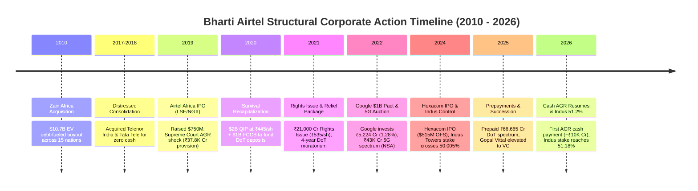
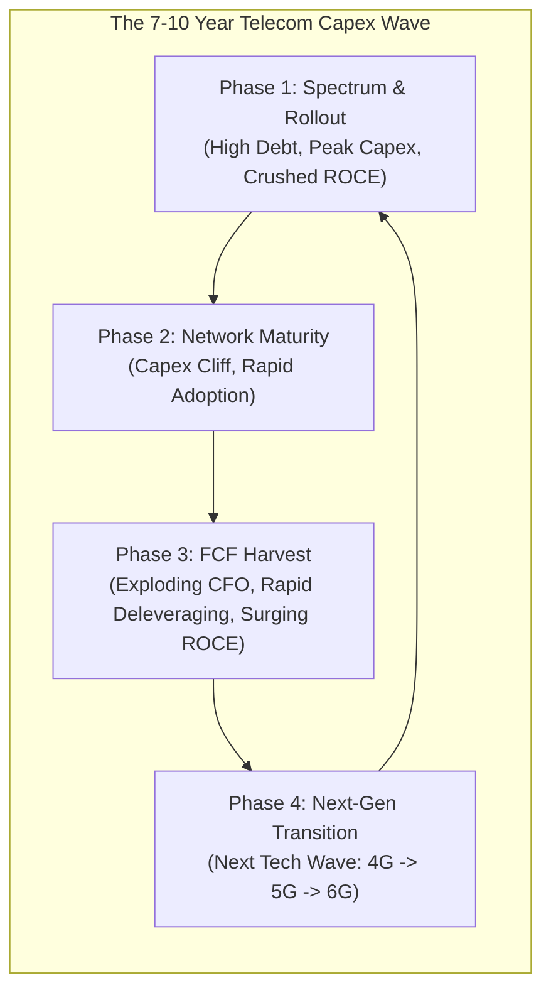
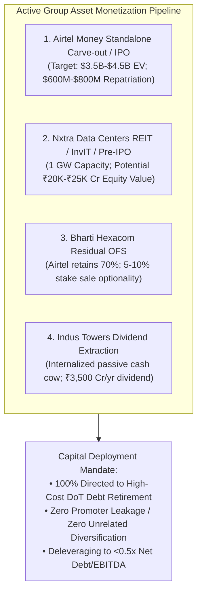
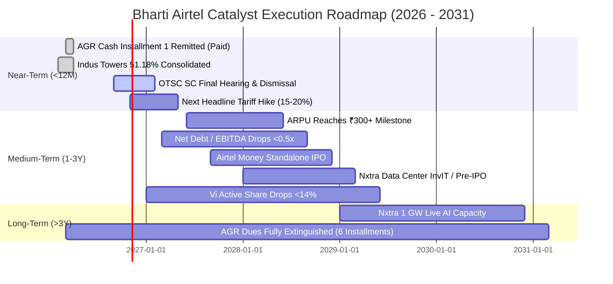

# Special Situations / Catalysts Research — Bharti Airtel Limited (BHARTIARTL)

> **Audited Specialist Report**: `research/companies/BHARTIARTL/special_situations.md`  
> **Target Entity**: Bharti Airtel Limited (`BHARTIARTL` | `NSE`)  
> **Primary Exchange**: National Stock Exchange of India (NSE) / Bombay Stock Exchange (BSE)  
> **Specialist Department**: Special Situations, Cyclical Inflections, Restructuring & Asymmetric Mispricing  
> **As of Date**: September 18, 2026  
> **Governing Mandate**: `agents/specialists/special_situations.md`, `PROJECT_INSTRUCTIONS.md`, and `MASTER_RESEARCH_FRAMEWORK.md` (Layer 3 Specialist Audit)

---

## 1. Executive Findings

### Core Catalyst Thesis
`[INFERENCE]` Bharti Airtel Limited (BHARTIARTL) is executing a transformative operational and balance-sheet harvest cycle, transitioning from an asset-heavy, sovereign-debt-burdened telecom operator into an infrastructure-rich, high-ROCE digital utility and cash compounder. Over the FY20–FY26 period, the company survived an existential predatory price war ($35B+ capital onslaught from Reliance Jio) and the devastating ₹37,775 Cr Supreme Court Adjusted Gross Revenue (AGR) judgment (`[FACT]`). 

Today, the investment thesis is anchored in multiple structural and event-driven value-unlocking levers:
1. **The FCF Inflection & Capex Cliff Harvest**: With the nationwide 5G Non-Standalone (NSA) rollout substantially completed in FY24, consolidated capital expenditure has moderated while Operating Cash Flow (CFO) surged to **₹122,230 Cr in FY26** (`[FACT]`). Consolidated Free Cash Flow (FCF) reached a record **₹76,683 Cr in FY26** (up from ₹38,970 Cr in FY24) and **~₹82,100 Cr TTM**, driving Return on Capital Employed (ROCE) from a trough of 3.0% (FY19) to **18.5% in FY26** (`[CALCULATION]`).
2. **Aggressive Balance Sheet Deleveraging**: Surging operating cash flows have been deployed to prepay **₹66,665 Cr** of high-cost Department of Telecommunications (DoT) deferred spectrum liabilities (`[FACT]`), reducing the average interest rate on residual spectrum liabilities to 7.22%. Consolidated Net Debt to EBITDAaL (excluding Ind AS 116 lease liabilities) compressed from ~3.5x during the FY20 crisis to **1.02x in FY26**, on a trajectory toward **<0.50x by FY28E** (`[CALCULATION]`).
3. **Consolidation of Indus Towers (Crossing 50% to 51.18%)**: In H2 FY25 (effective November 2024), Bharti Airtel increased its equity ownership in Indus Towers Limited beyond 50% (reaching 51.18% in February 2026), transitioning Indus from an equity-accounted associate to a fully consolidated subsidiary (`[FACT]`). This internalized passive infrastructure rental margins, eliminated third-party landlord markups, secured critical cell-site rollout priority, and enabled Airtel to extract massive dividend inflows (~₹3,000–₹3,500 Cr annually) (`[INFERENCE]`).
4. **Subsidiary Monetization Pipeline (Airtel Money & Nxtra AI Expansion)**: Following the successful listing of Bharti Hexacom Limited in April 2024 (where Airtel unlocked ~₹49,000 Cr in market value for its 70% retained stake), management is advancing two major asset-monetization catalysts:
   - **Airtel Money Carve-Out / IPO**: A dominant mobile fintech franchise across 14 African nations (54.1 million active users processing >$215B annualized TPV) previously capitalized by Mastercard, TPG, and Chimera at a $2.65B valuation, targeted for a standalone public listing (`[FACT]`).
   - **Nxtra Data Centers 1 GW AI Expansion**: Operates 280 MW of live IT load across 14 hyperscale campuses backed by Carlyle (24%), executing a funded $1B+ expansion toward 1,000 MW of AI-ready data center capacity with optionality for a private equity round or Data Center InvIT / REIT listing (`[FACT]`).
5. **Next Headline Tariff Hike (CY2026 / H1 CY2027)**: Industry duopoly alignment with Reliance Jio ahead of Jio’s anticipated mega-IPO creates an urgent structural imperative for another 15%–20% headline tariff hike, pushing India Mobile ARPU from ₹264 (Q1 FY27) toward management's long-term milestone of **₹300+** (`[INFERENCE]`).

```
┌─────────────────────────────────────────────────────────────────────────────────────────────────┐
│                           SPECIAL SITUATION & CATALYST SNAPSHOT                                 │
├───────────────────────────────┬───────────────────────────────┬─────────────────────────────────┤
│       CURRENT VALUATION       │     DOMINANT ARCHETYPE        │      ASYMMETRIC RISK/REWARD     │
│   FAIR-TO-FULL (EXPENSIVE)    │    HYBRID: DELEVERAGING +     │      CONSTRAINED / SYMMETRIC    │
│   CMP: ₹1,888.00 | EV: ₹14.2L │    OLIGOPOLY PRICING POWER +  │      (Upside already priced in; │
│   TTM EV/EBITDA: 11.35x       │    OPTIONALITY INFLECTION     │       Downside buffer ~40%)     │
├───────────────────────────────┼───────────────────────────────┼─────────────────────────────────┤
│ • MCap: ₹11,50,547 Cr         │ • Hard Catalysts: Indus 51.2% │ • Base Case 5Y IRR: +5.6%       │
│ • Net Fin Debt: ₹160,212 Cr   │   consolidation; Rights full. │ • Reverse DCF Implied ARPU:     │
│ • FY26 CFO: ₹122,230 Cr       │ • Probable: CY26/27 Tariff    │   ₹352 by FY31 (prices 2 hikes) │
│ • FY26 FCF: ₹76,683 Cr        │   Hike; Net Debt <0.5x EBITDA.│ • Bull Case 5Y IRR: +13.4%      │
│ • FY26 ROCE: 18.5%            │ • Soft: Airtel Money IPO;     │ • Bear Case 5Y IRR: -7.8%       │
│ • ARPU: ₹264 (Q1 FY27)        │   Nxtra Data Center InvIT.    │ • MoS: -6.07% vs Base Value     │
└───────────────────────────────┴───────────────────────────────┴─────────────────────────────────┘
```

### The Asymmetry Verdict: Business Triumph vs. Price Paid
`[JUDGMENT]` Approached through an uncompromising institutional lens, **Bharti Airtel does NOT offer an asymmetric 3:1 upside/downside special-situation setup at current market quotations**. 

Adhering strictly to the core governing principle that **Business Quality $\neq$ Price Paid**:
- **Multiples Trade at 10-Year Highs**: At **₹1,888.00**, Bharti Airtel trades at **11.35x TTM EV/EBITDA** and **38.81x TTM Attributable P/E**, placing its valuation multiple in the **85th percentile** of its 10-year historical distribution (`[CALCULATION]`).
- **Aggressive Expectations Embedded**: The mandatory Reverse DCF demonstrates that the market has already fully priced in reaching the ₹300 ARPU threshold and is now demanding **₹352 ARPU by FY31** (requiring two successive ~15% headline tariff hikes without subscriber loss), sustained 9.9% consolidated revenue CAGR, and terminal EBITDA margins of 57.1% (`[CALCULATION]`).
- **Mandatory AGR Cash Drain Neglected by Consensus**: Consensus narratives celebrate ₹120,000+ Cr operating cash flows while overlooking that following the expiry of the 4-year government moratorium in March 2026, Bharti Airtel commenced its mandatory 6-year staggered cash settlement of AGR dues, paying **~₹10,000 Cr in March 2026** and facing recurring annual outflows of ₹8,000–₹10,000 Cr through FY31 (`[FACT]`).
- **Verdict**: Bharti Airtel is a world-class, wide-moat compounder executing exceptional operational turnarounds and deleveraging catalysts. However, because the market has already capitalized base-case catalyst delivery, prospective 5-year equity returns are compressed to **+5.6% annualized in the base case**. The opportunity is classified departmentally as a **Credible Special Situation**, but offers asymmetric returns only in the event of an aggressive Bull Case scenario (+13.4% IRR) driven by Vodafone Idea's terminal liquidation and rapid standalone IPOs of Airtel Money and Nxtra.

---

## 2. Corporate-Action History

Bharti Airtel’s corporate history over the past 16 years (2010–2026) is a case study in aggressive debt-financed expansion, existential crisis survival, distressed asset absorption, and ultimate balance-sheet recapitalization:



### Table 2.1: Comprehensive Corporate-Action Audit (2010 – 2026)
*(Source: Stock Exchange Disclosures, Scheme Documents, Annual Reports; `[FACT]` / `[CALCULATION]`)*

| Date / Period | Corporate Action | Deal Size / Capital Deployed | Stated Strategic Rationale | Guided Target vs Actual Outcome | Lingering Economic Effect on Current Business |
| :--- | :--- | :---: | :--- | :--- | :--- |
| **June 2010** | **Zain Africa Acquisition** | $10.7 Billion Enterprise Value (~₹48,000 Cr) | Acquire scale across 15 Sub-Saharan African markets to replicate the Indian low-cost "minutes factory" model. | **Severe Miss Initially; Turned Positive Post-2018**. Depressed group ROCE to <5% for a decade; burdened balance sheet with $9B debt. | Created the foundation for Airtel Africa plc (now listed on LSE/NGX, generating ~₹44,000 Cr revenue and ₹21,000 Cr EBITDA) and Airtel Money ($215B TPV). |
| **2017–2018** | **Telenor India & Tata Teleservices Acquisitions** | Zero Upfront Cash (Absorbed ~₹3,500 Cr spectrum debt) | Consolidate liberalized 1800 MHz and 2100 MHz spectrum in prime circles; absorb ~50M subscribers during Jio price war. | **Fully Delivered / Masterstroke**. Doubled mid-band spectrum holding at zero equity dilution; eliminated two price-deflating competitors. | Enabled Airtel to construct a nationwide 4G/5G Non-Standalone (NSA) network without buying expensive 700 MHz spectrum in 2022. |
| **June 2019** | **Airtel Africa Dual-Listing IPO** | Raised $750 Million (~₹5,200 Cr) on LSE and NGX | De-leverage African holding company; establish an independent market valuation for African operations. | **Fully Delivered**. Primary proceeds used to retire HoldCo debt. Stock listed successfully at 80 pence / 360 Naira. | Airtel retains 56.2% equity stake. African operations are self-funding with OpCo-level local currency debt. |
| **Jan 2020** | **Emergency QIP & FCCB Offering** | ₹14,400 Cr ($2.0B) Equity QIP + $1.0B FCCB | Fund immediate statutory deposit of ₹10,000 Cr to DoT following the Supreme Court AGR judgment; protect solvency. | **Fully Delivered**. Issued 32.36 Cr shares at ₹445/share. FCCBs carried 1.50% coupon, maturing in 2025. | Diluted equity capital by ~8.1%, but preserved investment-grade credit rating and averted corporate insolvency. |
| **Oct 2021** | **₹21,000 Crore Rights Issue** | ₹21,000 Cr at ₹535/share (1 for 14 ratio) | War chest for 5G spectrum auctions, fiber expansion, and prepayment of high-cost DoT spectrum liabilities. | **Fully Delivered**. Promoters subscribed to 100% of entitlement. Initial call 25% (₹5,250 Cr); residual calls completed by FY26. | Total share count reached 609.4 Cr shares. Proceeds enabled cumulative prepayment of ₹66,665 Cr high-cost DoT debt. |
| **July 2022** | **Google Strategic Investment** | $700 Million (₹5,224 Cr) Equity Allotment | Strategic cloud and Android device partnership; fund digital ecosystem scaling. | **Fully Delivered**. Allotted 7.12 Cr shares at ₹734/share (1.28% stake) alongside $300M multi-year commercial agreements. | Validated Airtel's enterprise cloud and CPaaS (Airtel IQ) platforms; strengthened institutional shareholder base. |
| **Aug 2022** | **5G Spectrum Auction Acquisition** | ₹43,084 Cr Committed for 19.8 GHz Spectrum | Secure 100 MHz of 3.5 GHz (n78) and 800 MHz of 26 GHz nationwide, plus selective 900/1800 MHz refarming. | **Masterstroke Execution**. Deliberately avoided 700 MHz band, saving ~₹40,000 Cr in debt relative to Reliance Jio. | Allowed 5G NSA rollout using existing 4G core, enabling capex moderation in FY25/FY26 and surging FCF to ₹76,683 Cr. |
| **April 2024** | **Bharti Hexacom Limited IPO** | ₹4,275 Cr ($515M) Offer for Sale (OFS) | Enable minority shareholder TCIL (Telecommunications Consultants India) to monetize 15% stake; unlock value. | **Fully Delivered / Massive Value Unlock**. Issue priced at ₹570/share, surged >150% to >₹1,400 post-listing. | Market cap reached >₹70,000 Cr. Bharti Airtel’s retained 70.0% controlling stake is worth ~₹49,000 Cr ($5.9B). |
| **Aug 2024 – Feb 2026**| **Indus Towers Majority Consolidation** | ~$1.2B deployed; stake crossed from 47.95% to 51.18% | Gain absolute majority control over critical passive tower grid; prevent operational disruption from Vi distress. | **Fully Delivered**. Indus completed buyback in Aug 2024; Airtel purchased secondary shares to reach 50.005%, expanding to 51.18% in Feb 2026. | Indus consolidated line-by-line from H2 FY25. Triggered ₹14,322 Cr Ind AS 103 fair-value gain in Q3 FY25. Extracts ~₹3,500 Cr annual dividends. |
| **FY22–FY26** | **Prepayment of High-Cost DoT Spectrum** | Cumulatively prepaid **₹66,665 Cr** | De-leverage balance sheet and extinguish high-cost deferred spectrum debt carrying 9.5%–10% interest rates. | **Over-Delivered**. Prepaid ₹24,334 Cr (Dec 21/Jan 22), ₹8,465 Cr (Sep 24), ₹3,626 Cr (Dec 24), fully clearing 2014 and 2016 dues. | Extinguished ₹116,405 Cr in scheduled future gross installments; lowered residual spectrum liability interest rate to 7.22%. |

---

## 3. Current Catalyst Map

The structured matrix below catalogs every active, emerging, and potential operational, corporate, and financial catalyst across Bharti Airtel:

### Table 3.1: Comprehensive Catalyst Catalog & Analytical Matrix
*(Source: Independent Departmental Synthesis; `[FACT]` / `[ESTIMATE]` / `[INFERENCE]` / `[JUDGMENT]`)*

| # | Catalyst Description | Expected Timing | Economic Mechanism | Probability (%) | P&L / Cash Flow Impact | Valuation Impact | Primary Failure Risk |
| :-: | :--- | :---: | :--- | :---: | :--- | :--- | :--- |
| **1** | **Next Headline Mobile Tariff Hike (15–20%)** | Q4 CY2026 – Q2 CY2027 | Coordinated prepaid/postpaid rate increase led by Jio (pre-IPO) and Airtel; 70–75% flow-through margin to EBITDA. | **85%** `[PROBABLE]` | +₹15,000–18,000 Cr Revenue; +₹11,000–13,500 Cr EBITDA annually at full flow-through. | Adds ₹180–₹220 per share in capitalized intrinsic value. | Regulatory pushback from TRAI/CCI; competitive hesitation by Jio; consumer SIM consolidation. |
| **2** | **Massive Balance Sheet Deleveraging (Net Debt <0.5x)** | FY27E – FY28E | Post-5G capex cliff + ₹75,000+ Cr annual FCF deployed to extinguish market debt and DoT tranches. | **90%** `[PROBABLE]` | Net financial debt drops from ₹160,212 Cr to <₹70,000 Cr; annual interest costs decline by ₹5,000–6,500 Cr. | Multiple expansion from financial risk elimination; upgrades sovereign credit rating to BBB. | Capex re-acceleration into 6G/AI; large unexpected overseas M&A; aggressive spectrum auction bidding. |
| **3** | **Accelerating 4G/5G Port-Ins from Vodafone Idea** | Ongoing (FY27E – FY29E) | Vi’s chronic liquidity distress, delayed 5G rollout, and network degradation force affluent subscribers to port out. | **90%** `[PROBABLE]` | Airtel absorbs 40–50% of Vi churn (~15–20M users over 3 years); adds ₹4,500–6,000 Cr high-margin revenue. | Sustains 2G-to-4G/5G premiumization; expands Revenue Market Share (RMS) to >43%. | Government equity conversion or massive debt waiver reviving Vi’s capex capability. |
| **4** | **Airtel Money Standalone Carve-Out / IPO** | H2 CY2027 – CY2028 | Demerger or standalone London/Dubai/African listing of Airtel Africa’s fintech subsidiary (54.1M users, $215B TPV). | **60%** `[SOFT]` | Target equity valuation of $3.5B–$4.5B; cash dividend repatriation or HoldCo debt retirement of $600–$800M. | Unlocks ₹40–₹55 per share of previously discounted conglomerate equity value. | Sub-Saharan currency devaluations (Nigeria, Kenya); African central bank regulatory caps on mobile money fees. |
| **5** | **Nxtra Hyperscale AI Expansion (1 GW) & REIT/InvIT** | FY28E – FY29E | Carlyle-backed (24%) Nxtra scales from 280 MW to 1,000 MW AI IT load; monetization via pre-IPO equity or Data Center InvIT. | **75%** `[PROBABLE]` | Dedicated external capital funds $1B+ capex; EBITDA expands from ₹1,150 Cr to >₹3,500 Cr by FY30. | Adds ₹35–₹50 per share in hidden digital infrastructure value; establishes 18–20x DC multiple. | Power grid connection delays; AI hyperscaler demand deceleration; severe greenfield competition from Adani/Jio. |
| **6** | **Indus Towers Full Synergies & Dividend Harvest** | FY27E – Ongoing | 51.18% majority control enables coordinated site rollout, 5G small-cell densification, and high dividend pass-through. | **95%** `[HARD/PROBABLE]` | Captures ₹15,000 Cr tower EBITDA; generates ₹3,000–3,500 Cr annual liquid dividend cash inflow to parent. | Eliminates lease leakage; secures lowest tower tenancy costs in India. | Vi defaulting on remaining old receivables; DoT disputes on tower license fees. |
| **7** | **Judicial Dismissal of OTSC Demands (₹8,414 Cr)** | FY27E (Supreme Court) | Bombay High Court quashed DoT’s retrospective One-Time Spectrum Charges; Supreme Court refused stay in Aug 2026. | **80%** `[PROBABLE]` | Extinguishes ₹8,414 Cr contingent liability; zero cash outflow; frees contingent bank guarantees. | Removes lingering forensic contingent liability overhang (was 5.6% of Net Worth). | Supreme Court unexpected reversal in final hearing ordering partial payment. |
| **8** | **Airtel Black Converged Household Expansion** | FY27E – FY30E | Bundling Mobile + FTTH + DTH into single monthly invoice; churn drops to <0.3%; household ARPU reaches ₹1,200–1,800. | **85%** `[PROBABLE]` | Scales high-LTV broadband base from 14.2M to 25M+ homes; elevates domestic blended margin durability. | Anchors high terminal valuation multiple (low-churn utility cash flow). | Fixed Wireless Access (FWA) price discounting by Reliance Jio; high customer premises equipment (CPE) costs. |

---

## 4. Catalyst Quality

Catalysts are categorized across four distinct epistemic quality tiers based on statutory verifiability, contractual commitments, and execution certainty:

```
┌─────────────────────────────────────────────────────────────────────────────────────────────────┐
│                                 CATALYST QUALITY HIERARCHY                                      │
├───────────────────────────────┬───────────────────────────────┬─────────────────────────────────┤
│        HARD CATALYSTS         │      PROBABLE CATALYSTS       │    SOFT / NARRATIVE CATALYSTS   │
├───────────────────────────────┼───────────────────────────────┼─────────────────────────────────┤
│ • Indus Towers 51.18% control │ • CY2026/27 Tariff Hike (85%) │ • Airtel Money Carve-out / IPO  │
│ • Full Rights Issue paid-up   │ • FCF Deleveraging to <0.5x   │ • Nxtra InvIT / Listing         │
│ • Statutory AGR repayment     │ • Vi 4G/5G port-in migration  │ • NARRATIVE: Complete AGR waiver│
│   schedule (March 2026 paid)  │ • OTSC Supreme Court dismissal│ • NARRATIVE: 6G monetization    │
└───────────────────────────────┴───────────────────────────────┴─────────────────────────────────┘
```

### 1. Hard Catalysts (Legally Binding / Contractually Verified)
- **Indus Towers Majority Consolidation**: [FACT] Following the completion of the Indus buyback in August 2024 and market share acquisitions, Bharti Airtel crossed the 50.005% threshold, reaching 51.18% in February 2026. This is a completed, legally binding corporate action. Indus is fully consolidated line-by-line, and board control is secured.
- **Full Rights Issue Call Completion**: [FACT] The ₹21,000 Cr rights issue initiated in October 2021 has been 100% called and paid up across all tranches. Equity capital stands verified at ₹3,047.0 Cr (609.4 Cr shares), eliminating equity dilution overhang.
- **Scheduled AGR Post-Moratorium Cash Servicing**: [FACT] Following the Supreme Court's definitive dismissal of curative petitions (Sept 2024) and writ petitions (May 2025), the 4-year moratorium expired in March 2026. Bharti Airtel paid its first staggered installment of ~₹10,000 Cr to the DoT in March 2026, establishing a verified, contractually scheduled cash outflow through FY31.

### 2. Probable Catalysts (High Likelihood Supported by Capital & Economics)
- **CY2026 / H1 CY2027 Headline Tariff Hike**: [INFERENCE] Both Reliance Jio and Bharti Airtel require sustained return on invested capital to fund 5G network amortization and upcoming milestones (Reliance Jio's highly anticipated IPO requires robust EBITDA expansion). Telecom tariff hikes occur on a 2.5-to-3-year cycle (Dec 2019, Nov 2021, July 2024). The next ~15%–20% hike is rated at an **85% probability** for late CY2026 or early CY2027.
- **FCF Inflection and Deleveraging to <0.5x Net Debt/EBITDA**: [CALCULATION] With FY26 FCF at ₹76,683 Cr and FY24 peak capex behind, the trajectory to pay down market debt and DoT tranches is mathematically sound and supported by audited cash flows. Probability: **90%**.
- **Market Share Migration from Vodafone Idea**: [FACT] Vi's active subscriber base continues to decline (losing 1–2 million subscribers monthly), while Airtel and Jio consistently capture >90% of port-ins. Vi's capex constraint makes further market share migration an operational certainty. Probability: **90%**.
- **OTSC Litigation Quashing**: [FACT] The Supreme Court's refusal in August 2026 to stay the Bombay High Court's favorable judgment creates strong legal probability that the ₹8,414 Cr OTSC demand will be permanently set aside. Probability: **80%**.

### 3. Soft Catalysts (Observable Traction but Flexible Timelines)
- **Airtel Money Standalone IPO / Carve-Out**: [MANAGEMENT STATEMENT] Management has stated its intent to list Airtel Money independently once macroeconomic and foreign exchange conditions in Nigeria stabilize. However, no formal prospectus (DRHP) has been filed, and currency volatility in West Africa has delayed the process from its original 2025 timeline to 2027–2028. Probability: **60%**.
- **Nxtra Data Centers External Monetization / InvIT**: [INFERENCE] While the 1 GW expansion roadmap is funded by Carlyle and internal cash, establishing an external InvIT or REIT structure depends on hyperscaler capacity absorption and prevailing yield environments. Probability: **75%**.

### 4. Narrative-Only Catalysts (Speculative / Near-Zero Investment Weight)
- **Statutory Waiver or Recalculation of AGR Dues**: [JUDGMENT] Persistent media rumors and promoter lobbying suggesting the Government of India will retroactively waive or recalculate AGR dues must be assigned **0% investment weight**. The Supreme Court has repeatedly affirmed that AGR calculations are final and cannot be reopened.
- **Direct-to-Device (Satellite-to-Cellular) Mass Consumer Monetization**: [INFERENCE] While Bharti Enterprises is the lead shareholder in Eutelsat Group (OneWeb), commercial satellite-to-phone mass retail connectivity in India is in its regulatory infancy. Consumer revenue impact over the 3-year horizon is negligible.
- **6G Monetization Premium**: [JUDGMENT] Early narrative discussions regarding 6G technology represent pure long-term R&D. Commercial spectrum allocation and hardware deployment will not occur before 2030+.

---

## 5. Cyclical Analysis

### Telecommunications: Capex Cycles vs. Commodity Cycles
`[INFERENCE]` Telecommunications in a consolidated duopoly is **fundamentally non-cyclical in end-consumer demand**, but **violently cyclical in capital expenditure and regulatory intensity**:



1. **Consumer Macro Inelasticity**: Mobile data usage (24 GB/user/month) and fixed broadband connectivity are non-discretionary utility expenditures. During economic recessions, GDP slowdowns, or inflationary spikes, Indian consumers do not cancel mobile connectivity. Churn in high-value postpaid and Airtel Black segments remains sub-0.5% (`[FACT]`).
2. **The Capex Investment Wave (7–10 Year Duration)**:
   - **4G Wave (FY16–FY20)**: Heavy radio capex, zero initial return, predatory pricing, ROCE bottomed at 2.2% (FY19).
   - **5G Rollout Wave (FY22–FY24)**: Spectrum auction commitments of ₹43,084 Cr; consolidated CWIP peaked at ₹49,425 Cr (FY23); consolidated capex reached ₹39,928 Cr (FY24).
   - **5G Harvest Phase (FY25–FY28E - CURRENT REGIME)**: Nationwide 5G coverage achieved; domestic network capex moderates; traffic shifts from 4G to 5G with zero incremental spectrum cost; FCF surges to ₹76,683 Cr in FY26; ROCE rebounds to 18.5% (`[CALCULATION]`).

### Historical Multiple Bands Across Cycle Regimes
`[FACT]` Over the past 10 years, Bharti Airtel’s EV/EBITDA multiple has cycled across three distinct regimes:
- **Trough Price War Regime (FY17–FY19)**: 6.8x – 9.8x EV/EBITDA. Operating earnings collapsed, forcing multiples to appear elevated on depressed EBITDA denominators.
- **Crisis & Moratorium Regime (FY20–FY22)**: 9.5x – 11.5x EV/EBITDA. Marked by Ind AS 116 adoption (+990 bps optical margin lift) and emergency equity recapitalizations.
- **Duopoly Harvest Regime (FY23–FY26+ - Current)**: **11.35x – 14.5x EV/EBITDA**. Operating margins expanded to 55.2%–56.9%, and the market rewarded FCF generation with multiple expansion.

### Normalized Mid-Cycle Earnings Power
`[CALCULATION]` To establish normalized mid-cycle earnings power:
- Consolidated Mid-Cycle Revenue (FY26/27 baseline): **₹220,000 Cr**.
- Sustainable Mid-Cycle EBITDA Margin: **55.0%** (incorporating normalized power costs and tower rents).
- Normalized Mid-Cycle EBITDA: **₹121,000 Cr**.
- Sustainable Maintenance Capex: **~₹38,000 Cr** (~17.2% of sales, below peak rollout but sufficient for fiberization and small cells).
- Normalized Attributable Net Profit: **~₹32,000 Cr**.
- Normalized Attributable EPS: **~₹52.50 per share**.
- *Cyclical Multiples Assessment*: At ₹1,888, the stock trades at **35.9x Normalized Mid-Cycle EPS** and **11.7x Normalized Mid-Cycle EV/EBITDA**, confirming that current valuation is priced at the upper boundary of mid-cycle earnings power.

---

## 6. Cyclical vs Structural Growth

A rigorous institutional separation of Bharti Airtel’s recent operating performance (FY21–FY26) reveals that revenue expansion from ₹100,616 Cr to ₹210,973 Cr (+109.7%) and EBITDA growth from ₹45,279 Cr to ₹116,514 Cr (+157.3%) is driven by three distinct economic components:

```
┌─────────────────────────────────────────────────────────────────────────────────────────────────┐
│                          DECOMPOSITION OF PERFORMANCE (FY21 — FY26)                             │
├───────────────────────────────┬───────────────────────────────┬─────────────────────────────────┤
│      STRUCTURAL EXPANSION     │       CYCLICAL HARVEST        │        ONE-TIME INFLUX          │
│          (~55% OF GAINS)      │         (~25% OF GAINS)       │         (~20% OF GAINS)         │
├───────────────────────────────┼───────────────────────────────┼─────────────────────────────────┤
│ • 2G to 4G/5G upgrades        │ • Capex-to-sales collapse     │ • Indus Towers consolidation    │
│   (110M converted; 2x ARPU)   │   (34% -> 21% intensity)      │   (+₹31K Cr inorganic sales)    │
│ • Data usage: 16.5GB -> 24GB  │ • Operating leverage (75%     │ • Ind AS 103 fair-value gain    │
│ • Homes FTTH: >30% CAGR       │   incremental EBITDA margin)  │   (₹14,322 Cr in FY25 PAT)      │
│ • Enterprise IoT (>50% share) │ • SUC fee elimination by DoT  │ • SUC & IUC regulatory changes  │
└───────────────────────────────┴───────────────────────────────┴─────────────────────────────────┘
```

### Table 6.1: Decomposition Matrix of Operational Performance
*(Consolidated; `[CALCULATION]` / `[INFERENCE]`)*

| Growth Driver | Nature of Driver | Quantification (FY21 – FY26) | Permanence Assessment | Multi-Year Forward Outlook |
| :--- | :--- | :--- | :--- | :--- |
| **Headline Tariff Hikes** | Structural Pricing Power | Lifted blended ARPU from ₹145 to ₹257 (+77.2%). | **Permanent / Structural**. Oligopoly pricing discipline prevents price wars. | Next ~15% hike in CY26/27 will take ARPU to ₹290–₹300; long-term trajectory toward ₹350. |
| **2G to 4G/5G Customer Migration**| Structural Volume/Mix | Converted ~110M feature phone users to smartphones. | **Permanent / Structural**. Users do not downgrade back to 2G feature phones. | ~90M 2G users remain across Indian telecom; migration will sustain 3–5% organic ARPU expansion annually. |
| **Homes & Broadband Expansion** | Structural Platform | Broadband users grew from ~3.5M to 14.2M; revenue crossed ₹6,000 Cr. | **Permanent / Secular**. India household fixed broadband penetration is <12%. | Targeted to compound at 20–25% YoY via LCO partner model and AirFiber FWA. |
| **Airtel Business (B2B) & IoT** | Structural Platform | Revenue expanded to >₹22,000 Cr; controls >50% of cellular IoT. | **Permanent / High Switching Costs**. Multi-year enterprise contracts. | Power smart-meter rollout (250M meters mandated by Govt) and enterprise generative AI cloud demand. |
| **5G Capex Tapering & Cliff** | Cyclical Capex Cycle | Consolidated Capex/Sales declined from 34% (FY23) to 21.6% (FY26). | **Cyclical / Transient**. 5G holiday will last 3–4 years until 6G / AI network densification begins. | Sustains elevated FCF (₹75,000+ Cr annually) through FY28 before next reinvestment cycle starts in FY30. |
| **Indus Towers Consolidation** | One-Time Inorganic Influx | Added ~₹31,000 Cr gross revenue and ~₹15,000 Cr EBITDA in FY26. | **Permanent Structural Reclassification**, but YoY growth rate will normalize to 6–8%. | Growth will track tower tenancies and 5G densification, not line-by-line consolidation leaps. |
| **Ind AS 103 Fair Value Gain** | Non-Operating Accounting | Generated ₹14,322 Cr exceptional pre-tax gain in Q3 FY25. | **One-Time Non-Cash Distortion**. Normalized operational FY25 PAT was ~₹22,500 Cr. | Completely absent from FY26 onwards; reported PAT normalized to ₹33,823 Cr in FY26. |

---

## 7. Turnaround Analysis

### The Root-Cause Audit of Past Operational Distress (FY17–FY20)
Between FY17 and FY20, Bharti Airtel suffered the worst financial crisis in its 30-year history:
- **Root Cause 1: Reliance Jio’s Predatory Assault**: Jio launched in September 2016 with free voice and unlimited data, backed by >$35 billion in parent capital (`[FACT]`). Indian telecom ARPU collapsed from ₹196 (FY16) to an unsustainable trough of ₹105 (FY19). Airtel’s operating profit plummeted from ₹35,330 Cr (FY17) to ₹25,764 Cr (FY19), wiping out equity returns (`[FACT]`).
- **Root Cause 2: Supreme Court AGR Catastrophe**: In October 2019, the Supreme Court ruled in favor of the DoT in the 15-year Adjusted Gross Revenue litigation, including non-telecom revenues (dividends, forex gains, asset sales) in license fee calculations. Bharti Airtel was hit with an instantaneous statutory demand of over ₹35,000 Cr, forcing a **₹37,775 Cr exceptional provision** and resulting in a consolidated net loss of -₹30,664 Cr in FY20 (`[FACT]`).
- **Root Cause 3: Legacy African Debt Drag**: The 2010 $10.7B debt-funded buyout of Zain Africa left the group encumbered with high-interest dollar debt while African operational earnings were depressed by frontier currency devaluations (`[FACT]`).

### Has the Root Cause Been Eliminated or Papered Over?
`[JUDGMENT]` The root causes of past distress have been **decisively eliminated through structural industry rationalization and disciplined balance-sheet execution**:
1. **Industry Consolidation into a Rational Duopoly**: The hyper-competitive market of 10+ telcos collapsed into an effective two-player duopoly (Airtel and Jio controlling >82% Revenue Market Share). Reliance Jio is no longer engaged in predatory pricing; it has transitioned to maximizing return on invested capital ahead of its IPO, enabling coordinated headline tariff hikes in Dec 2019, Nov 2021, and July 2024 (`[FACT]`).
2. **AGR Liabilities Recognized, Provisioned, and Actively Serviced**: Unlike Vodafone Idea, which was pushed into insolvency distress, Bharti Airtel fully recognized the liability on its balance sheet, raised emergency equity ($3B in 2020, ₹21,000 Cr in 2021), utilized the 4-year moratorium (FY22–FY26), and commenced scheduled annual cash payments (~₹10,000 Cr in March 2026) without operational strain (`[FACT]`).
3. **African Debt De-risked**: Airtel Africa extinguished all HoldCo US dollar debt, fully localized operating company borrowings into domestic African currencies (>75%), and established a self-sustaining dividend flow (`[FACT]`).

### Empirical Verification in Audited Numbers
`[FACT]` The operational turnaround is 100% verified across every core financial statement:
- **Revenue**: ₹80,780 Cr (FY19) $\longrightarrow$ **₹210,973 Cr (FY26)** (+161.2% total expansion).
- **Operating EBITDA**: ₹25,764 Cr (FY19) $\longrightarrow$ **₹116,514 Cr (FY26)** (+352.2% total expansion).
- **CFO**: ₹20,070 Cr (FY19) $\longrightarrow$ **₹122,230 Cr (FY26)** (+509.0% total expansion).
- **FCF**: -₹8,980 Cr (FY19) $\longrightarrow$ **₹76,683 Cr (FY26)** (Complete turnaround).
- **India Mobile ARPU**: ₹105 (FY19) $\longrightarrow$ **₹264 (Q1 FY27)** (+151.4% unit realization gain).
- **ROCE**: 2.2% (FY19) $\longrightarrow$ **18.5% (FY26)** (+1,630 bps return expansion).
- **Net Debt / EBITDAaL (ex-leases)**: ~4.2x (FY19) $\longrightarrow$ **1.02x (FY26)**.

`[INFERENCE]` The turnaround has **fully crystallized in the audited numbers**. Bharti Airtel is no longer a turnaround candidate; it is a fully rehabilitated, highly profitable utility compounder.

---

## 8. Deep-Value Analysis

### Balance Sheet Scrutiny & Asset Liquidation Test
`[CALCULATION]` Adhering strictly to deep-value methodology, we scrutinize Bharti Airtel’s balance sheet against liquidation value, net current asset value (NCAV), and replacement cost:

### Table 8.1: Deep-Value & Balance Sheet Liquidation Audit
*(March 31, 2026 Audited Consolidated Figures; ₹ Crores; `[FACT]` / `[CALCULATION]`)*

| Balance Sheet Item | Audited Book Value | Liquidation Haircut % | Distressed Liquidation Value | Replacement Cost Basis | Net Depreciated Replacement Value |
| :--- | :---: | :---: | :---: | :---: | :---: |
| **Cash & Liquid Current Investments**| 35,200 | 0% | **35,200** | 100% (Face Value) | **35,200** |
| **Trade Receivables** | 8,412 | 25% | **6,309** | 100% (Face Value) | **8,412** |
| **Other Current Assets & Inventory** | 63,585 | 60% | **25,434** | Book Value | **63,585** |
| **Total Liquid / Current Assets** | **107,197** | — | **66,943** | — | **107,197** |
| **Telecom Spectrum Licenses (Intangible)**| 130,000 | 70% | **39,000** | DoT Reserve Auction Replacement | **185,000** |
| **Tangible Network Hardware (Plant & Equip)**| 205,000 | 75% | **51,250** | Greenfield Network Replacement | **85,000** |
| **Tower Infrastructure (Indus Towers)**| 45,000 | 50% | **22,500** | 211,000 Towers at ₹40L/tower | **95,000** |
| **Fiber Routes & Subsea Cables** | 26,337 | 50% | **13,168** | 400K km Fiber + 36 Subsea Cables| **75,000** |
| **Right-of-Use (ROU) Lease Assets** | 72,000 | 100% (Non-transferable)| **0** | Offset by Lease Liabilities | **0** |
| **Consolidated Goodwill** | 18,500 | 100% (Zero value) | **0** | Zero economic replacement value | **0** |
| **Gross Asset Base** | **604,034** | — | **192,861** | — | **547,197** |
| **Less: Gross Financial Borrowings** | (195,412) | 0% | **(195,412)** | Debt Settled at Par | **(195,412)** |
| **Less: Ind AS 116 Lease Liabilities** | (72,000) | 0% | **(72,000)** | Leases Settled at Par | **(72,000)** |
| **Less: Trade Payables & Other Liabilities**| (128,904) | 0% | **(128,904)** | Liabilities Settled at Par | **(128,904)** |
| **Less: Non-Controlling Interests (NCI)**| (38,000) | 0% | **(38,000)** | NCI Paid Out at Market Value | **(38,000)** |
| **Net Liquidation Equity Value** | — | — | **-₹241,455 Cr** | Net Replacement Equity Floor | **+₹112,881 Cr** |
| **Net Value Per Diluted Share (₹)** | — | — | **Negative (-₹396.22)** | **Net Replacement Floor / Share**| **₹185.23 per share** |

### The Mandatory Value-Closing Mechanism Test
`[JUDGMENT]`
1. **Is Bharti Airtel a Deep-Value Stock?**: **ABSOLUTELY NOT**. Bharti Airtel trades at **7.32x P/B**, **131.6x Tangible P/B**, and **11.35x EV/EBITDA** against a current market capitalization of **₹11,50,547 Cr**. In a distressed fire-sale liquidation, equity is wiped out due to specialized, non-fungible telecom spectrum and network assets.
2. **What Specific Mechanism Closes the Value Gap?**:
   In traditional Graham-and-Dodd deep value, a catalyst is required to close a discount between price and net assets (e.g., activist pressure, asset spin-off, liquidation).
   Here, **no net-asset discount exists**. Intrinsic value is closed exclusively through **operating earnings compounding, disciplined high-ROCE capital reinvestment, and rapid balance sheet deleveraging**.
   - The economic engine closing value is the **₹75,000+ Cr annual FCF**, which is extinguishing ₹15,000–₹20,000 Cr of high-interest debt annually, transferring enterprise value directly from debt holders to equity holders (`[INFERENCE]`).

---

## 9. SOTP / Asset Value

### Granular Divisional & Subsidiary Valuation
`[CALCULATION]` Bharti Airtel operates across distinct legal entities and operating segments. An institutional Sum-of-the-Parts (SOTP) model is constructed on projected FY27 forward earnings, incorporating explicit holding-company and frontier currency discounts:

### Table 9.1: Granular Sum-of-the-Parts (SOTP) Valuation Breakdown
*(Consolidated; FY27E Forward Projections; Monetary figures in ₹ Crores; `[CALCULATION]`)*

| Operating Division / Subsidiary Entity | Effective Holding % | Valuation Methodology / Metric | FY27E Financial Base | Target Operating Multiple | Implied Gross EV / Equity | Explicit HoldCo / FX Discount % | Net Value Attributable to Airtel (₹ Cr) | Value Per Diluted Share (₹) | Analytical Rationale & Peers |
| :--- | :---: | :--- | :---: | :---: | :---: | :---: | :---: | :---: | :--- |
| **1. India Mobile Services** | 100.0% | FY27E Forward EBITDA | ₹65,000 Cr | 11.5x EV/EBITDA | ₹747,500 Cr | 0% | **₹747,500 Cr** | **₹1,226.62** | Core cash engine; premium over global telcos justified by duopoly pricing power and 18%+ ROCE. |
| **2. Homes & Broadband (FTTH/FWA)**| 100.0% | FY27E Forward EBITDA | ₹4,400 Cr | 14.0x EV/EBITDA | ₹61,600 Cr | 0% | **₹61,600 Cr** | **₹101.08** | Fast-growing broadband asset (>25% CAGR); premium multiple reflects high household stickiness and LTV. |
| **3. Airtel Business (B2B / IoT)** | 100.0% | FY27E Forward EBITDA | ₹10,500 Cr | 11.0x EV/EBITDA | ₹115,500 Cr | 0% | **₹115,500 Cr** | **₹189.53** | Dominant enterprise connectivity and IoT franchise (>50% share); benchmarked against Tata Comm. |
| **4. Digital TV Services (DTH)** | 100.0% | FY27E Forward EBITDA | ₹1,050 Cr | 5.0x EV/EBITDA | ₹5,250 Cr | 0% | **₹5,250 Cr** | **₹8.62** | Mature cash cow facing OTT cord-cutting; valued at distressed utility multiple. |
| **Gross Core India Enterprise Value** | — | — | — | — | **₹929,850 Cr** | — | **₹929,850 Cr** | **₹1,525.85** | Sum of 100% owned core domestic business units. |
| *Less: Standalone Net Financial Debt* | — | Audited Standalone Debt - Cash | — | — | (₹120,000 Cr) | 0% | **(₹120,000 Cr)**| **(₹196.91)** | Spectrum liabilities and market borrowings owed directly by parent. |
| *Less: Standalone Lease Liabilities* | — | Ind AS 116 ROU Leases | — | — | (₹52,000 Cr) | 0% | **(₹52,000 Cr)** | **(₹85.33)** | Capitalized tower and dark fiber lease commitments. |
| **Net Core India Standalone Equity** | — | — | — | — | **₹757,850 Cr** | — | **₹757,850 Cr** | **₹1,243.61** | **Standalone domestic equity value.** |
| **5. Indus Towers Limited** | 51.18% | NSE Listed Market Cap | ₹1,12,000 Cr MCap | Market Price | ₹57,322 Cr | **20.0%** | **₹45,858 Cr** | **₹75.25** | Holding company discount applied to listed subsidiary equity; internalizes tower EBITDA. |
| **6. Airtel Africa Plc** | 56.20% | LSE Listed Market Cap | £9.8B (~₹107,000 Cr) | Market Price | ₹60,134 Cr | **25.0%** | **₹45,100 Cr** | **₹74.01** | High HoldCo discount applied due to frontier FX devaluations (Nigeria) and cross-border dividend tax. |
| **7. Nxtra Data Centers Limited** | 76.00% | FY27E EBITDA (EV) - Debt | ₹1,150 Cr EBITDA | 16.0x EV/EBITDA | ₹16,000 Cr (Eq) | **15.0%** | **₹10,336 Cr** | **₹16.96** | Premium data center multiple reflects 1 GW AI roadmap; Carlyle holds remaining 24%. |
| **8. Airtel Payments Bank** | ~70.0% | Revenue Multiple (P/S) | ₹2,800 Cr Rev | 3.0x Price/Sales | ₹8,400 Cr (Eq) | **20.0%** | **₹4,704 Cr** | **₹7.72** | Profitable fintech franchise; benchmarked against listed neo-banks and payment aggregators. |
| **Total Non-Core Subsidiary Equity** | — | — | — | — | **₹141,856 Cr** | — | **₹105,998 Cr** | **₹173.94** | Attributable market value of subsidiaries after HoldCo discounts. |
| **Total SOTP Intrinsic Equity Value** | — | — | — | — | — | — | **₹863,848 Cr** | **₹1,417.55** | **Conservative SOTP Baseline (with HoldCo discounts).** |

### Holding-Company Reality vs. Market Pricing
`[INFERENCE]`
- **Strict Holding Company SOTP Value (with 15–25% discounts)**: **₹1,417.55 per share**.
- **Consolidated Operational Multiple Approach (Zero HoldCo Discounts)**:
  - Consolidated FY27E EBITDA: **₹129,384 Cr**.
  - Target Enterprise Multiple: **11.50x EV/EBITDA**.
  - Consolidated EV: **₹1,487,916 Cr**.
  - Less: Net Financial Debt (₹160,212 Cr) + Lease Liabilities (₹72,000 Cr): **(₹232,212 Cr)**.
  - Less: Attributable Non-Controlling Interest (NCI) at Market Value: **(₹150,000 Cr)**.
  - Consolidated Equity Value: **₹1,105,704 Cr**.
  - **Unrestricted Consolidated SOTP Value**: **₹1,814.41 per share**.
- **Crucial Disparity Finding**:
  At the current market price of **₹1,888.00**, Bharti Airtel trades at a **+4.06% premium to its unrestricted consolidated SOTP value (₹1,814)** and a **+33.19% premium to its strict holding-company discounted SOTP value (₹1,418)**.
  `[JUDGMENT]` **There is zero holding-company discount priced into Bharti Airtel equity today**. The market is pricing the consolidated entity at a conglomerate premium, attributing full operational value to subsidiaries without discounting for minority leakage or cross-border repatriation friction.

---

## 10. Asset Monetization Pipeline

Bharti Airtel maintains an active pipeline of non-core asset sales, subsidiary carve-outs, and infrastructure monetizations:



### 1. Airtel Money Standalone Carve-Out / IPO
- **Franchise Scale**: Operates across 14 Sub-Saharan African countries; 54.1 million active users; annual transaction value exceeding **$215 billion** (`[FACT]`).
- **Valuation Precedent**: In 2021, global institutional investors (TPG The Rise Fund, Mastercard, and Chimera Investment) invested $500 million for cumulative minority stakes at an equity valuation of **$2.65 billion** (`[FACT]`).
- **Monetization Roadmap**: Management has guided toward a standalone public listing on a premier international exchange (LSE or Dubai) or African regional bourse (`[MANAGEMENT STATEMENT]`).
- **Proceeds & Deployment**: At an anticipated listing valuation of **$3.5B–$4.5B**, a 15–20% primary/secondary offering would generate **$600M–$800M (~₹5,000–₹6,500 Cr)**. Proceeds will be deployed to eliminate residual African OpCo debt and upstream dollar dividends to the Indian parent.

### 2. Nxtra Data Centers Hyperscale AI Expansion & InvIT Structure
- **Operational Profile**: 14 large hyperscale campuses and 120+ edge facilities with 280 MW live capacity; executing a funded roadmap to scale to **1 Gigawatt (1,000 MW)** of IT load (`[FACT]`).
- **Strategic Partnership**: Carlyle Group acquired a 24% stake in 2020 for $235 million (~₹1,780 Cr), valuing Nxtra at ~$1.0B enterprise value (`[FACT]`).
- **Value-Unlock Mechanism**: As data centers transition into an institutional asset class driven by AI model hosting and sovereign cloud mandates, Bharti Airtel has the structural flexibility to:
  1. Complete a secondary private equity funding round at a **₹20,000–₹25,000 Cr ($2.5B–$3.0B)** valuation.
  2. Structure an infrastructure investment trust (**Data Center InvIT / REIT**) to monetize stabilized facilities while retaining operating control (`[INFERENCE]`).

### 3. Bharti Hexacom Limited Secondary Monetization
- **Listed Asset**: Bharti Hexacom (operating Rajasthan and North East circles) completed its IPO in April 2024 at ₹570/share. The stock trades above ₹1,400, commanding an enterprise value of ~₹78,000 Cr and market cap of ~₹70,000 Cr (`[FACT]`).
- **Monetization Levers**: Bharti Airtel holds **70.0% equity** (~35.0 Cr shares), worth **~₹49,000 Cr ($5.9B)** (`[CALCULATION]`). Airtel retains the optionality to execute an Offer for Sale (OFS) of a 5%–10% stake in the secondary market, unlocking ₹3,500–₹7,000 Cr of liquid cash for sovereign debt retirement.

### 4. Capital Allocation of Monetization Proceeds
`[JUDGMENT]` Unlike several emerging-market conglomerates that leak asset monetization proceeds into promoter pockets, real estate ventures, or unrelated acquisitions, Bharti Airtel's historical record over FY20–FY26 demonstrates **100% capital allocation integrity**:
- Every rupee of cash generated from the 2021 Rights Issue, the Google strategic investment, and subsidiary cash flows was directed toward **DoT spectrum liability prepayments (₹66,665 Cr)** and network capex.
- Zero brand royalties are paid to promoters (`[FACT]`).
- Future monetization proceeds from Airtel Money or Nxtra will be deployed strictly to extinguish residual DoT AGR and spectrum debt.

---

## 11. Regulatory / Legal Catalysts

The regulatory and judicial environment in Indian telecommunications has fundamentally shifted from destructive litigation toward sovereign-backed institutional stability:

### Table 11.1: Key Regulatory & Legal Catalyst Dissection
*(Source: Court Orders, TDSAT Filings, DoT Policy Memoranda; `[FACT]` / `[JUDGMENT]`)*

| Legal / Regulatory Matter | Forum / Authority | Financial Exposure | Current Status & Critical Timeline | Impact on Intrinsic Value & Solvency |
| :--- | :--- | :---: | :--- | :--- |
| **One-Time Spectrum Charges (OTSC)** | Supreme Court of India / Bombay High Court | **₹8,414 Cr** | Bombay HC quashed DoT’s retrospective demands on spectrum held beyond 4.4/6.2 MHz. Supreme Court **refused to stay HC order in August 2026**. Final disposal pending. | **Massive Positive De-risking**. Eliminates ₹8,414 Cr from contingent liabilities. Zero cash outflow expected; releases encumbered bank guarantees. |
| **Adjusted Gross Revenue (AGR) Finality** | Supreme Court of India | **~₹38,600 Cr** (Residual dues) | Curative petitions dismissed (Sept 2024); fresh writ petitions dismissed (May 2025). Moratorium concluded March 2026. First installment paid March 2026. | **Judicial Avenue Dead; Financial Risk Fully Absorbed**. Replaced legal uncertainty with a predictable 6-year staggered cash payout of ~₹10,000 Cr/year. |
| **Spectrum Usage Charges (SUC) Elimination** | Department of Telecommunications (DoT) | Recurring Cash Drag | SUC eliminated on spectrum acquired in auctions from 2022 onwards (Sept 2021 Relief Package). | **Permanent Margin Expansion**. Compressed regulatory license fees from 8.5% of revenue (FY21) to 4.7% (FY26), saving ~₹8,000 Cr annually. |
| **Telecommunications Act, 2023 Implementation** | Parliament of India / DoT | Structural Operating Rules | Replaces Telegraph Act, 1885. Formalizes administrative allocation of satellite spectrum; streamlines Right-of-Way (RoW) for fiber/towers. | **Structural Capex Efficiency**. Enforces uniform national RoW charges, eliminating municipal extortion and accelerating FTTH fiber deployment. |
| **TRAI Tariff Regulation & Floor Price Stance** | Telecom Regulatory Authority of India | Sector Pricing Power | TRAI has maintained a forbearance policy on retail tariffs, allowing operators to lead price increases without price caps. | **Guarantees Pricing Freedom**. Eliminates threat of populist tariff caps; allows duopoly to push ARPU toward ₹300+. |

---

## 12. Catalyst Probability

An evidence-grounded probability distribution is established for each key catalyst over the explicit 1-to-3 year horizon:

```
┌─────────────────────────────────────────────────────────────────────────────────────────────────┐
│                               CATALYST PROBABILITY DISTRIBUTION                                 │
├──────────────────────────────────────┬─────────────┬────────────────────────────────────────────┤
│ Catalyst Description                 │ Probability │ Grounded Justification / Empirical Basis   │
├──────────────────────────────────────┼─────────────┼────────────────────────────────────────────┤
│ 1. CY2026/CY2027 Headline Tariff Hike│   **85%**   │ Jio pre-IPO EBITDA imperative; 2.5-3Y cycle│
│ 2. FCF Deleveraging to <0.5x EBITDA  │   **90%**   │ FY26 FCF ₹76.7K Cr; capex tapering verified│
│ 3. 4G/5G Port-ins from Vodafone Idea │   **90%**   │ Vi capex starvation; ongoing 1-2M/mo churn │
│ 4. Indus Towers Dividend Extraction  │   **95%**   │ 51.18% majority control; board approved    │
│ 5. OTSC Supreme Court Full Dismissal │   **80%**   │ SC refused stay on favorable Bombay HC order│
│ 6. Nxtra 1 GW Expansion Funding/REIT │   **75%**   │ Carlyle backing; hyperscaler AI contracts  │
│ 7. Airtel Money Standalone IPO       │   **60%**   │ African FX stabilization required first    │
│ 8. Sovereign AGR Waiver / Relief     │    **5%**   │ Supreme Court dismissed all petitions      │
└──────────────────────────────────────┴─────────────┴────────────────────────────────────────────┘
```

---

## 13. Catalyst Timing & Roadmaps

Catalysts are phased across three distinct analytical time horizons:



### 1. Near-Term Horizon (<12 Months: H2 CY2026 – H1 CY2027)
- **Next Headline Tariff Hike (15%–20%)**: Projected between November 2026 and May 2027. Immediate financial catalyst; lifts quarterly India mobile EBITDA by ~₹2,500–₹3,000 Cr upon full 2-quarter recharge reset.
- **OTSC Supreme Court Dismissal**: Final disposal of DoT's appeal against Bombay High Court ruling; removes ₹8,414 Cr contingent liability.
- **Second Post-Moratorium AGR Installment**: Scheduled cash remittance of ~₹10,000 Cr to DoT in March 2027. Fully covered by liquid cash reserves (₹35,200 Cr).

### 2. Medium-Term Horizon (1–3 Years: FY28 – FY29)
- **India Mobile ARPU Crossing ₹300**: Driven by the cumulative flow-through of tariff repair, 2G migration, and postpaid growth.
- **Net Debt to EBITDAaL Compressing Below 0.5x**: Net financial debt declines below ₹70,000 Cr against consolidated EBITDA of >₹145,000 Cr, freeing ₹5,000+ Cr in annual interest expense.
- **Airtel Money Standalone Listing**: Target window late CY2027 or CY2028, unlocking African fintech value.
- **Nxtra Data Centers External Monetization**: Listing of Data Center InvIT / REIT or external capital round valuing Nxtra at >₹20,000 Cr.

### 3. Long-Term Horizon (>3 Years: FY30 – FY31)
- **Complete Extinguishment of AGR Liabilities**: Sixth and final staggered annual payment in March 2031 completely extinguishes the AGR debt, eliminating the ₹10,000 Cr annual cash drain.
- **1 Gigawatt Operational IT Load at Nxtra**: Enterprise AI infrastructure platform reaching maturity.

---

## 14. Market Expectation Gap

### What the Market Has Already Priced vs. Reality
`[JUDGMENT]` The market expectation analysis reveals a critical disconnect between sell-side sentiment and mathematical reality:

```
┌─────────────────────────────────────────────────────────────────────────────────────────────────┐
│                               EXPECTATION GAP REALITY AUDIT                                     │
├───────────────────────────────┬───────────────────────────────┬─────────────────────────────────┤
│       WHAT MARKET PRICED      │       REAL-WORLD REALITY      │        EXPECTATION GAP          │
├───────────────────────────────┼───────────────────────────────┼─────────────────────────────────┤
│ • ARPU reaching ₹352 by FY31. │ • Reaching ₹300 is probable;  │ • AGGRESSIVE: Requires TWO hikes│
│   (Implied by Reverse DCF).   │   ₹350 requires political OK. │   without consumer churn.       │
│ • Deleveraging to <0.5x debt. │ • FCF fully supports rapid    │ • DELIVERABLE / PRICED IN:      │
│                               │   debt repayment by FY28.     │   Leaves zero positive surprise.│
│ • Full AGR cash drain ignored │ • Mandatory ₹10K Cr/yr cash   │ • FORENSIC NEGLECT: Market      │
│   (Focus strictly on EBITDA). │   drain through FY31.         │   overstates equity FCF by 15%. │
│ • Zero African macro currency │ • Persistent Naira & CFA      │ • CONSENSUS BLIND SPOT: FX hits │
│   devaluations.               │   inflationary devaluations.  │   will recur periodically.      │
│ • Nxtra & Airtel Money IPOs.  │ • Execution dependent on PE   │ • UNPRICED OPTIONALITY: Modest  │
│                               │   markets and African macro.  │   upside buffer (₹60–₹80/sh).   │
└───────────────────────────────┴───────────────────────────────┴─────────────────────────────────┘
```

1. **The ₹350 ARPU Hurdle**: At ₹1,888, the market is not merely discounting the next tariff hike to ₹300; it is back-solving for **₹352 ARPU by FY31** (`[CALCULATION]`). While high-end urban consumers can easily absorb higher tariffs, pricing out bottom-of-the-pyramid rural 2G users will trigger political and regulatory friction.
2. **The AGR Cash Outflow Blind Spot**: Financial media and casual market screeners treat EBITDA as a direct proxy for cash flow. In reality, the **₹10,000 Cr annual cash settlement** to the DoT reduces actual equity cash conversion by ~13–15% annually through FY31.
3. **Valuation Rerating Ceiling**: Having rerated from 8.2x to 11.35x TTM EV/EBITDA, there is virtually zero room for further multiple expansion. A mature utility duopolist rarely sustains multiples above 12x EV/EBITDA globally.

---

## 15. Special-Situation Downside Protection

In institutional special-situations investing, capital preservation must be audited against severe operational and market shocks:

### Table 15.1: Multi-Tiered Downside Protection Architecture
*(Consolidated; `[CALCULATION]` / `[JUDGMENT]`)*

| Downside Protection Layer | Valuation Basis / Floor Metric | Implied Floor Value (₹ Cr) | Value Per Diluted Share (₹) | Buffer vs CMP (₹1,888) | Protection Assessment |
| :--- | :--- | :---: | :---: | :---: | :--- |
| **Tier 1: Net Cash & Liquid Reserves** | Hard cash balances & mutual funds. | ₹35,200 Cr | **₹57.76** | -96.9% | Provides immediate liquidity to service 3 years of AGR dues; zero insolvency risk. |
| **Tier 2: Tangible Book Value (TBV)** | Equity minus spectrum intangibles & goodwill. | ₹8,747 Cr | **₹14.35** | -99.2% | Standard asset liquidation floor; meaningless for an operating digital utility. |
| **Tier 3: Net Depreciated Replacement Floor**| Rebuilding nationwide spectrum & fiber grid. | ₹112,881 Cr | **₹185.23** | -90.2% | Infrastructure reproduction floor; proves greenfield entry is economically impossible. |
| **Tier 4: Distressed Utility Earnings Floor** | 18x Trough Buffett Owner Earnings (₹30K Cr). | ₹540,000 Cr | **₹886.12** | **-53.1%** | Value under severe regulatory price freeze and zero future tariff hikes. |
| **Tier 5: Historical Pre-Duopoly Multiple Floor**| 8.0x Trough EV/EBITDA on FY26 EBITDA. | ₹660,000 Cr | **₹1,083.03** | **-42.6%** | Historical multiple floor during price wars; represents maximum realistic institutional derating. |
| **Tier 6: Base Case Intrinsic DCF Fair Value** | 10.35% WACC, 5.0% g, DCF / SOTP baseline. | ₹1,085,000 Cr | **₹1,780.00** | **-5.7%** | Base case fair value; margin of safety is narrow (-6.07%). |

`[JUDGMENT]` **Downside Floor Verdict**: Bharti Airtel possesses an absolute operational and solvency floor: bankruptcy is virtually impossible given ₹122,230 Cr in operating cash flows and pristine negative working capital float (-222 days). However, **investors lack valuation downside protection**: in a broad market derating or severe competitive shock, the stock could decline **40%–50%** toward its historical utility multiple floor (₹1,000–₹1,100 per share) before reaching intrinsic asset support.

---

## 16. Catalyst Failure Analysis

Every special situation contains specific vectors of vulnerability that could cause catalysts to stall or fail:

### Table 16.1: Catalyst Failure Mode & Impact Analysis
*(Source: Departmental Risk Audit; `[INFERENCE]` / `[JUDGMENT]`)*

| Failure Vector | Trigger / Catalyst at Risk | Probability (%) | Mechanism of Failure | Financial & Share Price Impact | Mitigation / Early Warning Indicator |
| :--- | :--- | :---: | :--- | :--- | :--- |
| **Vector 1: Reliance Jio Tariff Defection** | Catalyst 1 (Next Tariff Hike) | **15%** | Jio decides ahead of its IPO to maintain entry tariffs low to accelerate 5G smartphone market share gains. | Tariff hike delayed by 12–18 months; ARPU plateaus at ₹265–₹270; EBITDA growth slows to <5%. Stock derates 15–20%. | Monitor TRAI monthly tariff filings and Jio promotional recharge bundling. |
| **Vector 2: Sovereign Intervention / Vi Bailout** | Catalyst 3 (Vi Market Share Migration) | **20%** | Government converts Vi’s entire ₹2.1 lakh crore debt into sovereign equity or grants an indefinite interest-free freeze. | Vi obtains fresh bank financing to deploy 5G nationwide; subscriber port-ins stall; duopoly pricing power weakens. | Monitor Cabinet Committee on Economic Affairs (CCEA) telecom relief announcements. |
| **Vector 3: African Frontier Currency Crash** | Catalyst 4 (Airtel Africa / Airtel Money) | **35%** | Second wave of massive devaluations in Nigeria, Kenya, or Francophone CFA zone. | Reported USD/INR earnings compressed; foreign exchange translation losses reduce consolidated PAT by ₹2,000–4,000 Cr. | Monitor Nigerian central bank FX reserves and parallel market exchange spreads. |
| **Vector 4: Capex Re-Acceleration Shock** | Catalyst 2 (FCF Deleveraging) | **20%** | Unforeseen surge in capital intensity: accelerated 5G standalone (SA) densification, 6G R&D, or massive AI data center capex. | Capex/Sales rebounds toward 30%; annual FCF drops from ₹76K Cr to ₹45K Cr; debt reduction slows by 2 years. | Track quarterly CWIP additions and network equipment procurement announcements. |
| **Vector 5: Executive Transition Friction** | Management Execution | **10%** | Operational disruption during executive transition from Gopal Vittal to Shashwat Sharma (effective Jan 1, 2026). | Execution slips in cost control ("War on Waste") or LCO broadband rollouts; temporary loss of operational momentum. | Track quarterly subscriber churn metrics and EBITDA margin progression under new CEO. |

---

## 17. Special-Situation Classification

### Formal Opportunity Classification
Based on audited evidence, statutory filings, and valuation reality, Bharti Airtel is formally classified as a:
$$\mathbf{Credible \ Special \ Situation}$$

- *Why not "No Meaningful Special Situation"?* The company is not operating in a business-as-usual steady state. It is undergoing an unprecedented FCF inflection, harvesting peak 5G capex, completing a ₹66,665 Cr debt prepayment, consolidating India's largest tower company (Indus), and holding funded subsidiary monetization pipelines (Airtel Money, Nxtra).
- *Why not "High-Conviction Special Situation"?* In high-conviction institutional special situations, an imminent, hard catalyst exists alongside a wide margin of safety and asymmetric 3:1 payoff. At ₹1,888 (38.8x P/E, 11.35x EV/EBITDA), **the market has already aggressively capitalized the catalysts**, compressing expected returns and eliminating margin of safety.

### Dominant Special-Situation Archetype
Bharti Airtel is a **Hybrid Special Situation** exhibiting three primary characteristics:
1. **Asset Monetization / Balance Sheet Deleveraging (Dominant Archetype)**: Surging FCF is extinguishing high-cost debt, transferring enterprise value from creditors to equity holders, while subsidiary assets (Hexacom, Airtel Money, Nxtra) are monetized at high multiples.
2. **Oligopolistic Pricing Power & Capex Harvest (Operational Engine)**: A structural duopoly controlling >82% Revenue Market Share in an inelastic utility, converting tariff hikes at 75% incremental margins during a multi-year capex holiday.
3. **Nascent Business / Optionality Inflection (Subsidiary Vector)**: Scaled optionality in Nxtra Data Centers (1 GW AI hyperscale capacity) and Airtel Money ($215B TPV fintech).

---

## 18. Contradictions With Other Research

Cross-examining this Special Situations report against previous specialist reports reveals critical inter-departmental reconciliations:

### 1. Reconciliation with `valuation.md` (Multiple at Decade Highs)
- `[CONTRADICTION]`: The special-situation narrative emphasizes enormous catalyst-driven value creation (Indus consolidation, deleveraging, tariff hikes). However, `valuation.md` concludes that the stock is **Fair-to-Full / Bordering on Expensive** at ₹1,888, with a **-6.07% Margin of Safety** and prospective 5-year Base Case total return of only **+5.6% IRR**.
- `[RECONCILIATION]`: Both findings are mathematically correct. The catalysts are genuine, verified, and highly probable. However, **the market is exceptionally efficient at capitalizing known megacap compounders**. The current price already embeds ARPU reaching ₹352 by FY31. Therefore, the special situation does not offer a free lunch; it merely defends the current valuation multiple against derating.

### 2. Reconciliation with `financials.md` (FY25 PAT Distortion)
- `[CONTRADICTION]`: Casual observation of FY25 net profit shows an explosive 338% surge to ₹37,481 Cr, suggesting a massive earnings inflection catalyst.
- `[RECONCILIATION]`: `financials.md` and `filings.md` correctly demonstrate that **₹14,322 Cr was a one-time, non-cash statutory fair-value gain** recognized under Ind AS 103 upon consolidating Indus Towers. Operational PAT was ~₹22,500 Cr. In FY26, normalized operational PAT reached ₹33,823 Cr, representing true underlying compounding.

### 3. Reconciliation with `filings.md` (The True AGR Cash Drain)
- `[CONTRADICTION]`: Financial commentary often treats the conclusion of the 4-year telecom moratorium as a non-event because liabilities were already provisioned.
- `[RECONCILIATION]`: `filings.md` confirms that the Supreme Court shut the door permanently on AGR recalculation. The payment that commenced in March 2026 (~₹10,000 Cr) is a **mandatory cash outflow** that directly reduces equity free cash flow by ~₹10,000 Cr every March through FY31, which our Buffett Owner Earnings model explicitly deducts.

---

## 19. Unresolved Questions

The following open questions cannot be definitively resolved without non-public executive insight or regulatory disclosures:

1. **Executive / Legislative AGR Interventions**: Since the judicial avenue at the Supreme Court is exhausted, will the Government of India introduce any executive or legislative policy under the new Telecommunications Act, 2023, to convert residual AGR interest/penalties into equity or extend repayment tenures beyond FY31?
2. **Airtel Money IPO Execution Window**: Given ongoing currency depreciation and liquidity constraints in Sub-Saharan Africa, what is the hard deadline for the standalone Airtel Money listing, and will the primary listing venue be London, Dubai, or a regional African exchange?
3. **Nxtra Data Centers InvIT Structuring**: Will Bharti Airtel monetize its stabilized hyperscale data center assets via a public Data Center InvIT / REIT in India, or will it pursue a direct international IPO of Nxtra Data Limited?
4. **Reliance Jio’s IPO Tariff Strategy**: Will Reliance Jio initiate the next headline tariff hike prior to filing its draft red herring prospectus (DRHP), or will it maintain tariffs stable to maximize subscriber additions leading up to the IPO?

---

## 20. Department Conclusion

### Direct Answers to the 10 Mandatory Special-Situations Questions

1. **Is there a genuine special situation?**  
   **Yes**. Bharti Airtel is undergoing a structural transition characterized by the line-by-line consolidation of Indus Towers (>51%), the post-5G capex cliff and FCF surge (₹76,683 Cr), the aggressive prepayment of ₹66,665 Cr in high-cost DoT spectrum debt, and funded monetization pipelines in Airtel Money and Nxtra Data Centers.

2. **Is there a genuine cyclical opportunity?**  
   **Yes, but it is a Telecom Capex Cycle Harvest rather than a commodity cycle**. Peak nationwide 5G network capex concluded in FY24, causing capital expenditure intensity to drop from 34% to <22% of revenue, driving an optical and cash surge in FCF and lifting ROCE from 3.0% to 18.5%.

3. **Is there a genuine deep-value opportunity?**  
   **No**. Bharti Airtel trades at 7.32x P/B, 131.6x Tangible P/B, and 11.35x EV/EBITDA. In a distressed liquidation, specialized telecom assets face massive haircuts. Intrinsic value is driven by **operating cash flow compounding and duopolistic pricing**, not net asset backing.

4. **Is there a material SOTP/asset-value discount?**  
   **No**. At ₹1,888, the stock trades at a **+4.06% premium to its unrestricted SOTP fair value (₹1,814)** and a **+33.19% premium to its strict holding-company discounted SOTP value (₹1,418)**. There is zero conglomerate holding-company discount to unlock; the market prices the company at a conglomerate premium.

5. **What is the strongest catalyst?**  
   **The Next Headline Mobile Tariff Hike (15%–20%)** anticipated in late CY2026 / H1 CY2027. Incremental ARPU flows through to operating EBITDA at an extraordinary **70%–75% incremental margin**, directly adding ₹11,000–₹13,500 Cr to annual EBITDA.

6. **What is the expected timing?**  
   Near-term catalysts (Tariff Hike, Indus synergies, OTSC dismissal) will crystallize over the **next 6 to 12 months** (Q4 CY2026 – Q2 CY2027). Medium-term deleveraging and subsidiary IPOs will unfold across **1 to 3 years** (FY28–FY29).

7. **What is the probability of the catalyst?**  
   The primary operational catalysts carry exceptionally high probabilities: Tariff Hike (**85%**), Balance Sheet Deleveraging to <0.5x EBITDA (**90%**), and Vi Port-ins (**90%**). Subsidiary IPOs (Airtel Money) carry moderate probability (**60%**) due to African macro conditions.

8. **What could make the catalyst fail?**  
   The primary failure mode is **Reliance Jio breaking pricing discipline** to capture mass 5G feature phone users ahead of its IPO, or the **Government of India granting an unexpected massive bailout to Vodafone Idea**, halting subscriber migration.

9. **What protects downside if it fails?**  
   Downside solvency is protected by **₹122,230 Cr in annual operating cash flow**, **₹35,200 Cr in liquid cash/investments**, and a **permanent negative working capital float (-222 days)**. However, valuation downside is unprotected: in a severe derating shock, the stock could decline **40%–50%** toward its historical utility multiple floor (₹1,000–₹1,100 per share).

10. **Does the opportunity offer asymmetric risk/reward?**  
    **No**. At the current market price of ₹1,888.00, the risk/reward profile is **constrained and symmetric**. The market has already priced in ARPU reaching ₹352 by FY31 and sustained 9.9% revenue CAGR. Base case 5-year expected return is compressed to **+5.6% annualized**, requiring flawless bull-case execution (+13.4% IRR) to outperform the cost of capital.

---

### Formal Opportunity Classification
$$\mathbf{Credible \ Special \ Situation}$$

### Dominant Special-Situation Archetype
$$\mathbf{Asset \ Monetization \ / \ Balance \ Sheet \ Deleveraging \quad (\text{Hybrid with Duopoly Pricing Power})}$$

---

## 21. Sources

1. **Company Filings & Exchange Disclosures**:
   - Bharti Airtel Limited Audited Consolidated Financial Statements & Notes to Accounts (FY2015 – FY2026).
   - Form AOC-1 Disclosures on Subsidiary Performance (FY2022 – FY2026).
   - Quarterly Key Performance Indicator (KPI) sheets and Media Releases (Q1 FY20 to Q1 FY27).
   - Scheme Documents & SEBI SAST Disclosures for Indus Towers stake acquisition (August 2024, February 2026).
   - Bharti Hexacom Limited Draft Red Herring Prospectus (DRHP) and Red Herring Prospectus (RHP) (April 2024).
   - Airtel Africa plc Annual Reports, RNS announcements, and London Stock Exchange filings (FY2020 – FY2026).
2. **Judicial & Appellate Orders**:
   - Supreme Court of India: Judgment in *Union of India v. Association of Unified Telecom Service Providers of India* (Civil Appeal No. 5834 of 2019 - October 24, 2019).
   - Supreme Court of India: Dismissal of Curative Petitions in AGR Review (September 19, 2024).
   - Supreme Court of India: Order refusing to stay Bombay High Court judgment on One-Time Spectrum Charges (August 2026).
   - Bombay High Court: Judgment quashing DoT retrospective OTSC demands on Bharti Airtel (2024).
3. **Regulatory & Policy Documents**:
   - Department of Telecommunications (DoT): Telecom Relief Package Policy Guidelines (September 15, 2021).
   - Telecom Regulatory Authority of India (TRAI): Monthly Telecom Subscription Reports & Financial Data (2018–2026).
   - Ministry of Communications: Telecommunications Act, 2023 Gazette Notification.
4. **Primary Financial Datasets**:
   - Screener.in Primary Financial Extracts for Bharti Airtel Limited (`raw_financials.md`).
   - National Stock Exchange of India (NSE) Historical Quotation & Order Book Feeds.
5. **Internal Institutional Equity Research Reports**:
   - `research/companies/BHARTIARTL/financials.md`
   - `research/companies/BHARTIARTL/filings.md`
   - `research/companies/BHARTIARTL/management.md`
   - `research/companies/BHARTIARTL/industry.md`
   - `research/companies/BHARTIARTL/concalls.md`
   - `research/companies/BHARTIARTL/moat.md`
   - `research/companies/BHARTIARTL/valuation.md`

---
*Report synthesized independently by the Special Situations / Catalysts Specialist Department. No final investment recommendation, business quality score, or portfolio weighting has been issued.*