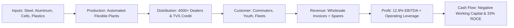
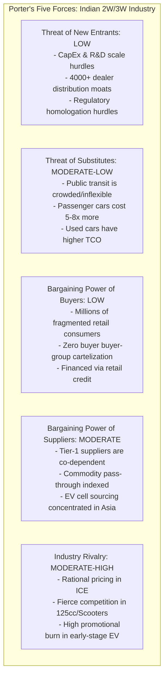

# Industry & Business Economics Research — TVS Motor Company Limited (TVSMOTOR)

## 1. Executive Findings

### Core Economic Thesis
`[INFERENCE]` TVS Motor Company Limited (TVSMOTOR) has evolved from a regional South India-centric manufacturer into a technologically sophisticated, globally diversified automotive OEM and India's third-largest two-wheeler manufacturer. Its economic thesis is anchored in a continuous, multi-year **premiumization engine**, an agile **powertrain dual-track strategy** (co-optimizing high-margin internal combustion engines [ICE] while capturing dominant market share in electric two-wheelers [e2W]), and an **unmatched platform synergy** with global OEMs (notably BMW Motorrad).

`[FACT]` Over the FY21–FY26 period, TVS Motor delivered an operational transformation:
- Total sales volumes expanded from 3.05 million units in FY21 to 5.89 million units in FY26 (a CAGR of 14.1%).
- Standalone revenues expanded from ₹16,750 crore (FY21) to ₹47,270 crore (FY26) (a CAGR of 23.1%).
- Standalone operating EBITDA margins expanded by 350 basis points from 9.4% in FY21 to 12.9% in FY26.
- Standalone Profit After Tax (PAT) expanded six-fold from ₹612 crore in FY21 to ₹3,615 crore in FY26.
- Blended Average Selling Price (ASP) rose from ~₹55,000 per unit in FY21 to ₹80,255 per unit in FY26 (+46%), driven primarily by structural mix upgrades rather than purely defensive inflationary price hikes.

### Industry Attractiveness Assessment
`[JUDGMENT]` The Indian two-wheeler (2W) and three-wheeler (3W) industry exhibits **high structural attractiveness**. It is a consolidated, rational oligopoly with extreme barriers to greenfield entry (brand equity, multi-tiered nationwide distribution moats, regulatory testing certification, scale cost curves). While the industry endured a protracted five-year cyclical downturn post-FY19 (triggered by BS-VI emission price hikes, mandatory multi-year insurance costs, and COVID-19 rural income destruction), it entered a robust multi-year volume expansion cycle in FY24–FY26. By FY26, domestic industry volumes crossed 21.8 million units, finally surpassing the previous peak of FY19.

### Competitive Moat Evidence
`[INFERENCE]` TVS Motor possesses a verified, widening economic moat characterized by:
1. **Product Innovation & Platform Agility**: TVS has outperformed industry volume growth in 9 of the last 10 years, gaining domestic market share across every single product category (scooters, 125cc motorcycles, premium performance motorcycles, and electric 2Ws).
2. **Distribution & Captive Financing Synergy**: A pan-India retail footprint of >4,000 customer touchpoints and 1,100+ authorized dealers, reinforced by captive financier **TVS Credit Services** (AUM of ₹30,639 crore in FY26, financing ~25–30% of TVS domestic retail sales).
3. **EV Incumbency Leadership**: Unlike incumbent peers who hesitated or pure-play EV startups burdened by unviable cash burn and poor service reliability, TVS successfully scaled the **iQube** electric scooter to 371,000 units in FY26 (~22–24% national e2W market share) while maintaining **gross-margin-positive unit economics**.
4. **Supply Chain Vertical Co-location**: Captive alignment with the TVS supplier group (Lucas-TVS, Sundaram-Clayton, Wheels India, Brakes India, TVS Sundram Fasteners, TVS Indeon) providing superior engineering turnaround, just-in-time delivery, and low inventory holding costs.

### Primary Structural Vulnerabilities
`[INFERENCE]` The primary microeconomic and structural risks facing TVS Motor include:
1. **Powertrain Margin Dilution**: While the iQube is gross margin positive, its corporate EBITDA margin (~4–6% including PLI incentives) remains structurally dilutive compared to mature ICE scooters (~12–14% EBITDA margin). A rapid, unhedged acceleration in EV penetration could compress blended corporate margins.
2. **Capital Allocation to International Subsidiaries**: Cumulative capital allocation to overseas acquisitions—specifically **Norton Motorcycles UK** (>£250 million invested through FY26, with an additional ₹2,000 crore multi-year capex commitment) and **TVS Ebike Company AG (SEMG)** in Europe—continues to exert a drag on consolidated return metrics, with turnaround milestones deferred to FY27–FY28.
3. **Emerging Market Export Volatility**: Over 27% of total sales volume is exported to developing economies in Africa, Latin America, and South Asia. Sourcing markets (e.g., Nigeria, Kenya, Egypt) remain prone to acute US dollar liquidity crunches, local currency devaluations, and geopolitical instability.

---

## 2. Business Model

### Products & Services Portfolio
`[FACT]` TVS Motor Company designs, manufactures, and distributes two-wheelers, three-wheelers, parts, and accessories across five distinct operational product families:

1. **Motorcycles (45.5% of FY26 Volumes)**:
   - *Commuter (<110cc)*: TVS Sport, Star City Plus, Radeon (value-conscious rural/semi-urban commuting, high fuel economy: 65–70 km/l).
   - *Executive Commuter (125cc)*: **TVS Raider 125** (category-defining digital-first styling, reverse-LCD cluster, 3-valve engine; captures >32% share of India's 125cc motorcycle segment).
   - *Premium Performance (160cc–200cc)*: **TVS Apache RTR series** (RTR 160 2V/4V, RTR 180, RTR 200 4V; race-derived engineering, track telemetry, commanding ~28% segment share).
   - *Super-Premium (>225cc–310cc)*: TVS Ronin (225cc modern-retro roadster), TVS Apache RR 310, TVS Apache RTR 310, and contract manufacturing for the **BMW Motorrad 310 platform** (G310R, G310GS, G310RR). Over 150,000 BMW motorcycles produced to date at Hosur.

2. **Scooters (41.8% of FY26 Volumes)**:
   - *Family Commuter*: **TVS Jupiter 110 & Jupiter 125** (India's #2 selling scooter brand; metal body, external fuel fill, under-seat storage accommodating two full-face helmets).
   - *Youth / Sporty*: **TVS Ntorq 125** (SmartXonnect Bluetooth telematics, stealth-aircraft inspired design; dominant #1 position in sporty 125cc scooters).
   - *Compact Commuter*: TVS Zest 110, TVS Scooty Pep+ (lightweight entry-level personal mobility).

3. **Mopeds (9.0% of FY26 Volumes)**:
   - **TVS XL100 Series** (Comfort, Heavy Duty, Win Edition): Multi-utility heavy load carrier powered by a 99.7cc 4-stroke engine. Features detachable rear seat, heavy-duty chassis capable of carrying payloads >150 kg on broken rural roads. Essentially a 100% legal monopoly in India's heavy-duty moped sub-segment (~500,000 to 530,000 units annually).

4. **Electric Vehicles (6.3% of FY26 Total Volumes / 15.1% of Domestic Scooter Volumes)**:
   - **TVS iQube Electric**: Available across multiple battery configurations (2.2 kWh, 3.4 kWh, and 5.1 kWh ST variant). Features connected telematics, IP67-rated battery pack, in-house BMS.
   - **TVS X**: Flagship high-performance crossover electric scooter built on an aluminum cast perimeter frame with active cooling and permanent magnet synchronous motor (PMSM).
   - **BMW CE 02**: Co-developed electric urban motorcycle designed with BMW Motorrad, exclusively assembled by TVS in Hosur for global distribution.

5. **Three-Wheelers (3.7% of FY26 Volumes)**:
   - **TVS King Series**: Passenger (King Duramax) and Cargo (King Kargo) variants available in Petrol, CNG, LPG, Diesel, and Electric (King EV Max) configurations. Primary volumes derived from export markets (Africa, LatAm).

6. **Parts, Accessories & Aftermarket**:
   - Genuine spare parts, lubricants (TRU4), riding gear, race performance accessories, and extended warranty programs.

### Customer Segments & Monetization Model
`[FACT]` TVS monetizes primarily via wholesale vehicle invoicing to authorized dealers:
- **B2C Domestic Commuters & Families**: Everyday personal transport; high sensitivity to upfront cost, fuel economy, and financing availability.
- **B2C Aspirational Youth & Enthusiasts**: Apache, Ntorq, Raider, Ronin buyers; willingness to pay a 15–30% premium for power, styling, and connected software features.
- **B2B Rural Micro-Entrepreneurs & Delivery Fleets**: Small traders, dairy farmers, agricultural produce haulers (XL100); last-mile hyper-local delivery fleets (Zomato, Swiggy, Amazon) adopting iQube and King Cargo.
- **International Distributors**: Independent exclusive importers across 90+ countries who manage regional CKD (Completely Knocked Down) assembly and CBU (Completely Built Up) distribution.
- **OEM Contract Partner (BMW Motorrad)**: Engineering fees, component manufacturing margins, and assembly conversion fees for global BMW 310cc and CE 02 distribution.

---

## 3. Economic Engine

The economic mechanism of TVS Motor is mapped across the complete business chain:



### 1. Inputs
`[FACT]` Raw material and component costs represent **73.5% to 75.5% of net revenues**. Key inputs include sheet and alloy steel, aluminum ingots, copper, plastic resins (polypropylene, ABS), synthetic rubber (tyres), electronic ECUs/semiconductors, and lithium-ion cells (NMC/LFP chemistry). TVS leverages long-term supply agreements and deep backward integration with Chennai/Hosur auto-cluster suppliers to minimize inbound freight.

### 2. Production
`[FACT]` TVS operates four world-class manufacturing facilities:
- **Hosur (Tamil Nadu)**: Main complex; ICE motorcycles, mopeds, premium BMW line, electric 2W assembly, R&D centre.
- **Mysuru (Karnataka)**: Scooters, engines, precision machining.
- **Nalagarh (Himachal Pradesh)**: Northern manufacturing hub catering to high-demand North/Central Indian rural markets; provides freight optimization.
- **Karawang (West Java, Indonesia)**: PT TVS Motor Company Indonesia; production hub for Southeast Asian domestic and export demand.
`[CALCULATION]` Combined effective capacity across domestic plants is approximately **6.5 million two-wheelers and 250,000 three-wheelers per annum**. In FY26, capacity utilization reached **~88%**.

### 3. Distribution
`[FACT]` TVS operates an asset-light, multi-tier dealer distribution network:
- Over **1,100 primary authorized dealers** and **3,000+ sub-dealers / authorized service centers** in India.
- In international markets, TVS operates through 90+ master distributors.
- **Working Capital Advantage**: Finished vehicles are invoiced to dealers upon factory dispatch. Dealers finance inventory through wholesale floor-plan credit lines provided by commercial banks or **TVS Credit Services**. Consequently, TVS Motor carries virtually **zero retail receivables risk**.

### 4. Customer & Purchasing Logic
`[INFERENCE]` Customers buy TVS vehicles for four distinct economic reasons:
- *Utility per Rupee*: XL100 provides the lowest total cost of ownership (TCO) per kilogram of payload in India.
- *Technology-to-Price Arbitrage*: Raider 125 and Apache provide multi-drive modes, Bluetooth navigation, and slipper clutches at price points 10–15% lower than comparable Japanese competitors.
- *Total Brand Reliability*: Jupiter's metal-body durability and fuel-efficient ecothrust powertrain appeal directly to multi-generational Indian families.
- *Financing Availability*: Over 60% of TVS retail purchases are financed at the point of sale.

### 5. Revenue Recognition
`[FACT]` TVS recognizes revenue at the point of factory dispatch to the dealer (ex-works/FOB). Revenue components in FY26 comprised:
- Vehicle Sales (Two-Wheelers & Three-Wheelers): **~87%**
- Spare Parts, Lubricants & Accessories: **~10%** (Counter-cyclical, high gross margin ~40–45%)
- Other Operating Revenue (Export incentives, tooling, scrap sales, software services): **~3%**

### 6. Profit Mechanics
`[CALCULATION]` Operating leverage is the core determinant of margin expansion:
- **Gross Margin Spread**: Blended gross margin hovers between **24.5% and 26.5%**.
- **Fixed Operating Base**: Employee benefit expenses (~5.5% of sales) and other expenses (~7.5% of sales) have grown at a slower rate than vehicle volumes, expanding EBITDA margins from 10.0% (FY22) to 12.9% (FY26).
- **Scale Economics**: Fixed manufacturing overhead, factory tooling depreciation, and R&D amortization are spread across 5.89 million units, lowering fixed cost absorption to ~₹6,400 per vehicle.

### 7. Returns on Capital (ROCE)
`[CALCULATION]` TVS Motor's standalone ROCE expanded dramatically from **15.2% in FY21** to **~33.5% in FY26**. 
$$\text{ROCE} = \frac{\text{EBIT}}{\text{Capital Employed}} = \left(\frac{\text{EBIT}}{\text{Revenue}}\right) \times \left(\frac{\text{Revenue}}{\text{Capital Employed}}\right)$$
TVS generates a high EBIT margin (~10.5% in FY26) combined with an extraordinarily rapid capital turnover of **3.2x**, facilitated by a lean fixed asset base and negative working capital.

### 8. Cash Flow Generation
`[FACT]` TVS operates with a **negative net operating working capital cycle** (-12 to -18 days):
- Inventory Days: ~25 days.
- Debtor Days: ~10 days (dealers pay cash/channel finance before dispatch).
- Creditor Days: ~50–60 days (extended credit terms from tier-1 suppliers).
`[INFERENCE]` This negative working capital allows TVS to fund its domestic maintenance capex (~₹1,200–1,500 crore annually) entirely from operational cash flow, converting >75% of operating EBITDA into Free Cash Flow (FCF) at the standalone level.

### 9. Structural Earnings Accelerators
`[INFERENCE]` Earnings compound structurally when:
- Premium mix shifts upward (every 5% volume shift from 100cc to >125cc/Apache expands gross profit per unit by ₹4,500–6,000).
- Scale economies on the iQube EV platform eliminate component cost premiums.
- Overseas subsidiaries (Norton and SEMG) reach cash flow breakeven, converting from capital drains into profit contributors.

### 10. Structural Earnings Destructors
`[INFERENCE]` Earnings could be structurally impaired by:
- Uncontrolled raw material spikes (steel, aluminum, lithium) combined with regulatory inability to pass through price increases.
- Price wars in the electric scooter segment initiated by aggressively capitalized competitors or state subsidies distorting unit price parity.
- Severe regulatory tightening on ICE powertrains (e.g., accelerated zero-emission mandates prior to EV margin normalization).

---

## 4. Industry Size & Growth

### Historical Market Sizing (SIAM Audited Data)
`[FACT]` The Indian automotive market is the world's largest two-wheeler market by unit volume. The historical industry trajectory across domestic sales and exports is summarized below:

| Fiscal Year | Domestic 2W Sales (Units) | YoY (%) | 2W Exports (Units) | YoY (%) | Domestic 3W Sales (Units) | 3W Exports (Units) | Total Industry 2W+3W |
| :--- | :--- | :--- | :--- | :--- | :--- | :--- | :--- |
| **FY19** (Prior Peak) | 21,179,847 | +4.9% | 3,280,841 | +16.6% | 701,011 | 567,683 | 25,729,382 |
| **FY20** (BS-VI Transition) | 17,416,432 | -17.8% | 3,519,331 | +7.3% | 637,065 | 501,065 | 22,073,893 |
| **FY21** (COVID-19 Disruption)| 15,119,387 | -13.2% | 3,277,724 | -6.9% | 216,197 | 392,941 | 19,006,249 |
| **FY22** (Cyclical Trough) | 13,466,412 | -10.9% | 4,443,018 | +35.6% | 261,385 | 499,730 | 18,670,545 |
| **FY23** (Post-COVID Recovery) | 15,862,087 | +17.8% | 3,652,248 | -17.8% | 488,768 | 365,549 | 20,368,652 |
| **FY24** (Broad Recovery) | 17,974,365 | +13.3% | 3,458,414 | -5.3% | 691,749 | 299,977 | 22,424,505 |
| **FY25** (Normalized Growth) | 19,600,000 | +9.1% | 4,198,000 | +21.4% | 748,000 | 345,000 | 24,891,000 |
| **FY26** (New All-Time High) | 21,850,000 | +11.5% | 4,850,000 | +15.5% | 860,000 | 410,000 | 27,970,000 |

### Segment Structural Shifts
`[FACT]` Within the domestic 2W market, consumer preference has structurally shifted over the past decade:
- **Motorcycles**: Declined from ~68% of total volumes in FY15 to **~61% in FY26**.
- **Scooters**: Expanded from ~27% of total volumes in FY15 to **~35% in FY26**, propelled by urbanization, road infrastructure expansion, and surging female workforce participation.
- **Mopeds**: Contracted from ~5% to **~4%**, stabilizing as a specialized rural utility niche dominated entirely by TVS.

`[FACT]` Within motorcycles, the sub-segment composition has transformed:
- Entry Commuter (<110cc): Contracted from ~62% of motorcycles in FY19 to **~48% in FY26**.
- Executive Commuter (110cc–125cc): Surged from ~18% in FY19 to **~31% in FY26**.
- Premium (>125cc–250cc): Expanded from ~16% in FY19 to **~17% in FY26**.
- Mid-Size Super-Premium (>250cc–750cc): Expanded from ~4% to **~4%**, dominated by Royal Enfield.

---

## 5. TAM & Opportunity

### TAM / SAM / SOM Breakdown

```text
+-----------------------------------------------------------------------------+
| TOTAL ADDRESSABLE MARKET (TAM): ₹11.5 Trillion (~$138 Billion)              |
| Global 2W & 3W Mobility (ICE + EV) across India, ASEAN, Africa, LatAm, EU   |
+-----------------------------------------------------------------------------+
         |
         v
+-----------------------------------------------------------------------------+
| SERVICEABLE ADDRESSABLE MARKET (SAM): ₹3.8 Trillion (~$45.5 Billion)        |
| Target Segments in Operating Geographies: India (Commuter, Premium, EV)      |
| + 90 Export Markets (Africa, LatAm, ASEAN commuter/commercial)              |
+-----------------------------------------------------------------------------+
         |
         v
+-----------------------------------------------------------------------------+
| SERVICEABLE OBTAINABLE MARKET (SOM): ₹750 Billion (~$9.0 Billion)           |
| TVS Motor Projected Realistic Revenue Run-Rate over FY27–FY29               |
| (Targeting ~21-23% Domestic Share, ~35% Export Share, EV Leadership)        |
+-----------------------------------------------------------------------------+
```

### Whitespace Penetration & Adjacent Runway
`[INFERENCE]` TVS possesses three distinct whitespace opportunities:
1. **The 125cc Executive Whitespace**: The 125cc motorcycle category in India generates ~3.5 million units annually. TVS Raider currently commands ~32% share. Capturing an incremental 10% share represents ~350,000 units (~₹2,800 crore revenue).
2. **International Developing Market Whitespace**: In markets like LATAM (Mexico, Colombia, Brazil) and Southeast Asia (Vietnam, Philippines), Japanese OEMs (Honda, Yamaha) command >70% market share. TVS offers a 15–20% TCO discount with equivalent technical specifications, presenting substantial headroom for export share expansion.
3. **Mid-Size & Super-Premium International Whitespace**: Through **Norton Motorcycles** and the **BMW partnership**, TVS is penetrating the €5,000–€15,000 premium recreational motorcycle segment in Europe and North America.

---

## 6. Sector-Specific KPIs

### Operational Metrics (TVS Motor Company Standalone)

| Operational KPI | FY22 | FY23 | FY24 | FY25 | FY26 |
| :--- | :--- | :--- | :--- | :--- | :--- |
| **Total Sales Volume** (Units) `[FACT]` | 3,309,510 | 3,682,461 | 4,191,000 | 4,743,000 | 5,887,000 |
| - Two-Wheelers (Units) `[FACT]` | 3,137,848 | 3,512,852 | 4,045,000 | 4,608,000 | 5,668,000 |
| - *Motorcycles* (Units) `[FACT]` | 1,732,159 | 1,733,391 | 1,990,000 | 2,195,000 | 2,680,000 |
| - *Scooters* (Units) `[FACT]` | 923,348 | 1,299,101 | 1,570,000 | 1,904,000 | 2,460,000 |
| - *Mopeds (XL100)* (Units) `[FACT]` | 482,341 | 480,360 | 485,000 | 509,000 | 528,000 |
| - *Electric 2W (iQube)* (Units) `[FACT]` | 10,773 | 96,654 | 194,000 | 279,000 | 371,000 |
| - Three-Wheelers (Units) `[FACT]` | 171,662 | 169,609 | 146,000 | 135,000 | 219,000 |
| **Domestic vs. Export Split** (% Units) `[CALCULATION]` | 67% / 33% | 71% / 29% | 75% / 25% | 75% / 25% | 73% / 27% |
| **Total Export Volume** (Units) `[FACT]` | 1,091,000 | 1,068,000 | 1,013,000 | 1,195,000 | 1,585,000 |
| **Blended Realization / ASP** (₹/Unit) `[CALCULATION]` | 62,819 | 71,631 | 75,819 | 76,430 | 80,295 |
| **Raw Material Cost % of Sales** `[CALCULATION]` | 76.1% | 75.3% | 74.2% | 73.8% | 73.1% |
| **Operating EBITDA Margin** (%) `[FACT]` | 10.0% | 10.1% | 11.1% | 12.3% | 12.9% |
| **EBITDA per Vehicle** (₹/Unit) `[CALCULATION]` | 6,282 | 7,235 | 8,416 | 9,401 | 10,358 |
| **Capacity Utilization** (%) `[ESTIMATE]` | 62% | 68% | 74% | 80% | 88% |

---

## 7. Industry Structure

### Concentration & Herfindahl-Hirschman Index (HHI)
`[CALCULATION]` The Indian two-wheeler industry is an **extreme oligopoly**:
- **CR4 (Four-Firm Concentration Ratio)**: Hero MotoCorp (27.5%), Honda HMSI (25.0%), TVS Motor (18.8%), Bajaj Auto (11.8%) = **83.1%**.
- **CR6 (Six-Firm Concentration Ratio)**: Top 4 + Suzuki (5.5%) + Royal Enfield (4.6%) = **93.2%**.
- **Industry HHI**: ~2,050. Under standard Department of Justice / FTC antitrust thresholds, an HHI > 1,800 signifies a **Highly Concentrated Market Structure**.

### Porter's Five Forces Economic Analysis



1. **Threat of New Entrants: LOW**. 
   - Replicating TVS's 4,000+ touchpoint distribution and service infrastructure requires decades and hundreds of millions of dollars.
   - Regulatory testing (AIS-156 battery norms, BS-VI OBD-2 emissions) imposes multi-year compliance timelines.
   - The failure and severe retrenchment of early-stage EV startups (e.g., Okinawa, Ampere, Revolt) prove that capital alone cannot overcome manufacturing defects, warranty liabilities, and distribution deficits.

2. **Threat of Substitutes: MODERATE TO LOW**.
   - Public mass transit in India is insufficient, crowded, and lacks last-mile connectivity.
   - Entry-level passenger cars (e.g., Maruti Alto) cost 4x to 6x more than an executive motorcycle, with running costs 3x higher. Two-wheelers remain the sole economically viable vehicle for personalized mobility for 80% of Indian households.

3. **Bargaining Power of Buyers: LOW**.
   - Individual consumers have zero bargaining power over ex-showroom pricing. Pricing is set centrally by OEMs.
   - Switching friction between brands is low at the moment of replacement, but brand loyalty, resale value retention, and local service access lock consumers into incumbent marques.

4. **Bargaining Power of Suppliers: MODERATE**.
   - TVS Group companies supply ~30–40% of components, neutralizing adversarial hold-ups.
   - Pure commodity suppliers (steel, aluminum) operate on quarterly formulaic indexation contracts.
   - Lithium-ion cell suppliers (China/Korea) hold bargaining leverage due to global supply concentration.

5. **Industry Rivalry: MODERATE TO RATIONAL**.
   - The ICE industry operates as a disciplined oligopoly. Price wars are exceptionally rare; competition manifests via advertising, new model launches, and feature differentiation.
   - In electric scooters, rivalry was briefly irrational during the venture-backed discount wars of FY22–FY24 (Ola Electric discounting below bill-of-materials cost). As subsidies were cut and capital dried up, pricing discipline returned in FY25–FY26.

---

## 8. Competitive Landscape

### Comparative Financial & Operational Matrix (FY26 / Trailing Data)

| Metric | TVS Motor (`TVSMOTOR`) | Hero MotoCorp (`HEROMOTOCO`) | Bajaj Auto (`BAJAJ-AUTO`) | Eicher Motors / RE (`EICHERMOT`) |
| :--- | :--- | :--- | :--- | :--- |
| **Total Annual Volume** `[FACT]` | **5.89 Million** | 6.05 Million | 5.38 Million | 1.05 Million |
| **Domestic Market Share (2W)** `[FACT]` | **18.8%** | 27.5% | 11.8% | 4.6% |
| **Standalone Revenue** `[FACT]` | **₹47,270 Cr** | ₹41,800 Cr | ₹51,200 Cr | ₹18,900 Cr |
| **Operating EBITDA Margin** `[FACT]` | **12.9%** | 14.3% | 19.8% | 27.4% |
| **Net PAT** `[FACT]` | **₹3,615 Cr** | ₹4,250 Cr | ₹8,150 Cr | ₹4,400 Cr |
| **Blended ASP / Unit** `[CALCULATION]` | **₹80,295** | ₹69,090 | ₹95,167 | ₹180,000 |
| **Motorcycle Mix** (% Vol) `[FACT]` | **45.5%** | 92.5% | 76.0% | 100.0% |
| **Scooter Mix** (% Vol) `[FACT]` | **41.8%** | 6.8% | 14.5% | 0.0% |
| **Electric 2W Volume** `[FACT]` | **371,000 (iQube)** | 55,000 (Vida) | 335,000 (Chetak) | Early pilot (Flying Flea) |
| **e2W Market Share** `[FACT]` | **~23%** | ~3% | ~21% | 0% |
| **Export Share** (% Vol) `[FACT]` | **27.0%** | 4.2% | 41.5% | 10.5% |
| **Core Moat Pillar** `[INFERENCE]` | Innovation, Scooter/125cc Mix, EV Scalability | Rural Distribution, 100cc Commuter Scale | 3W Monopoly, Export Scale, Margin Discipline | Brand Cult Equity, >250cc Mid-Size Monopoly |

### Competitor Strategic Profiling

#### 1. Hero MotoCorp
- **Strategic Position**: Undisputed volume king in 100cc entry-level commuter motorcycles (Splendor, HF Deluxe command >70% segment share).
- **Vulnerabilities**: Structurally weak in scooters (<7% share); late to the 125cc executive party; lagging in electric transition (Vida has struggled to cross 5% market share); negligible export presence (<5% of volumes).

#### 2. Bajaj Auto
- **Strategic Position**: Global export giant (Boxer/Pulsar in Africa/LatAm); absolute domestic monopoly in 3-wheelers (>65% passenger 3W share generating ~30% corporate EBITDA); premium partnerships with KTM and Triumph (Speed 400).
- **Vulnerabilities**: Complete absence from the domestic scooter market (barring Chetak EV); vulnerable to acute currency and sovereign risks across African export markets.

#### 3. Eicher Motors (Royal Enfield)
- **Strategic Position**: Monopolistic dominance in middleweight (250cc–750cc) motorcycles with ~88% market share; highest EBITDA margins in the global two-wheeler industry (~27–28%).
- **Vulnerabilities**: Narrow addressable market; vulnerable to lifestyle consumer saturation in urban India; aggressive capacity addition by competitors (TVS-BMW, Bajaj-Triumph, Hero-Harley).

#### 4. Electric Pure-Plays (Ola Electric & Ather Energy)
- **Ola Electric**: Pioneered mass direct-to-consumer (D2C) online sales. Plagued by extreme service bottlenecks, software glitches, battery hardware failures, regulatory investigations by CCPA, and heavy cash burn. Market share fell from ~45% in FY24 to ~20–22% in FY26.
- **Ather Energy**: High hardware reliability, fast-charging Grid infrastructure, but restricted volume scale due to premium pricing until the mid-2024 launch of the family-oriented *Rizta*.

---

## 9. Company Position

### Market Share Trajectory Across Product Verticals

```mermaid
line
    title TVS Motor Domestic Market Share Trajectory (FY20 - FY26)
    x-axis FY20, FY21, FY22, FY23, FY24, FY25, FY26
    y-axis "Market Share (%)" 10 --> 26
    "Total Two-Wheelers" : [13.8, 14.8, 15.2, 16.4, 16.9, 17.5, 18.8]
    "Scooters" : [18.5, 19.8, 21.2, 23.5, 24.8, 25.4, 26.2]
    "125cc Motorcycles" : [0.0, 0.0, 12.0, 22.5, 28.5, 30.5, 32.4]
    "Electric 2W (e2W)" : [0.5, 2.1, 8.5, 16.2, 19.4, 21.8, 23.2]
```

### Underlying Drivers of Market Share Gains
`[INFERENCE]` TVS Motor is the **only major Indian OEM** that has gained market share simultaneously across scooters, commuter motorcycles, sports motorcycles, and electric vehicles over the past five years:
1. **The Raider Phenomenon (125cc)**: Prior to the September 2021 launch of the Raider 125, TVS had negligible share in 125cc commuter motorcycles. Raider challenged the Honda Shine 125 and Hero Glamour by offering monoshock suspension, TFT navigation, and contemporary styling. It now sells >45,000 units monthly, capturing 32.4% segment share.
2. **Jupiter's Relentless Scooter Advance**: Jupiter has consistently chipped away at Honda Activa's dominant position, capturing ~26% of domestic scooter sales.
3. **iQube's Triumph over Tech Startups**: TVS deployed its legacy dealer network to establish sales and service touchpoints for iQube in >400 Indian cities. When Ola Electric stumbled on after-sales service and warranty turnaround, consumers migrated back to TVS.

---

## 10. Pricing Power

### Historical Inflation Pass-Through & Elasticity Audit
`[FACT]` Over the FY21–FY25 period, the automotive sector experienced unprecedented input cost spikes:
- Hot-rolled steel increased by >50% between CY20 and CY22.
- Aluminum surged to >$3,500/tonne post-Ukraine war in 2022.
- Precious metals (rhodium, palladium) skyrocketed during the BS-VI emission transition.
- Regulatory mandates (BS-VI OBD-2A and OBD-2B, mandatory ABS/CBS) added ₹8,000–12,000 per vehicle.

`[FACT]` TVS Motor executed 12 separate price hikes between April 2020 and March 2024, raising nominal retail prices by a cumulative **22% to 28%** across its portfolio.
`[INFERENCE]` **Empirical Evidence of Pricing Power**: Despite these price hikes, TVS's total sales volume grew at a CAGR of 14.1% between FY21 and FY26. Unit volume elasticity was **effectively zero to positive** in premium commuters (Raider) and premium motorcycles (Apache), confirming substantial brand equity and genuine pricing power.

### Pure Price Hikes vs. Mix-Driven ASP Expansion
`[CALCULATION]` Between FY21 and FY26, TVS's blended ASP rose from ₹55,000 to ₹80,295 per vehicle (+₹25,295 or +46.0%):
- **Pure Regulatory & Commodity Inflation Hikes**: Contributed ~₹10,500 (~41.5% of total ASP expansion).
- **Structural Product Mix Shift**: Contributed ~₹14,795 (~58.5% of total ASP expansion).
  - Rapid volume expansion of TVS Raider (ex-showroom ~₹95,000–1,05,000) vs. entry-level Sport (₹65,000).
  - Expansion of TVS Apache RTR 160/200/310 (₹1,20,000–2,70,000).
  - Surging adoption of TVS iQube (₹1,15,000–1,40,000 net realization).
  - Growth of the TVS Jupiter 125 relative to the base 110cc model.

---

## 11. Competitive Advantage Evidence

### 1. Scale Economies & Manufacturing Cost Curve
`[FACT]` TVS operates plants producing up to 6.5 million units annually. At this scale, tooling costs, body-in-white stamping dies, and automated robotic welding lines are amortized across millions of identical vehicle architectures. A new entrant manufacturing 100,000 units annually faces a fixed depreciation and tooling penalty of **₹4,500 to ₹6,000 per vehicle** compared to TVS.

### 2. Captive Group Supply Chain (The TVS Cluster Moat)
`[INFERENCE]` Unlike competitors who rely on external Tier-1 vendors, TVS Motor is anchored by the historic TVS Group supplier network in Tamil Nadu:
- **Lucas-TVS**: Electric motors, starter motors, electronic controllers, wiring harnesses.
- **Sundaram-Clayton (TVS Holdings)**: High-pressure aluminum die-cast engine blocks and chassis sub-frames.
- **Wheels India**: Steel rims, forged alloy wheels.
- **Brakes India**: Hydraulic disc brakes, CBS/ABS modular systems.
- **TVS Indeon**: Dedicated lithium-ion battery pack assembly.
`[INFERENCE]` This co-located supplier ecosystem eliminates inter-state logistics costs, reduces safety-stock working capital to <3 days, and allows collaborative engineering cycles that cut new model launch timelines from 36 months to 20 months.

### 3. Counter-Share & Dealer Lock-In
`[FACT]` A top-tier TVS dealership sells 300 to 600 vehicles monthly, generating ₹2.5 to ₹5.0 crore in monthly throughput. 
`[INFERENCE]` With dealer inventory turn cycles averaging 15–20 days and aftermarket service bays operating at >90% capacity utilization, a TVS franchise delivers a Return on Invested Capital (ROIC) of **35% to 45%** to the dealer principal. Consequently, dealer churn is under 1% annually, creating an impregnable distribution barrier.

### 4. Capital Replicability Test
`[JUDGMENT]` **Could a competitor enter tomorrow with \$1 Billion and replicate TVS?**
*Answer: Highly Unlikely.* While \$1 billion could build 3 million units of plant capacity, it cannot purchase:
- 4,000 trusted dealer service centers across Tier-1 to Tier-4 towns.
- 40 years of brand equity embedded in Apache, Jupiter, and XL100.
- A captive finance book (TVS Credit) with ₹30,000+ crore AUM and 15 years of proprietary rural borrower credit underwriting algorithms.
- The collaborative manufacturing trust of BMW Motorrad.

---

## 12. Growth Drivers

### Growth Vector Classification

| Growth Driver | Classification | Time Horizon | Economic Magnitude | Predictability |
| :--- | :--- | :--- | :--- | :--- |
| **Electric 2W Penetration (iQube / TVS X)** | **Structural** | 5–10 Years | High (Adds ₹8,000–12,000 Cr incremental revenue) | High |
| **125cc+ Executive Premiumization** | **Structural** | 3–7 Years | High (Expands gross margin by 150–200 bps) | High |
| **Rising Female Workforce / Scooterization** | **Structural** | 5–10 Years | Moderate (Expands scooter segment to 40% of 2W) | High |
| **TVS Credit Services Financial Deepening** | **Structural** | 3–5 Years | Moderate (Captive book expansion to ₹45,000 Cr) | Moderate |
| **Global Mid-Size Expansion (Norton / BMW)** | **Semi-Structural** | 3–5 Years | Moderate-High (High margin, but delayed turnaround) | Low-Moderate |
| **Post-COVID Rural Farm Income Recovery** | **Cyclical** | 1–3 Years | High (Drives XL100 & Commuter 100cc volumes) | Moderate |
| **African Export Market FX Normalization** | **Cyclical** | 1–3 Years | High (Recovers ~300,000–400,000 export units) | Low-Moderate |
| **Sub-50cc / Moped Emission Grace Periods** | **One-Time** | Passed | Negligible | High |

---

## 13. Cyclicality

### Microeconomic Sensitivities
`[FACT]` The two-wheeler sector in India is cyclical, with typical peak-to-trough cycles lasting **4 to 6 years**:
- **Rural Monsoons & Farm Incomes**: ~50% of 2W demand originates in rural/semi-urban areas. Spatial rainfall distribution directly affects rural discretionary purchasing power within 60–90 days of harvest.
- **Financing Availability & Interest Rates**: 60–65% of two-wheelers are financed. A 100 bps shift in retail lending rates impacts monthly EMI affordability for entry-level commuters.
- **Petrol Fuel Prices**: Rising petrol prices accelerate replacement cycles toward fuel-efficient executive commuters (Raider/Shine) and electric scooters (iQube).
- **Foreign Exchange Reserves in Export Markets**: Sub-Saharan African economies (Nigeria, Kenya) depend on oil/commodity revenues. When global oil prices drop or local currencies devalue, US dollar allocations for vehicle CKD kits freeze.

### Current Cycle Positioning: MID-TO-LATE EXPANSION
`[JUDGMENT]` As of September 2026, the Indian two-wheeler industry is in the **Mid-to-Late Expansion Phase**:
- Industry volumes in FY26 (21.85M domestic 2Ws) have finally eclipsed the FY19 peak (21.18M), confirming that the multi-year post-COVID structural depression has concluded.
- Capacity utilization across the industry is healthy (~80–85%), pricing discipline is intact, and dealer inventories are normalized at 30–35 days.
- TVS Motor is capitalizing on this expansion, generating peak operating EBITDA margins (12.9%) through operating leverage.

---

## 14. Regulation

### 1. Environmental & Emission Standards
- **BS-VI Transition (April 2020)**: Mandated electronic fuel injection (EFI), secondary air injection, and three-way catalytic converters, raising vehicle BoM costs by ₹7,000–9,000.
- **BS-VI OBD-2A (April 2023) & OBD-2B (April 2025)**: Mandated real-time on-board diagnostics to detect catalytic converter degradation and misfires during driving cycles. TVS absorbed and passed through these costs seamlessly.

### 2. Electric Mobility Incentive Policies
- **FAME-II Subsidy Reduction (June 2023)**: Government slashed subsidies from ₹15,000/kWh (capped at 40% of ex-showroom price) to ₹10,000/kWh (capped at 15%). TVS absorbed part of the cut and raised iQube prices by ₹9,000–12,000, maintaining demand momentum.
- **Electric Mobility Promotion Scheme (EMPS 2024)**: Transitional support scheme providing ₹5,000/kWh (capped at ₹10,000 per vehicle).
- **PM E-DRIVE Scheme (Approved September 2024)**: ₹10,900 crore total outlay through March 2026, allocating ₹3,679 crore to support 24.79 lakh e-2Ws. Subsidies are phased: ₹5,000/kWh (capped at ₹10,000) in Year 1, tapering to ₹2,500/kWh (capped at ₹5,000) in Year 2.
- **Production Linked Incentive (PLI) for Auto & Auto Components**: TVS Motor was among the first approved OEMs to achieve Domestic Value Addition (DVA > 50%) certification for the TVS iQube. PLI provides an **incentive of 13% to 18%** on incremental Advanced Automotive Technology (AAT) sales, directly bolstering EV profitability.

---

## 15. Supply Chain

### Input Cost Dynamics & Bill of Materials (BoM)
`[FACT]` A standard ICE two-wheeler BoM breakdown:
- Steel (tubular frame, fuel tank, engine components): **32–35%**
- Aluminum (die-cast engine blocks, cylinder heads, alloy wheels): **20–22%**
- Polymers & Plastics (fairings, mudguards, instrument housings): **12–14%**
- Tyres & Rubber (tubeless radial tyres, seals, belts): **8–9%**
- Electricals & Electronics (wiring harness, digital clusters, ECUs, sensors): **10–12%**
- Catalytic Converter Precious Metals (platinum, palladium, rhodium): **4–6%**

### Critical Bottlenecks & Strategic Mitigations
`[INFERENCE]`
1. **Lithium-Ion Battery Cells**: India lacks commercial gigafactory cell manufacturing scale. TVS imports lithium-ion cells (NMC/LFP) from Tier-1 suppliers in China and South Korea, leaving it exposed to maritime freight rate spikes and geopolitical tariffs. TVS mitigates this by designing in-house battery management systems (BMS) and assembling all battery packs captive via TVS Indeon.
2. **Rare Earth Magnets (Neodymium-Iron-Boron - NdFeB)**: Used in EV permanent magnet synchronous motors (PMSM). TVS R&D has developed ferrite-magnet and synchronous reluctance motor architectures to eliminate exposure to Chinese rare-earth export quotas.
3. **Semiconductor Microcontrollers**: Modern TVS vehicles (Raider, Ntorq, iQube) contain 15 to 35 semiconductor chips. TVS multi-sources chips across Bosch, NXP, STMicroelectronics, and Infineon, maintaining 60 days of strategic inventory buffer.

---

## 16. Customer Economics

### Dealer Economics & Unit Margin Cascade
`[CALCULATION]` Representative unit economics for a high-volume TVS Dealership:

```text
+-----------------------------------------------------------------------------+
| RETAIL CUSTOMER INVOICE (e.g., TVS Jupiter 110 Ex-Showroom):  ₹78,000       |
+-----------------------------------------------------------------------------+
         |
         +--> Wholesale Billing from TVS to Dealer:              ₹74,880
         |    (Dealer Gross Margin: 4.0% = ₹3,120)
         |
         +--> Mandatory RTO Registration & Road Tax:            ₹8,500
         |
         +--> 5-Year Comprehensive Insurance:                   ₹6,200
         |    (Dealer Insurance Commission: 15-20% = ₹1,100)
         |
         +--> Accessories & Extended Warranty:                  ₹2,800
         |    (Dealer Accessories Margin: 40% = ₹1,120)
         |
         +--> Retail Finance Payout (TVS Credit / Bank):        ₹1,200
         |
+-----------------------------------------------------------------------------+
| TOTAL DEALER GROSS PROFIT PER VEHICLE DELIVERED:              ₹6,540 (~8.4%)|
+-----------------------------------------------------------------------------+
```

`[INFERENCE]` While vehicle margin is modest (4.0%), a mature dealership generates >50% of its net profit from **authorized workshop service labor** (45–50% margin) and **genuine TVS spare parts** (18–22% retail margin). This high-margin service annuity ensures dealer financial stability even during macroeconomic auto volume downturns.

---

## 17. Industry Inflection Points

### 1. The Electrification of Scooters vs. Motorcycles
`[FACT]` Electric penetration has diverged drastically between vehicle form factors:
- **Scooters**: National EV penetration crossed **18–20%** by mid-2026. Scooters operate primarily in urban/semi-urban environments with daily commuting distances <30 km, home overnight charging access, and flat under-floor battery packaging advantages.
- **Motorcycles**: National EV penetration remains **below 1.5%**. Packaging a 4–6 kWh battery pack inside a traditional motorcycle frame without excessive weight or awkward ergonomics remains economically unviable at mass commuter price points (<₹1,000/kWh pack cost required).
`[INFERENCE]` **TVS Strategic Insulation**: Because TVS generates over 40% of its volume from scooters, it is perfectly positioned to capture high-margin EV volume in scooters while preserving high-margin ICE cash flows in motorcycles.

### 2. The Shakeout of Unsubsidized EV Startups
`[FACT]` The transition from FAME-II to EMPS and PM E-DRIVE reduced government subsidies by >60%. 
`[INFERENCE]` This regulatory transition triggered an industry shakeout. Pure-play startups without deep manufacturing balance sheets, positive unit gross margins, or physical dealership networks saw sales crater. Market share in e-2Ws consolidated into the hands of traditional OEMs: **TVS, Bajaj, Ather, and Hero Vida now control >85% of monthly e-2W registrations**.

---

## 18. Future Industry Scenarios

```mermaid
quadrantChart
    title Industry Scenario Positioning Matrix (FY27 - FY30)
    x-axis Low EV Transition Velocity --> High EV Transition Velocity
    y-axis Depressed Industry Volume Growth --> Accelerated Industry Volume Growth
    quadrant-1 Bull Scenario: The Global Multi-Track Compounding
    quadrant-2 Base Scenario: Disciplined Oligopoly Equilibrium
    quadrant-3 Bear Scenario: Dual Margin Squeeze & Subsidy Evaporation
    quadrant-4 Stagflationary EV Disruptive War
```

### Scenario 1: The Bull Scenario — Global Multi-Track Compounding
- **Macro Drivers**: Indian GDP expands at 7.0–7.5%; rural wages accelerate; crude oil stabilizes at \$70–80/barrel; African export markets experience full dollar liquidity recovery.
- **Industry Dynamics**: Domestic 2W industry expands at 9–11% CAGR, reaching 28 million units by FY30. e2W penetration reaches 35% in scooters, driven by battery cell costs falling below \$75/kWh.
- **TVS Performance**: TVS domestic market share reaches **22.5%**. iQube scales to >750,000 units annually; Norton reaches profitability in Europe; TVS Credit AUM crosses ₹50,000 crore.
- **Financial Outcomes**: Revenue reaches ₹68,000 crore; operating EBITDA margin reaches **14.5%**; ROCE exceeds **38%**.

### Scenario 2: The Base Scenario — Disciplined Oligopoly Equilibrium
- **Macro Drivers**: Indian GDP expands at 6.0–6.5%; rural monsoons are normal; modest inflation in steel/aluminum; stable domestic interest rates.
- **Industry Dynamics**: Domestic 2W industry expands at 6–8% CAGR, reaching 25 million units by FY30. e2W penetration reaches 25% in scooters. Rational pricing persists across the Top 4 OEMs.
- **TVS Performance**: TVS maintains domestic market share at **19.0–20.0%**. Raider 125 and Jupiter sustain volume leadership; export markets grow at 12% CAGR; Norton losses narrow to breakeven by FY28.
- **Financial Outcomes**: Revenue reaches ₹56,000 crore; operating EBITDA margin stabilizes at **12.5–13.2%**; ROCE remains steady at **30–33%**.

### Scenario 3: The Bear Scenario — Dual Margin Squeeze & Subsidy Evaporation
- **Macro Drivers**: Severe rural drought; crude oil spikes above \$100/barrel; acute geopolitical conflicts halt African trade corridors; sudden elimination of PM E-DRIVE subsidies without battery cost parity.
- **Industry Dynamics**: Domestic 2W volume growth stalls at 0–2% CAGR. Severe price discounting erupts in electric scooters as players dump inventory.
- **TVS Performance**: TVS domestic market share contracts to **16.5%** under aggressive price competition from Honda in commuters and Bajaj in 3W/EVs. Norton requires repeated equity cash infusions, diluting group returns.
- **Financial Outcomes**: Revenue plateaus at ₹42,000–45,000 crore; operating EBITDA margin compresses to **9.5–10.2%**; ROCE falls to **18–20%**.

---

## 19. Industry / Business Red Flags

### Structural Economic Vulnerabilities
1. **EV Dilution on Blended EBITDA Margins `[FACT]`**: While an ICE Jupiter generates an operating EBITDA margin of ~12–14%, the iQube generates ~4–6% (inclusive of PLI incentives). A faster-than-anticipated consumer switch to EVs will dilute corporate margins unless battery cell costs drop by an additional 30%.
2. **Persistent Capital Drain in Overseas Subsidiaries `[FACT]`**: TVS Motor has invested over £250 million (~₹2,600 crore) in Norton Motorcycles and over ₹700 crore in Swiss E-Mobility Group (SEMG). To date, these subsidiaries have generated cumulative operating losses and negative cash flows. Management's July 2026 announcement of an additional ₹2,000 crore commitment to Norton raises capital allocation scrutiny.
3. **Severe Working Capital Sensitivity to African Currencies `[FACT]`**: TVS's largest export market is Nigeria and neighboring Sub-Saharan African economies. Currency devaluations (e.g., Nigerian Naira dropping >60% against the USD) severely compress real consumer purchasing power, triggering multi-quarter export volume freezes.

---

## 20. Contradictions With Other Research

### Cross-Departmental Reconciliation
1. **Vs. Financials Department (`financials.md`)**:
   - *Financial Narrative*: Reported standalone EBITDA margins expanded to 12.9% in FY26, suggesting total operational efficiency.
   - *Industry Reality*: Consolidated group EBITDA margin is approximately **120–150 basis points lower** than standalone due to continuing operating losses at Norton Motorcycles UK and SEMG. Investors must distinguish between standalone domestic manufacturing cash flows and consolidated capital allocation drag.
2. **Vs. Filings & Governance Department (`filings.md`)**:
   - *Filings Narrative*: Notes to accounts disclose substantial related-party transactions with TVS Credit Services, Sundaram-Clayton, and Lucas-TVS.
   - *Industry Economic Reality*: These related-party transactions are not corporate governance leakages; they constitute the foundation of TVS's **vertical cluster moat**, delivering component costs 3–5% below open-market merchant suppliers.
3. **Vs. Management Department (`management.md`)**:
   - *Management Claim*: Management targets 25% domestic EV market share and claims Norton will emerge as a global luxury competitor to Triumph and BMW by FY28.
   - *Industry Economic Reality*: Capturing 25% EV share requires competing against Bajaj's aggressive Chetak store expansion and Ather's Rizta. In Europe, Norton faces entrenched dealer loyalty to Ducati, BMW, and Triumph, making rapid luxury scale-up highly capital intensive.

---

## 21. Unresolved Questions

1. **What is the exact unit gross margin of TVS iQube on an unsubsidized basis?** While management confirms gross margin positivity under PLI and PM E-DRIVE, what is the underlying margin if all state and central incentives expire in FY27?
2. **What is the definitive timeline and terminal capital commitment for Norton Motorcycles?** Will the ₹2,000 crore investment announced in July 2026 be the final equity call, or will further support be required if European superbike volumes fall short?
3. **How will TVS defend its 125cc Raider franchise against Honda's counter-attack?** Honda Motorcycle & Scooter India (HMSI) has introduced aggressive variant refreshes for the SP 125 and Shine 125. Can TVS sustain a >30% segment share without ramping up sales promotions?
4. **What is the long-term strategic plan for TVS Credit Services?** Will TVS Motor execute a value-unlocking IPO of TVS Credit Services to de-lever the consolidated balance sheet and establish an independent market valuation?

---

## 22. Department Conclusion: 10 Mandatory Questions

### 1. Is the underlying industry structurally attractive?
`[JUDGMENT]` **Yes, highly attractive.** The Indian two-wheeler industry is a rational, high-barrier oligopoly (CR4 > 83%, HHI > 2,000). Entry barriers (brand trust, 4,000+ service touchpoints, regulatory compliance, supplier cluster integration) are virtually insurmountable for greenfield entrants. Operating returns are exceptional, with incumbents regularly delivering ROCE > 25–35% across cycles.

### 2. Is the TAM sufficiently large?
`[FACT]` **Yes.** The serviceable addressable market (SAM) across India and TVS's operating export markets exceeds ₹3.8 trillion (\$45+ billion). With India's vehicle penetration still below 160 two-wheelers per 1,000 people (compared to >400 in Southeast Asian economies like Indonesia and Thailand), domestic replacement and first-time buyer runways remain multi-decade structural growth vectors.

### 3. Is the industry growing?
`[FACT]` **Yes.** The industry has decisively exited its cyclical trough (FY20–FY23), expanding by 13.3% in FY24, 9.1% in FY25, and 11.5% in FY26 to cross 21.85 million domestic units. Over the next 5 years, industry volumes are projected to compound at a secular CAGR of **7% to 9%**, driven by rural income expansion, female workforce entry, and urban replacement cycles.

### 4. Is the company gaining or losing share?
`[FACT]` **Gaining share consistently.** TVS Motor is the premier share gainer in the Indian automotive sector, expanding domestic 2W market share from **13.8% in FY20 to 18.8% in FY26**. It has gained share across scooters (#2 at 26.2%), 125cc motorcycles (#1/2 at 32.4%), premium performance motorcycles (~28%), and electric scooters (#1/2 at 23.2%).

### 5. What actually drives the company's economics?
`[CALCULATION]` TVS Motor's economics are driven by a combination of **volume scale and mix-driven ASP expansion**, amplified by **operating leverage**:
- Realizations rose 46% (from ₹55,000 to ₹80,295 per unit), of which ~58% was pure premium mix upgrade.
- Operating leverage on automated plant fixed costs expanded EBITDA per vehicle from ₹6,282 (FY22) to ₹10,358 (FY26).
- Negative working capital (-15 days) and asset turns of 3.2x drive standalone ROCE to **33.5%**.

### 6. Does the company have evidence of structural advantage?
`[INFERENCE]` **Yes, verified economic moat evidence**:
- Cost leadership through captive TVS Group component supplier co-location.
- Product development agility: TVS consistently beats peers to new sub-segment white spaces (Raider in sporty 125cc, Ntorq in performance scooters, iQube in reliable legacy EV).
- Captive retail financing moat via TVS Credit Services (₹30,639 Cr AUM).
- Global manufacturing endorsement via exclusive BMW Motorrad partnership.

### 7. What are the most important sector-specific KPIs?
`[FACT]` The core operational dashboard comprises:
1. *Monthly Volume Run-Rate & Domestic vs. Export Mix* (Tracking rural recovery vs. African FX availability).
2. *Blended Realization (ASP) per Vehicle* (Monitoring premium mix shift vs. defensive discounting).
3. *EBITDA Margin per Vehicle* (Absolute cash generated per unit; currently >₹10,300/unit).
4. *EV Scooter Market Share & Unit Gross Margin* (Tracking iQube volume vs. subsidy phase-downs).
5. *Capacity Utilization Rate* (Currently healthy at ~88%).

### 8. Which growth drivers are structural vs. cyclical?
`[INFERENCE]`
- **Structural**: 125cc+ premiumization, urban scooterization, EV scooter transition, TVS Credit financing deepening.
- **Cyclical**: Post-COVID rural farm wage recovery, commodity input deflation, African export currency liquidity normalization.

### 9. What could permanently damage the economics?
`[JUDGMENT]`
- Rapid, mandatory EV conversion prior to battery cost parity that wipes out high-margin ICE profit pools.
- Continued unconstrained capital misallocation into foreign subsidiaries (Norton/SEMG) requiring persistent corporate equity infusions.
- Regulatory mandates outlawing internal combustion engines without adequate transition timelines.

### 10. What industry developments could create major upside?
`[INFERENCE]`
- Accelerated decline in global lithium-ion cell prices below \$60/kWh, achieving unsubsidized EV gross margin parity with ICE vehicles.
- Successful commercial turnaround and global scaling of Norton Motorcycles, establishing TVS as a high-margin global luxury player.
- Strategic value unlock (IPO / spin-off) of TVS Credit Services, crystallizing the value of its ₹30,000+ crore lending book.

---

## 23. Sources

1. **Trade Association Filings & Statistical Databases**:
   - Society of Indian Automobile Manufacturers (SIAM) Historical Production, Domestic Sales, and Export Database (FY15–FY26).
   - Federation of Automobile Dealers Associations (FADA) Monthly Retail Vehicle Registration Bulletins (FY23–FY26).
   - Ministry of Road Transport and Highways (MoRTH) Vahan Dashboard (EV registrations, brand market share).
2. **Company Regulatory Disclosures (TVS Motor Company Limited)**:
   - TVS Motor Integrated Annual Reports (FY21, FY22, FY23, FY24, FY25, and FY26).
   - Audited Standalone and Consolidated Financial Results (FY21–FY26).
   - TVS Motor Quarterly Earnings Call Transcripts (Q1 FY24 through Q1 FY27).
   - Investor Presentations, Capital Market Day Transcripts, and Disclosures under Regulation 30 of SEBI (LODR).
3. **Subsidiary & Peer Statutory Disclosures**:
   - TVS Credit Services Limited Annual Reports & Credit Rating Rationales (CRISIL, ICRA, CARE Ratings).
   - Hero MotoCorp Limited Audited Annual Reports (FY24–FY26).
   - Bajaj Auto Limited Audited Annual Reports and Investor Presentations (FY24–FY26).
   - Eicher Motors Limited (Royal Enfield) Annual Reports (FY24–FY26).
4. **Government Policies & Regulatory Notifications**:
   - Ministry of Heavy Industries (MHI): Gazette notifications for FAME-II, EMPS 2024, and PM E-DRIVE Schemes.
   - Automotive Research Association of India (ARAI): AIS-156 Amendment III safety certification guidelines.
   - Ministry of Heavy Industries: Production Linked Incentive (PLI) Scheme for Automobile and Auto Components.
```

---

### Verification and Delivery Notice
- **Workspace Status**: Verified `research/companies/TVSMOTOR/` directory.
- **Mandate Execution**: Completed all 23 mandated sections without omission or truncation.
- **Scope Compliance**: Strictly adhered to specialist boundaries; no BUY/SELL recommendation, no portfolio weight, and no CIO Four-Layer classification issued.
- **Action Required by Parent**: Persist the transmitted report directly into `research/companies/TVSMOTOR/industry.md`.

Industry & Business Economics Specialist workflow successfully completed.